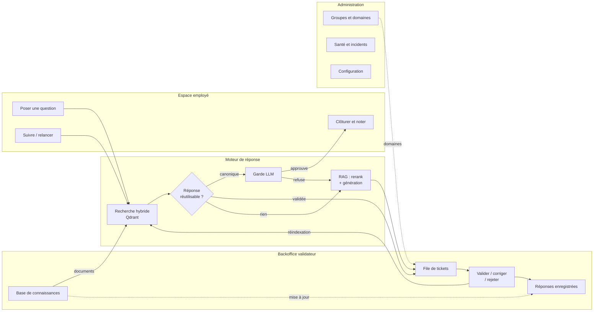

# Documentation TicketAI

TicketAI est un helpdesk interne : un employé pose une question, l'IA y répond en
s'appuyant sur les documents de l'entreprise, et un expert du domaine valide la réponse
avant qu'elle ne devienne réutilisable.

Cette documentation couvre l'intégralité du produit — le parcours des utilisateurs, les
écrans du backoffice, l'administration, et le fonctionnement interne du moteur de réponse.

---

## Par où commencer

| Vous êtes… | Commencez par |
|---|---|
| **Nouveau sur le projet** | [Présentation](presentation.md) — ce que fait le système en 5 minutes |
| **Employé / utilisateur** | [Espace utilisateur](fonctionnalites/espace-utilisateur.md) — poser une question, suivre un ticket |
| **Validateur (expert métier)** | [Traiter les tickets](fonctionnalites/backoffice-tickets.md), puis [Réponses enregistrées](fonctionnalites/reponses-enregistrees.md) |
| **Administrateur** | [Administration](fonctionnalites/administration.md) — groupes, santé, configuration |
| **Développeur** | [Onboarding développeur](onboarding-dev.md) — du clone au premier test vert |

---

## Sommaire

### Vue d'ensemble

| Document | Contenu |
|---|---|
| [Présentation du projet](presentation.md) | Objectif, utilisateurs, les trois branches de réponse, stack technique, principes de conception. |
| [Onboarding développeur](onboarding-dev.md) | Prérequis, variables d'environnement, démarrage de la stack, tests, structure du code. |

### Fonctionnalités

| Document | Contenu |
|---|---|
| [Espace utilisateur](fonctionnalites/espace-utilisateur.md) | Poser une question, suivre son ticket, relancer le fil, clôturer, noter la réponse, boîte à suggestions. |
| [Traiter les tickets (backoffice)](fonctionnalites/backoffice-tickets.md) | Liste et filtres, détail d'un ticket, verrou collaboratif, assignation, valider / corriger / rejeter, timeline. |
| [Cycle de vie et labels d'un ticket](fonctionnalites/labels-et-categories.md) | Signification de chaque badge, règle de priorité, onglets de filtrage, exemple complet jusqu'à la canonisation. |
| [Réponses enregistrées](fonctionnalites/reponses-enregistrees.md) | Les trois onglets Canoniques / À relire / Obsolètes, éditer, retirer, restaurer, supprimer. |
| [Base de connaissances](fonctionnalites/base-de-connaissances.md) | Importer un document, doublons et homonymes, consulter les chunks, versions, angles morts. |
| [Notifications et temps réel](fonctionnalites/notifications-et-temps-reel.md) | Cloche de notification, flux SSE, canaux Redis, liste des événements et de leurs effets. |
| [Statistiques et pilotage](fonctionnalites/statistiques-et-pilotage.md) | Tableau de bord backoffice, vue globale admin, statistiques par membre, satisfaction. |
| [Administration](fonctionnalites/administration.md) | Groupes et domaines, membres et chefs, configuration du site, bannière, mode maintenance, santé, incidents, quotas Albert, suggestions. |

### Technique

| Document | Contenu |
|---|---|
| [Choix techniques](technique/choix-techniques.md) | Stack retenue et raisons de chaque choix : FastAPI, Celery, Valkey, PostgreSQL, Qdrant, Albert, React. |
| [Pipeline de traitement des questions](technique/architecture-pipeline-questions.md) | Embedding, recherche hybride, branches CANONIQUE / SUGGESTION / RAG, mode suivi, boucle de feedback. |
| [Garde du cache canonique](technique/garde-cache-canonique.md) | Le juge LLM qui décide si une réponse canonique est servie sans revue humaine. |
| [Mettre à jour un document](technique/mise-a-jour-documents.md) | Versionnement, diff, ré-vérification des réponses, obsolescence et file « À relire ». |
| [Auth & rôles](technique/auth-et-roles.md) | Rôles USER / ADMIN, groupes, domaines, règles d'accès, LDAP et JWT. |
| [Référence API](technique/reference-api.md) | Tous les endpoints HTTP, leurs paramètres et leurs gardes d'accès. |

---

## Carte du système



---

## Conventions de cette documentation

- Les noms d'états de la base (`NOUVEAU`, `VALIDÉE`, `EN_ATTENTE`…) sont écrits tels
  qu'ils apparaissent en base, en majuscules.
- Les branches de réponse (**CANONIQUE**, **SUGGESTION**, **RAG**) sont en gras.
- Les captures d'écran sont dans `Docs/images/`, produites automatiquement par
  `backend/scripts/captures_doc.py` (voir ci-dessous).
- Les blocs `> 📸 **[CAPTURE D'ÉCRAN COMPLÉMENTAIRE]**` signalent une image encore
  manquante, avec la description de ce qu'elle doit montrer. Elles nécessitent soit un
  compte administrateur, soit une instance contenant davantage de données que
  l'environnement de test.

### Régénérer les captures

```bash
cd backend
.venv/bin/python scripts/seed_demo_doc.py     # jeu de démonstration (idempotent)
TAI_USER=<identifiant> TAI_PASS=<mot de passe> .venv/bin/python scripts/captures_doc.py
.venv/bin/python scripts/seed_demo_doc.py --purger   # pour tout retirer ensuite
```

`seed_demo_doc.py` crée dans le domaine `IT` des tickets et des réponses couvrant tous les
états visibles (les sept badges, les onglets Canoniques / À relire / Obsolètes, les angles
morts, les notes de satisfaction). Ses identifiants sont **déterministes** : le relancer ne
crée pas de doublons, et `--purger` supprime exactement ce qu'il a écrit. Il n'écrit rien
dans Qdrant — toutes ces vues sont des requêtes PostgreSQL.

Le script se connecte à l'interface, parcourt les écrans et écrit les PNG dans
`Docs/images/`. Deux points à connaître :

- Il **n'attend jamais `networkidle`** : l'application garde une connexion SSE ouverte en
  permanence, donc le réseau n'est jamais au repos et l'attente expirerait.
- Il **réessaie la connexion** plusieurs fois. L'annuaire est intermittent et un échec
  LDAP est indiscernable d'un mauvais mot de passe (voir
  [Auth & rôles](technique/auth-et-roles.md#authentification)).
