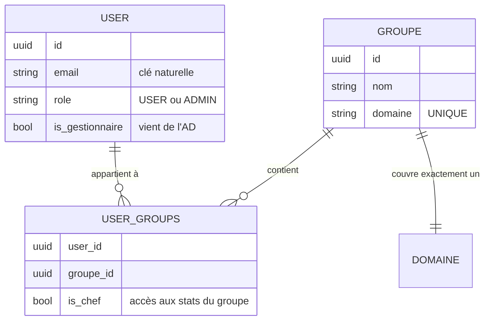
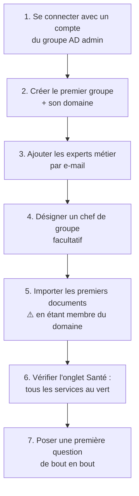

# Administration

Les pages d'administration sont réservées au rôle `ADMIN`. Elles couvrent quatre sujets :
**qui a le droit de faire quoi**, **comment se porte la plateforme**, **ce qui est cassé**,
et **la configuration**.

| Page | Adresse | Contenu |
|---|---|---|
| **Vue globale** | `/admin/dashboard` | Agrégation multi-domaines |
| **Groupes** | `/admin` | Groupes, domaines, membres, chefs |
| **Configuration** | `/admin/config` | Quatre onglets : Santé, Incidents, Configuration, Suggestions |

> **Rappel important :** être `ADMIN` ne donne **aucun droit d'écriture métier**. Un admin
> sans groupe peut créer des groupes et superviser la plateforme, mais il ne peut ni
> importer de document, ni valider de ticket. Les règles complètes sont dans
> [Auth & rôles](../technique/auth-et-roles.md).

---

## 1. Groupes et domaines

### Le modèle



Une contrainte structure tout le reste : **un groupe couvre exactement un domaine, et un
domaine appartient à exactement un groupe.** La colonne `domaine` porte une contrainte
d'unicité.

Un utilisateur peut appartenir à plusieurs groupes — il a alors accès à plusieurs domaines.

> **Les domaines ne se créent pas séparément.** Créer un groupe crée son domaine ; la
> liste des domaines disponibles (`GET /admin/domaines`) est simplement l'ensemble des
> valeurs distinctes existantes.
>
> **Conséquence à connaître :** tant qu'aucun groupe n'existe, aucun employé ne peut poser
> de question et aucun document ne peut être importé. **Créer le premier groupe est
> l'étape d'amorçage obligatoire d'une installation neuve.**

### Les actions

| Action | Endpoint | Notes |
|---|---|---|
| Lister les groupes | `GET /admin/groupes` | Avec leurs membres |
| Lister les domaines | `GET /admin/domaines` | Valeurs distinctes |
| Créer un groupe | `POST /admin/groupes` | Échoue si le domaine est déjà pris |
| Supprimer un groupe | `DELETE /admin/groupes/{id}` | Supprime aussi les associations de membres |
| Ajouter un membre | `POST /admin/groupes/{gid}/membres/{user_id}` | Accepte un **UUID ou un e-mail** ; crée l'utilisateur à la volée si besoin |
| Retirer un membre | `DELETE /admin/groupes/{gid}/membres/{user_id}` | |
| Désigner / révoquer un chef | `PUT /admin/groupes/{gid}/membres/{user_id}/chef` | |
| Lister les gestionnaires | `GET /admin/gestionnaires` | Depuis l'AD, avec repli sur la base |

L'ajout par e-mail est le chemin normal : le compte d'un employé n'existe en base
qu'après sa première connexion. Passer un e-mail permet de constituer une équipe **avant**
que ses membres ne se soient connectés.

Le rôle de **chef de groupe** ne donne qu'une chose : l'accès aux
[statistiques par membre](statistiques-et-pilotage.md#5-les-statistiques-par-membre).

> **Supprimer un groupe supprime l'accès à son domaine**, mais ni les tickets, ni les
> documents, ni les réponses de ce domaine. Ils deviennent simplement inaccessibles à tous
> sauf aux admins jusqu'à ce qu'un nouveau groupe reprenne le domaine.

---

## 2. Santé de la plateforme

Onglet *Santé* — `GET /admin/health`.

### Les services surveillés

| Service | Test effectué |
|---|---|
| **PostgreSQL** | `SELECT 1` |
| **Qdrant** | Liste des collections |
| **Valkey** | `PING` |
| **Albert — embeddings** | Appel de disponibilité |
| **Albert — LLM** | Appel de disponibilité |
| **Albert — reranker** | Appel de disponibilité |
| **Celery `queue_ingestion`** | Workers actifs sur la file |
| **Celery `queue_questions`** | Workers actifs sur la file |
| **Celery Beat** | Battement de cœur en Redis |

Le cas de **Celery Beat** mérite une explication : il n'exécute sa tâche qu'à 02 h 00.
Entre son démarrage et cette heure-là, il n'a encore rien fait. Deux clés Redis lèvent
l'ambiguïté — l'une écrite au démarrage, l'autre à chaque exécution. Un Beat démarré mais
pas encore exécuté est signalé `ok` avec la mention *« Démarré, en attente de la première
exécution (02h00) »*, et non en erreur.

### Les indicateurs fonctionnels

| Indicateur | Ce qu'il signale |
|---|---|
| `nb_documents` | Documents vivants indexés |
| `nb_reponses_validees` | Réponses canoniques |
| `reponses_a_relire` | Signalements en attente de relecture |
| `tickets_echoues` | Jobs en `ÉCHOUÉ` |
| `tickets_bloques` | En `EN_COURS` depuis **plus de 10 minutes** — signe d'un worker mort |
| `documents_echoues` | Ingestions en échec |
| `celery_pending_*` | Longueur des deux files |
| `celery_workers_*` | Nombre de workers par file |
| `derniere_activite` | Dernier ticket traité |

Le couple `tickets_bloques` + `celery_workers_questions = 0` est la signature classique
d'un worker tombé : des tickets entrent dans la file et personne ne les consomme.

---

## 3. Les quotas Albert

`GET /admin/albert-quotas`.

Albert applique **deux quotas journaliers simultanés** :

| Quota | Limite typique | Lequel bloque en premier |
|---|---|---|
| Jetons d'entrée par jour (`tpd`) | 1 280 000 | Rarement |
| **Requêtes par jour (`rpd`)** | **1 000** | **Presque toujours** — les prompts du garde sont très courts |

Deux points contre-intuitifs, à connaître avant de diagnostiquer une panne :

1. **Les quotas sont attachés au modèle, pas à la clé ni au compte.** Changer de clé API ne
   débloque rien. **Changer de modèle, si.**
2. **Un dépassement ne produit pas d'erreur visible côté métier.** Le garde du cache
   interprète toute réponse non conforme comme un refus. Un quota épuisé se manifeste donc
   par des réponses qui basculent silencieusement en RAG, pas par un message d'erreur.

C'est précisément pourquoi `ALBERT_GARDE_MODEL_NAME` existe : donner au garde son propre
modèle empêche les appels de génération de vider son compteur. Voir
[Garde du cache canonique](../technique/garde-cache-canonique.md).

La vue agrège la consommation du jour par modèle (jetons et requêtes) et la rapporte aux
limites déclarées par l'API.

---

## 4. Les incidents

Onglet *Incidents* — `GET /admin/incidents`. C'est le poste de réparation.

### Ce qui est listé

| Catégorie | Critère | Limite |
|---|---|---|
| **Tickets échoués** | `statut_job = ÉCHOUÉ` | 50 plus récents |
| **Tickets bloqués** | `statut_job = EN_COURS` depuis > 10 min | 50 plus récents |
| **Documents échoués** | Tâches d'ingestion en échec, lues depuis Redis | — |

### Réparer un ticket

| Action | Endpoint | Effet |
|---|---|---|
| **Relancer** | `POST /admin/tickets/{id}/retry` | Nouveau `job_id`, statut remis à `EN_ATTENTE`, erreur effacée, `nb_retries` incrémenté, job réenvoyé |
| **Supprimer** | `DELETE /admin/tickets/{id}` | Supprime le ticket définitivement |

Les deux refusent d'agir (`409`) si le ticket n'est **pas** en `ÉCHOUÉ` ou `EN_COURS` : on
ne relance pas un ticket qui a réussi.

### Réparer un document

| Action | Endpoint | Effet |
|---|---|---|
| **Télécharger** | `GET /admin/documents/{task_id}/download` | Récupère le fichier temporaire pour inspection |
| **Relancer** | `POST /admin/documents/{task_id}/retry` | Renvoie le job avec les mêmes arguments |
| **Supprimer** | `DELETE /admin/documents/{task_id}` | Efface le fichier temporaire et la trace de la tâche |

Ces actions s'appuient sur le fichier temporaire conservé sur disque. S'il a disparu, le
retry répond `409 Fichier temporaire introuvable — re-uploader le document`.

### Réconcilier les documents

`POST /admin/documents/reconcile` recrée les lignes de la table `documents` manquantes à
partir de ce qui se trouve réellement dans Qdrant. **L'opération est idempotente.**

Elle répare la situation où l'index vectoriel contient des chunks pour lesquels la ligne
en base a disparu — typiquement après une restauration partielle ou une interruption
d'ingestion.

---

## 5. La configuration du site

Onglet *Configuration*.

| Endpoint | Accès |
|---|---|
| `GET /admin/config` | **Tout utilisateur authentifié** — l'interface a besoin de la bannière |
| `PUT /admin/config/{key}` | Admin uniquement |

Les valeurs vivent dans la table `site_config` (clé → valeur JSONB). Une clé absente
retombe sur sa valeur par défaut. **Une clé inconnue est refusée (`404`)** — impossible
d'écrire n'importe quoi dans la table.

### La bannière

Clé `banner` :

```json
{ "active": false, "message": "", "url": "" }
```

C'est le bandeau défilant affiché en haut de l'application à tous les utilisateurs —
maintenance planifiée, information générale. Sa modification diffuse un événement
`banner_updated` sur le canal global : **le bandeau apparaît chez tous les utilisateurs
connectés sans qu'ils rechargent la page.**

### Le mode maintenance

Clé `maintenance` :

```json
{ "active": false, "message": "" }
```

Quand le mode est activé, **tous les utilisateurs non-admins sont bloqués dès la couche
réseau** et voient une page dédiée à la place de l'application. Les admins continuent
d'accéder au site normalement — ce qui permet de finaliser une intervention pendant que
les employés sont déjà sur la page de maintenance.

Le `message` est facultatif. S'il est vide, la page affiche un texte par défaut.

Deux mécanismes assurent l'affichage côté frontend :

- **Au démarrage** — l'application interroge l'état de maintenance avant de rendre la
  moindre page, y compris la page de connexion. Un employé qui ouvre le site pendant la
  maintenance voit directement la page dédiée, sans jamais être redirigé vers `/login`.
- **En cours de session** — si la maintenance est activée alors qu'un employé navigue
  déjà, la première requête bloquée déclenche l'affichage de la page dans les secondes
  qui suivent.

La désactivation est perçue dans les **5 à 35 secondes** (cache backend 5 s + vérification
frontend 30 s).

> **La bannière et le mode maintenance sont indépendants.** Activer l'une ne désactive pas
> l'autre. L'usage typique est : activer la bannière en amont pour prévenir, puis passer en
> mode maintenance au moment de l'intervention.

### Les valeurs en lecture seule

`GET /admin/config` renvoie aussi `jours_auto_cloture`, qui vient de l'environnement et
**n'est pas modifiable via l'API**. L'interface s'en sert pour afficher le compte à
rebours de clôture automatique aux employés.

Les autres réglages structurants sont également des variables d'environnement, pas des
entrées de cette table :

| Variable | Rôle |
|---|---|
| `SEUIL_CANONIQUE` | Validations requises pour promouvoir une réponse (**défaut : 3**) |
| `SEUIL_COSINUS` | Filtre de coût avant le garde (**défaut : 0.80**) |
| `SEUIL_LEXICAL_PAR_TERME` | Porte lexicale BM25, en disjonction du cosinus ; `0` la referme (**défaut : 1.0**) |
| `FAQ_MAX_RESULTATS` | Résultats renvoyés par la page FAQ (**défaut : 5**) |
| `FAQ_SEUIL_PERTINENCE` | Seuil du rang « réponses » de la FAQ (**défaut : 0.75**) |
| `FAQ_SEUIL_INCERTAIN` | Seuil du rang « pistes », renvoyé seulement si le premier est vide (**défaut : 0.55**) |
| `FAQ_RATE_LIMIT_PAR_MINUTE` | Recherches FAQ par utilisateur et par minute ; `0` désactive (**défaut : 20**) |
| `JOURS_AUTO_CLOTURE` | Délai avant clôture automatique (**défaut : 7**) |
| `LOCK_TTL_SECONDS` | Durée du verrou de ticket (**défaut : 300**) |
| `ALBERT_GARDE_MODEL_NAME` | Modèle dédié au garde |

> ⚠️ **Modifier `backend/.env` n'atteint pas une stack déjà démarrée.** Docker Compose lit
> `env_file:` à la *création* du conteneur, et ces valeurs priment sur le fichier monté.
> Une clé déjà présente reste figée à son ancienne valeur, silencieusement. Il faut
> **recréer** `backend`, `worker_questions` et `worker_ingestion`, puis vérifier la valeur
> depuis l'intérieur du conteneur.

---

## 6. La boîte à suggestions

Onglet *Suggestions*. Les retours envoyés par les utilisateurs depuis `/suggestion` (voir
[Espace utilisateur](espace-utilisateur.md#5-la-boîte-à-suggestions)).

| Action | Endpoint | Accès |
|---|---|---|
| Envoyer | `POST /suggestions` | Tout utilisateur authentifié |
| Lister | `GET /suggestions` | Admin |
| Marquer comme lue | `PATCH /suggestions/{id}/lu` | Admin |
| Supprimer | `DELETE /suggestions/{id}` | Admin |

Contraintes de saisie : entre **10 et 2 000 caractères**.

Si le compte de l'auteur est supprimé, la suggestion est conservée mais devient anonyme
(`user_id` passe à `NULL`) — le retour reste exploitable sans rattacher de donnée
personnelle.

---

## 7. Mise en route d'une installation neuve

L'ordre compte :



Le piège de l'étape 5 : **un admin qui n'est membre d'aucun groupe ne peut pas importer de
document.** Il doit d'abord s'ajouter lui-même au groupe, ou confier l'import à un membre.
