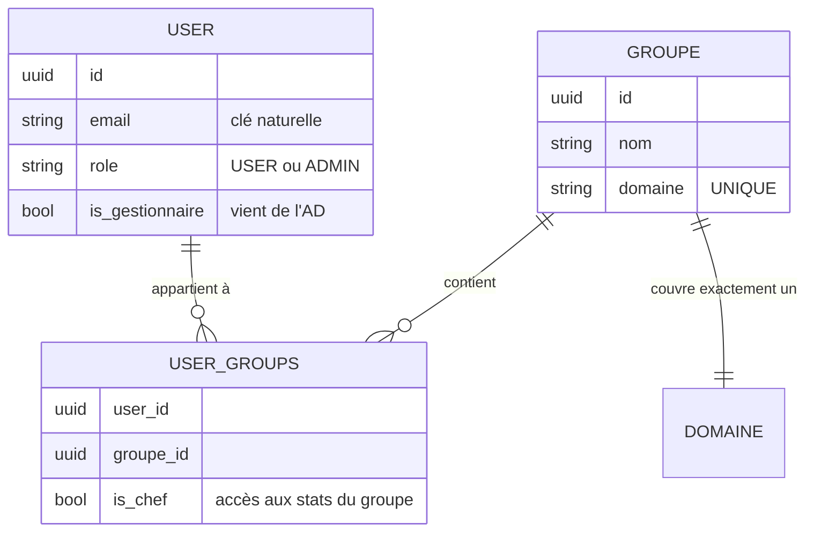
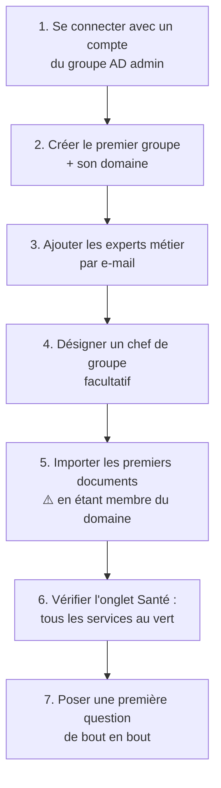

# Administration

Les pages d'administration sont réservées au rôle `ADMIN`. Elles couvrent quatre sujets :
**qui a le droit de faire quoi**, **comment se porte la plateforme**, **ce qui est cassé**,
et **la configuration**.

| Page | Adresse | Contenu |
|---|---|---|
| **Vue globale** | `/admin/dashboard` | Agrégation multi-domaines |
| **Groupes** | `/admin` | Groupes, domaines, membres, chefs |
| **Configuration** | `/admin/config` | Quatre onglets : Santé, Incidents, Configuration, Suggestions |

> **Rappel important :** être `ADMIN` ne donne **aucun droit d'écriture métier**. Un admin
> sans groupe peut créer des groupes et superviser la plateforme, mais il ne peut ni
> importer de document, ni valider de ticket. Les règles complètes sont dans
> [Auth & rôles](../technique/auth-et-roles.md).

---

## 1. Groupes et domaines

### Pourquoi on fait ça

Les groupes sont le point de départ de toute la plateforme : créer un groupe crée son
domaine, ce qui active la soumission de questions et l'import de documents pour ce service.
Sans groupe, aucun employé ne peut poser de question et aucun document ne peut être indexé.

### Comment ça fonctionne

Depuis `/admin`, la page liste tous les groupes dans le panneau gauche. Cliquez sur un
groupe pour voir ses membres et gérer l'équipe dans le panneau droit.

**Créer un groupe** (raccourci `n`) : saisissez un nom et choisissez le domaine (chaîne
libre, ex. `"RH"`, `"IT"`). Un domaine ne peut appartenir qu'à un seul groupe — si le
domaine est déjà pris, la création échoue.

**Ajouter un membre** : saisissez l'adresse e-mail dans le champ de recherche. L'ajout
par e-mail fonctionne même si l'employé ne s'est pas encore connecté — son compte sera
créé à la volée à sa première connexion.

**Désigner un chef** : cochez la case chef sur la ligne du membre. Le statut de chef donne
uniquement accès aux statistiques par membre de son groupe.

**Supprimer un groupe** : une confirmation est demandée. La suppression supprime les
associations de membres mais **pas** les tickets, documents ou réponses du domaine — ils
deviennent inaccessibles jusqu'à ce qu'un nouveau groupe reprenne le domaine.

### Détails techniques

Le modèle :



Un utilisateur peut appartenir à plusieurs groupes — il a alors accès à plusieurs domaines.
La contrainte d'unicité sur `domaine` garantit qu'un domaine n'appartient qu'à un groupe.

Endpoints :

| Action | Endpoint | Notes |
|---|---|---|
| Lister les groupes | `GET /admin/groupes` | Avec leurs membres |
| Lister les domaines | `GET /admin/domaines` | Valeurs distinctes |
| Créer un groupe | `POST /admin/groupes` | Échoue si le domaine est déjà pris |
| Supprimer un groupe | `DELETE /admin/groupes/{id}` | Supprime aussi les associations de membres |
| Ajouter un membre | `POST /admin/groupes/{gid}/membres/{user_id}` | Accepte un **UUID ou un e-mail** ; crée l'utilisateur à la volée si besoin |
| Retirer un membre | `DELETE /admin/groupes/{gid}/membres/{user_id}` | |
| Désigner / révoquer un chef | `PUT /admin/groupes/{gid}/membres/{user_id}/chef` | |
| Lister les gestionnaires | `GET /admin/gestionnaires` | Depuis l'AD, avec repli sur la base |

> **Conséquence à connaître :** tant qu'aucun groupe n'existe, aucun employé ne peut poser
> de question et aucun document ne peut être importé. **Créer le premier groupe est
> l'étape d'amorçage obligatoire d'une installation neuve.**

---

## 2. Santé de la plateforme

### Pourquoi on fait ça

Détecter une panne avant que les employés la signalent. Quand un service tombe, les
symptômes côté utilisateur sont souvent silencieux (réponses qui tardent, tickets bloqués)
plutôt que des messages d'erreur explicites. L'onglet Santé donne une vue d'ensemble en
un coup d'œil.

### Comment ça fonctionne

Depuis `/admin/config`, cliquez l'onglet **Santé**. La page présente deux blocs :

1. **Infrastructure** — neuf services, chacun indiqué en vert (OK) ou en rouge (erreur).
   Si un service est rouge, un message d'explication est affiché en dessous.
2. **Indicateurs fonctionnels** — compteurs clés de l'activité et de la file d'attente.

La page se rafraîchit automatiquement toutes les 30 secondes. Le bouton **Voir les
incidents** vous amène sur l'onglet Incidents si des anomalies sont détectées.

Le cas particulier de **Celery Beat** : il n'exécute sa tâche (la clôture automatique)
qu'à 02 h 00. Entre son démarrage et cette heure-là, il n'a encore rien fait — mais il
fonctionne. L'interface distingue « démarré mais pas encore exécuté » (`ok` + mention)
de « erreur » grâce à deux clés Redis distinctes.

### Détails techniques

Endpoint : `GET /admin/health` (admin uniquement).

**Services surveillés :**

| Service | Test effectué |
|---|---|
| **PostgreSQL** | `SELECT 1` |
| **Qdrant** | Liste des collections |
| **Valkey** | `PING` |
| **Albert — embeddings** | Appel de disponibilité |
| **Albert — LLM** | Appel de disponibilité |
| **Albert — reranker** | Appel de disponibilité |
| **Celery `queue_ingestion`** | Workers actifs sur la file |
| **Celery `queue_questions`** | Workers actifs sur la file |
| **Celery Beat** | Battement de cœur en Redis |

**Indicateurs fonctionnels :**

| Indicateur | Ce qu'il signale |
|---|---|
| `nb_documents` | Documents vivants indexés |
| `nb_reponses_validees` | Réponses canoniques |
| `reponses_a_relire` | Signalements en attente de relecture |
| `tickets_echoues` | Jobs en `ÉCHOUÉ` |
| `tickets_bloques` | En `EN_COURS` depuis **plus de 10 minutes** — signe d'un worker mort |
| `documents_echoues` | Ingestions en échec |
| `celery_pending_*` | Longueur des deux files |
| `celery_workers_*` | Nombre de workers par file |
| `derniere_activite` | Dernier ticket traité |

Le couple `tickets_bloques` + `celery_workers_questions = 0` est la signature classique
d'un worker tombé : des tickets entrent dans la file et personne ne les consomme.
Clés Redis Celery Beat : `ticketai:beat:heartbeat` (battement) et `ticketai:beat:started`
(démarrage).

---

## 3. Les quotas Albert

### Pourquoi on fait ça

Albert applique des limites journalières. Un dépassement ne produit pas d'erreur visible
côté métier : les réponses basculent silencieusement en RAG ou le garde refuse sans le
dire. Surveiller les quotas permet d'anticiper et de réagir avant que les employés
ne remarquent un dysfonctionnement.

### Comment ça fonctionne

Dans l'onglet **Santé**, la carte **Quotas Albert** agrège la consommation du jour par
modèle (jetons et requêtes) et la rapporte aux limites déclarées par l'API.

Deux points contre-intuitifs à connaître avant de diagnostiquer une panne :

1. **Les quotas sont attachés au modèle, pas à la clé ni au compte.** Changer de clé API
   ne débloque rien. **Changer de modèle, si.**
2. **Un dépassement ne produit pas d'erreur visible.** Le garde du cache interprète toute
   réponse non conforme comme un refus. Un quota épuisé se manifeste donc par des réponses
   qui basculent silencieusement en RAG, pas par un message d'erreur.

### Détails techniques

Endpoint : `GET /admin/albert-quotas`.

**Deux quotas journaliers simultanés :**

| Quota | Limite typique | Lequel bloque en premier |
|---|---|---|
| Jetons d'entrée par jour (`tpd`) | 1 280 000 | Rarement |
| **Requêtes par jour (`rpd`)** | **1 000** | **Presque toujours** — les prompts du garde sont très courts |

C'est précisément pourquoi `ALBERT_GARDE_MODEL_NAME` existe : donner au garde son propre
modèle empêche les appels de génération de vider son compteur. Voir
[Garde du cache canonique](../technique/garde-cache-canonique.md).

---

## 4. Les incidents

### Pourquoi on fait ça

Réparer les tickets et documents qui ont échoué à être traités, sans avoir à intervenir
directement en base de données. L'onglet Incidents est le poste de réparation
self-service pour les pannes ponctuelles.

### Comment ça fonctionne

Depuis `/admin/config`, cliquez l'onglet **Incidents**. La page présente trois catégories :

| Catégorie | Critère | Limite |
|---|---|---|
| **Tickets échoués** | `statut_job = ÉCHOUÉ` | 50 plus récents |
| **Tickets bloqués** | `statut_job = EN_COURS` depuis > 10 min | 50 plus récents |
| **Documents échoués** | Tâches d'ingestion en échec, lues depuis Redis | — |

**Pour un ticket :** le bouton **Relancer** crée un nouveau job et remet le ticket dans la
file — comme s'il venait d'être soumis. Le bouton **Supprimer** efface le ticket définitivement.

**Pour un document :** le bouton **Relancer** réutilise le fichier temporaire encore sur
disque. Si ce fichier a disparu, le bouton répond *« Fichier temporaire introuvable —
re-uploader le document »*. Le bouton **Supprimer** efface le fichier temporaire et la
trace de la tâche.

**Réconcilier les documents** (bouton en bas de page) : recrée les lignes manquantes dans
la table `documents` à partir de ce qui se trouve réellement dans Qdrant. À utiliser
quand l'index vectoriel et la base de données sont désynchronisés après une interruption.

### Détails techniques

Endpoint liste : `GET /admin/incidents`.
Actions tickets :
- `POST /admin/tickets/{id}/retry` — nouveau `job_id`, statut remis à `EN_ATTENTE`,
  erreur effacée, `nb_retries` incrémenté, job réenvoyé ; `409` si le ticket n'est pas
  `ÉCHOUÉ` ou `EN_COURS`.
- `DELETE /admin/tickets/{id}` — suppression définitive.

Actions documents :
- `GET /admin/documents/{task_id}/download` — récupère le fichier temporaire pour inspection.
- `POST /admin/documents/{task_id}/retry` — renvoie le job avec les mêmes arguments ;
  `409` si le fichier temporaire est introuvable.
- `DELETE /admin/documents/{task_id}` — efface le fichier temporaire et la trace de la tâche.

Réconciliation : `POST /admin/documents/reconcile` — idempotente.

---

## 5. La configuration du site

### La bannière d'annonce

#### Pourquoi on fait ça

Prévenir tous les utilisateurs d'une maintenance imminente ou diffuser une information
urgente sans aucune intervention technique. La bannière s'affiche immédiatement chez tous
les utilisateurs connectés — pas besoin qu'ils rechargent la page.

#### Comment ça fonctionne

Dans l'onglet **Configuration**, carte **Bannière d'annonce** :

1. Activez le toggle pour afficher la bannière.
2. Saisissez le message (ex. *« Maintenance prévue samedi de 10h à 12h »*).
3. Ajoutez éventuellement un lien vers une page d'information.
4. Cliquez **Enregistrer**.

Le bandeau défilant apparaît immédiatement en haut de l'application pour tous les
utilisateurs connectés. Pour retirer la bannière, désactivez le toggle et enregistrez.

> **La bannière et le mode maintenance sont indépendants.** L'usage typique : activer la
> bannière en amont pour prévenir, puis passer en mode maintenance au moment de l'intervention.

#### Détails techniques

Clé `banner` dans la table `site_config` :
```json
{ "active": false, "message": "", "url": "" }
```
Endpoint : `PUT /admin/config/banner`.
Sa modification diffuse un événement SSE `banner_updated` sur le canal global : le bandeau
apparaît chez tous les utilisateurs connectés **sans rechargement de page**.

---

### Le mode maintenance

#### Pourquoi on fait ça

Bloquer l'accès à la plateforme pour tous les non-admins pendant une intervention, afin
d'éviter que des employés accèdent à une application dans un état instable ou voient des
erreurs techniques.

#### Comment ça fonctionne

Dans l'onglet **Configuration**, carte **Mode maintenance** :

1. Activez le toggle.
2. Une boîte de confirmation s'affiche : *« Tous les utilisateurs non-admins seront
   déconnectés »*.
3. Confirmez. Saisissez éventuellement un message personnalisé à afficher aux utilisateurs.
4. Pour sortir du mode maintenance, désactivez le toggle et enregistrez.

Les admins continuent d'accéder au site normalement pendant toute la durée de l'intervention.

Un employé qui essaie d'accéder au site pendant la maintenance voit directement une page
dédiée, sans jamais être redirigé vers la connexion. La désactivation est perçue en **5 à
35 secondes**.

#### Détails techniques

Clé `maintenance` dans la table `site_config` :
```json
{ "active": false, "message": "" }
```
Endpoint : `PUT /admin/config/maintenance`.
Le `message` est facultatif ; s'il est vide, la page affiche un texte par défaut.

Deux mécanismes assurent l'affichage côté frontend :
- **Au démarrage** — l'application interroge l'état de maintenance avant de rendre la
  moindre page, y compris la page de connexion.
- **En cours de session** — si la maintenance est activée alors qu'un employé navigue
  déjà, la première requête bloquée déclenche l'affichage dans les secondes qui suivent.

La désactivation est perçue dans les 5 à 35 secondes (cache backend 5 s + vérification
frontend 30 s).

---

### Les valeurs en lecture seule

`GET /admin/config` renvoie aussi des réglages issus des variables d'environnement, **non
modifiables via l'API** — l'interface les lit pour afficher les comptes à rebours et
informer les validateurs.

| Variable | Rôle |
|---|---|
| `SEUIL_CANONIQUE` | Validations requises pour promouvoir une réponse (**défaut : 3**) |
| `SEUIL_COSINUS` | Porte CANONIQUE (**défaut : 0.80**) |
| `SEUIL_LEXICAL_PAR_TERME` | Porte lexicale BM25 ; `0` la referme (**défaut : 1.0**) |
| `FAQ_MAX_RESULTATS` | Résultats renvoyés par la page FAQ (**défaut : 5**) |
| `FAQ_SEUIL_PERTINENCE` | Seuil du rang « réponses » de la FAQ (**défaut : 0.75**) |
| `FAQ_SEUIL_INCERTAIN` | Seuil du rang « pistes » (**défaut : 0.55**) |
| `FAQ_RATE_LIMIT_PAR_MINUTE` | Recherches FAQ par utilisateur et par minute ; `0` désactive (**défaut : 20**) |
| `JOURS_AUTO_CLOTURE` | Délai avant clôture automatique (**défaut : 7**) |
| `LOCK_TTL_SECONDS` | Durée du verrou de ticket (**défaut : 300**) |
| `ALBERT_GARDE_MODEL_NAME` | Modèle dédié au garde |

> ⚠️ **Modifier `backend/.env` n'atteint pas une stack déjà démarrée.** Docker Compose lit
> `env_file:` à la *création* du conteneur, et ces valeurs priment sur le fichier monté.
> Une clé déjà présente reste figée à son ancienne valeur, silencieusement. Il faut
> **recréer** `backend`, `worker_questions` et `worker_ingestion`, puis vérifier la valeur
> depuis l'intérieur du conteneur.

---

## 6. La boîte à suggestions

### Pourquoi on fait ça

Centraliser les retours produits envoyés par les employés pour les traiter en équipe, avec
une traçabilité simple (lu / non lu) et la possibilité de purger une fois traités. Sans
cet onglet, les suggestions s'accumuleraient sans qu'on sache lesquelles ont été lues.

### Comment ça fonctionne

Depuis `/admin/config`, cliquez l'onglet **Suggestions**. Chaque suggestion s'affiche
sous forme de carte avec son contenu, son auteur, et sa date.

Les suggestions non lues sont marquées d'un point coloré. Pour les traiter :
- Cliquez la **coche** pour marquer une suggestion comme lue (ou la décocher si nécessaire).
- Le bouton **Tout marquer comme lu** traite toutes les non-lues en un clic.
- Le bouton **Supprimer** n'apparaît que sur les suggestions **déjà lues** — impossible
  de supprimer sans avoir au moins marqué lu.

### Détails techniques

Ces retours sont envoyés par les utilisateurs depuis `/suggestion` (voir
[Espace utilisateur](espace-utilisateur.md#9-la-boîte-à-suggestions)).

| Action | Endpoint | Accès |
|---|---|---|
| Envoyer | `POST /suggestions` | Tout utilisateur authentifié |
| Lister | `GET /suggestions` | Admin |
| Marquer comme lue | `PATCH /suggestions/{id}/lu` | Admin — bascule lu/non-lu |
| Supprimer | `DELETE /suggestions/{id}` | Admin — `409` si la suggestion n'est pas encore lue |

Contraintes de saisie : entre **10 et 2 000 caractères**.
Si le compte de l'auteur est supprimé, la suggestion est conservée mais devient anonyme
(`user_id` passe à `NULL`).

---

## 7. Mise en route d'une installation neuve

L'ordre compte :



Le piège de l'étape 5 : **un admin qui n'est membre d'aucun groupe ne peut pas importer de
document.** Il doit d'abord s'ajouter lui-même au groupe, ou confier l'import à un membre.
