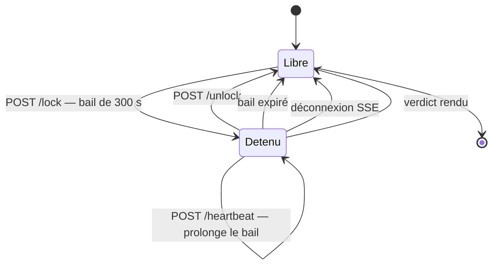
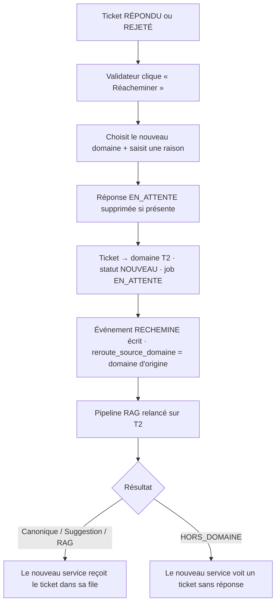
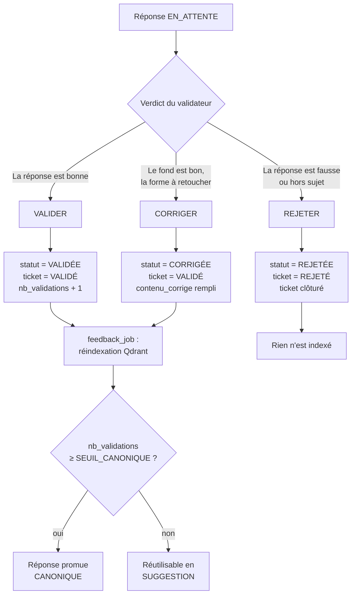

# Traiter les tickets (backoffice)

Ce document décrit le travail quotidien d'un validateur : trouver les tickets à traiter,
se les réserver, et rendre un verdict.

**Qui a accès ?** Tout utilisateur appartenant à au moins un groupe, plus les
administrateurs. Un validateur ne voit que les tickets **de ses domaines** — le filtre est
appliqué en base, pas seulement dans l'interface.

---

## 1. Les pages du backoffice

| Page | Adresse | Contenu |
|---|---|---|
| **Tableau de bord** | `/` | Compteurs, graphiques, file d'attente — voir [Statistiques](statistiques-et-pilotage.md) |
| **Tickets** | `/tickets` | La file de travail : liste, filtres, onglets |
| **Détail d'un ticket** | `/tickets/{id}` | Le fil, les actions de validation, la barre latérale |
| **Mon suivi** | `/mon-suivi` | Les tickets auxquels *vous* avez participé |
| **Réponses enregistrées** | `/reponses-enregistrees` | La base de réponses — voir [Réponses enregistrées](reponses-enregistrees.md) |
| **Base de connaissances** | `/base-de-connaissances` | Les documents — voir [Base de connaissances](base-de-connaissances.md) |

---

## 2. La liste des tickets

### Les onglets

Quatre onglets découpent la file. Le détail exact de ce qui tombe dans chacun, ainsi que
la signification des badges de couleur, est documenté dans
[Cycle de vie et labels d'un ticket](labels-et-categories.md).

En résumé :

| Onglet | Contenu |
|---|---|
| **Tous** | Tous les tickets ouverts (non clôturés) |
| **En attente** | Ceux qui réclament une action humaine |
| **Traités** | Réponse canonique servie, ou réponse validée par un humain |
| **Clôturés** | Requête serveur séparée (`closed=true`) |

Les onglets portent leur compteur (`Tous 8`, `En attente 6`, `Traités 2`), et la colonne
de droite montre les badges dans leurs différents états : **En cours**, **Nouvelle**,
**Suggestion**, **Hors domaine**, **Traitée**. Noter la pastille orange sur *Réponses
enregistrées* dans la barre latérale : c'est le compteur de réponses à relire.

> 📸 **[CAPTURE D'ÉCRAN COMPLÉMENTAIRE]** : *Un ticket verrouillé par un autre validateur (cadenas) et un ticket assigné (avatar) — cela demande deux comptes validateurs connectés simultanément.*

### Les filtres disponibles

L'endpoint `GET /api/v1/tickets` accepte :

| Paramètre | Effet |
|---|---|
| `page`, `limit` | Pagination (défaut : page 1, 10 par page) |
| `domaine` / `domaines` | Un domaine, ou plusieurs séparés par des virgules. **Toujours intersecté avec vos domaines autorisés** |
| `statut` | Filtre sur `statut_ticket` (`NOUVEAU`, `RÉPONDU`, `VALIDÉ`, `REJETÉ`) |
| `closed` | `true` = clôturés, `false` = ouverts |
| `search` | Cherche dans l'objet et la question. **Si la valeur est un UUID valide, cherche le ticket par son identifiant** |
| `user_id` | Tickets d'un utilisateur donné |
| `disponibles` | Ne garde que les tickets non assignés, ou assignés à vous |
| `note_max` | Tickets dont la note qualité **ou** délai est ≤ à cette valeur — pour retrouver les insatisfaits |
| `periode` | `semaine` / `mois` / `annee`, appliqué sur la **date de clôture** |
| `exclure_canonique` | Écarte les tickets répondus automatiquement |

> **Garde-fou :** un utilisateur sans groupe qui appelle cet endpoint ne reçoit que ses
> propres tickets, quels que soient les filtres passés.

---

## 3. Le verrou collaboratif

### Le problème

Deux validateurs du même domaine ouvrent le même ticket. Tous deux rédigent une
correction. Le second écrase le travail du premier — ou pire, la question reçoit deux
verdicts contradictoires.

### La solution : un bail à expiration

Ouvrir un ticket en prend le **verrou**. Ce n'est pas un blocage définitif mais un *bail*
qui expire tout seul, ce qui évite qu'un onglet oublié gèle un ticket pour toujours.

| Mécanisme | Détail |
|---|---|
| **Durée du bail** | `LOCK_TTL_SECONDS`, **défaut 300 s** (5 minutes) |
| **Prolongation** | Un *heartbeat* périodique repousse l'échéance tant que l'onglet est ouvert |
| **Libération explicite** | `POST /tickets/{id}/unlock` — idempotent, n'agit que si vous détenez le verrou |
| **Libération à la déconnexion** | Quand le flux SSE se ferme, **tous** les verrous de cet utilisateur sont relâchés |
| **Libération après verdict** | Valider, corriger ou rejeter libère le verrou automatiquement |

L'acquisition est **atomique** : un `UPDATE` conditionnel qui ne réussit que si le ticket
est libre, déjà à vous, ou si le bail précédent a expiré. Deux validateurs qui cliquent en
même temps ne peuvent pas obtenir le verrou tous les deux.

Si le verrou est déjà pris, l'API répond `409` avec l'e-mail du détenteur et la date
d'expiration, ce qui permet à l'interface d'afficher *« En cours de traitement par
marie@entreprise.fr »*.

### Verrou et assignation

Ce sont deux notions différentes :

| | **Verrou** | **Assignation** |
|---|---|---|
| Durée | quelques minutes | jusqu'à changement explicite |
| Objectif | éviter la collision d'édition | répartir la charge dans l'équipe |
| Posé par | celui qui ouvre le ticket | n'importe quel validateur du domaine |
| Expire seul | oui | non |

Un ticket **assigné à quelqu'un d'autre** ne peut pas être verrouillé par vous : l'API
répond `409` avec `is_assigned: true`. L'assignation prime donc sur le verrou.

---

## 4. L'assignation

| Action | Endpoint | Règle |
|---|---|---|
| Assigner | `POST /tickets/{id}/assigner` | L'assigné doit être **membre du domaine du ticket** (`422` sinon) |
| Désassigner | `POST /tickets/{id}/desassigner` | Remet le ticket dans le pot commun |

Assigner un ticket **libère son verrou** au passage — l'assigné n'hérite pas du verrou de
celui qui l'a assigné.

Les deux actions écrivent un événement dans la timeline (`ASSIGNE` / `DESASSIGNE`) et
notifient en temps réel : le domaine entier, plus l'assigné personnellement.

La page **Mon suivi** (`/mon-suivi`) et l'endpoint `GET /tickets/mes-assignations`
permettent à chacun de retrouver ce qui lui a été confié.

Pour peupler le sélecteur d'assignation, l'interface appelle
`GET /tickets/domaines/{domaine}/validateurs`.

> 📸 **[CAPTURE D'ÉCRAN REQUISE]** : *Le menu d'assignation ouvert sur un ticket, listant les validateurs du domaine avec leurs avatars. Annoter pour montrer que seuls les membres du domaine apparaissent.*

---

## 5. Réacheminer un ticket

Un validateur peut constater qu'un ticket a été envoyé au mauvais service. Le
**réacheminement** transfère le ticket vers un autre domaine sans perdre l'historique, et
relance le pipeline RAG sur ce nouveau domaine — comme si l'employé avait posé sa question
au bon service dès le départ.

### Qui peut réacheminer

| Condition | Règle |
|---|---|
| Statut du ticket | `RÉPONDU` uniquement (badge **En attente**) — un ticket validé, rejeté ou clôturé ne peut pas être réacheminé |
| Domaine d'origine | Le validateur doit être **membre du domaine d'origine** (`check_domain_write`) |
| Précisions | Un ticket ayant reçu au moins une **question de suivi** (précision de l'employé) ne peut pas être réacheminé |

### Ce qui se passe

1. La réponse en attente éventuelle (générée pour le mauvais domaine) est **supprimée** — elle n'aurait aucune valeur pour le nouveau service.
2. Le ticket est remis à zéro : `statut_ticket = NOUVEAU`, `statut_job = EN_ATTENTE`, verrou et assignation effacés.
3. `reroute_source_domaine` mémorise le service d'origine pour afficher la provenance dans la barre latérale.
4. Un événement `RECHEMINE` est écrit dans la timeline avec les domaines `from`/`to` et la raison saisie.
5. Les deux domaines (ancien et nouveau) reçoivent un événement SSE `ticket_rerouted` pour que leurs files se mettent à jour instantanément.

### Ce que voient les différents acteurs

| Acteur | Ce qu'il voit |
|---|---|
| **Ancien domaine** | Le ticket disparaît de sa file |
| **Nouveau domaine** | Le ticket arrive en `NOUVEAU`, avec une note « Ticket transmis depuis le service X » dans le fil de conversation, et un badge « Provenance : X » dans la barre latérale |
| **Employé propriétaire** | Une note « Demande transmise au service X » s'insère dans son fil de conversation, entre la question initiale et la prochaine réponse |

### Contraintes

- Le nouveau domaine doit exister (`422` sinon).
- Il ne peut pas être identique au domaine actuel (`422`).
- La raison est **obligatoire** (champ non vide).
- L'endpoint : `POST /tickets/{id}/recheminer` — corps `{ "nouveau_domaine": "RH", "raison": "..." }`.

---

## 6. Rendre un verdict

C'est le cœur du travail de validation. Trois issues possibles.

### Valider

`POST /reponses/{id}/valider`

- La réponse passe `VALIDÉE`, le ticket passe `VALIDÉ`.
- Le compteur `nb_validations` est incrémenté — **sur la réponse source** si celle-ci est
  une copie SUGGESTION, sinon sur elle-même.
- Quand le compteur atteint `SEUIL_CANONIQUE` (**défaut : 3**), la réponse devient
  canonique.
- Un `feedback_job` réindexe la réponse dans Qdrant pour qu'elle soit réutilisable.
- L'employé reçoit une notification.

### Corriger

`PUT /reponses/{id}/corriger` — le corps doit contenir un `contenu_corrige` non vide
(`400` sinon).

- La réponse passe `CORRIGÉE`, le ticket passe `VALIDÉ`.
- Le texte original est **conservé** dans `contenu` ; la correction va dans
  `contenu_corrige`. C'est la version corrigée qui est servie.
- Si la réponse était signalée *à relire*, le drapeau est levé.
- Un `feedback_job` est déclenché : la version corrigée est indexée.

> **À noter :** corriger n'incrémente pas `nb_validations`. Une réponse corrigée ne
> progresse pas vers le statut canonique par cette action.

### Rejeter

`POST /reponses/{id}/rejeter` — **le motif est obligatoire**.

- La réponse passe `REJETÉE`, le ticket passe `REJETÉ` **et est clôturé** (`closed_at`
  renseigné).
- Rien n'est indexé dans Qdrant : une réponse rejetée ne sera jamais réutilisée.
- L'employé reçoit une notification de type `REPONSE_REJETEE`.

On y voit la réponse produite par l'IA (signalée « Générée par l'IA à partir des
documents — relisez attentivement avant de valider »), les trois actions **Valider /
Corriger / Rejeter**, et la barre latérale qui porte le statut, le demandeur et
l'assignation.

> 📸 **[CAPTURE D'ÉCRAN COMPLÉMENTAIRE]** : *La zone de saisie du motif de rejet ouverte, pour montrer qu'elle est obligatoire.*

### Le panneau de confirmation de validation

Cliquer sur **Valider** n'envoie pas encore le verdict : un panneau de confirmation
s'ouvre avec deux options à renseigner avant de confirmer.

#### Catégorie (tag)

Un champ **Catégorie** est pré-rempli avec le tag suggéré automatiquement par le pipeline
au moment où la question a été traitée : c'est une proposition, pas une valeur définitive.

**Pourquoi s'en préoccuper ?** Les tags sont le seul mécanisme de filtrage thématique sur
la page Réponses enregistrées. Une base de connaissances sans tags cohérents est difficile
à parcourir ; un tag trop spécifique (`"perte carte Swile"`) ou trop générique
(`"avantages sociaux"`) réduit l'utilité des filtres pour l'équipe entière.

**Ce que le validateur doit faire :**

1. Lire le tag proposé — il est pré-rempli dans le champ.
2. Le corriger s'il est mal catégorisé : préférer le thème large (`"ticket restaurant"`)
   au terme précis de la question (`"carte Swile"`).
3. Réutiliser un tag existant chaque fois que c'est possible — la liste de complétion
   propose les tags déjà utilisés dans le domaine.
4. Ne pas laisser le champ vide si la réponse relève clairement d'un thème identifiable.

Le tag est enregistré **uniquement lors de la première validation** de la réponse. Il peut
être modifié à tout moment depuis la page Réponses enregistrées — mais le corriger dès
la première validation évite la prolifération de synonymes dans la liste de filtres.

#### Inclure dans la FAQ

Une case à cocher **Inclure dans la FAQ** est présente dans le même panneau. Elle détermine
si la réponse — si elle atteint le statut canonique — sera visible dans la page *Questions
fréquentes* accessible à tous les employés.

Par défaut, la case est **décochée** : une réponse nouvellement canonique n'apparaît pas
dans la FAQ tant qu'un validateur ne l'y a pas explicitement incluse.

**Quand cocher la case ?** Lorsque la réponse traite d'une question générale susceptible
d'intéresser plusieurs employés (congés, remboursements, procédures courantes…). À
l'inverse, une réponse très spécifique à une situation individuelle ou à un contexte rare
n'a pas nécessairement sa place dans un catalogue public.

Cette visibilité peut être modifiée à tout moment depuis la page Réponses enregistrées >
onglet Canoniques, via le badge **FAQ** de chaque ligne.

### Les quatre gardes avant tout verdict

Chaque action de verdict vérifie, dans cet ordre :

| Garde | Refus | Message |
|---|---|---|
| **État initial** | `409` | La réponse est déjà `VALIDÉE` / `REJETÉE` / `CORRIGÉE` — seules les `EN_ATTENTE` sont traitables |
| **Domaine** | `403` | Vous devez être **membre** du domaine du ticket. *Sans exception pour l'admin* |
| **Anti-auto-validation** | `403` | Vous ne pouvez pas trancher sur **votre propre ticket** |
| **Verrou** | `409` | Le ticket doit être libre ou verrouillé par vous |

La règle anti-auto-validation est structurelle : elle garantit qu'une réponse servie sans
revue a bien été examinée par quelqu'un d'autre que le demandeur.

---

## 7. La timeline d'un ticket

`GET /tickets/{id}/workflow` reconstitue l'histoire complète du ticket, triée
chronologiquement. C'est ce qu'affiche la fenêtre *Workflow*.

| Type d'événement | Origine | Signification |
|---|---|---|
| `CREE` | ticket | Le ticket a été créé |
| `SUIVI` | réponse avec `question_suivi` | L'employé a relancé le fil |
| `REPONSE_GENEREE` | réponse | L'IA a produit une réponse (le `meta` porte la branche) |
| `ASSIGNE` / `DESASSIGNE` | table `ticket_events` | Changement d'assignation, avec l'acteur |
| `VALIDE` / `CORRIGE` / `REJETE` | réponse validée | Verdict humain, avec l'acteur et le motif de rejet |
| `RECHEMINE` | table `ticket_events` | Ticket réacheminé — `meta` porte `from`, `to` et `raison` |
| `CLOTURE` | ticket | Le ticket a été fermé |

Les événements portent l'e-mail et le nom complet de l'acteur quand il est connu. À
horodatage égal, un ordre de type départage l'affichage (création avant suivi avant
réponse avant verdict avant clôture) pour que la timeline reste lisible.

Elle s'ouvre par le bouton **Voir l'historique** de la barre latérale.

> 📸 **[CAPTURE D'ÉCRAN COMPLÉMENTAIRE]** : *La même fenêtre sur un ticket ayant vécu — création, réponse générée, assignation, relance, seconde réponse, validation, clôture. C'est la vue qui montre le mieux la traçabilité ; l'instance de test n'a que deux événements.*

---

## 8. Mon suivi

Page `/mon-suivi`, alimentée par `GET /tickets/participated`.

Elle rassemble les tickets sur lesquels **vous** êtes intervenu — validés, corrigés,
rejetés ou assignés — pour permettre de revenir sur son propre travail sans fouiller
toute la file du domaine.

---

## 9. Ce qui bouge tout seul

Le backoffice n'a pas besoin d'être rafraîchi. Chaque action diffuse un événement temps
réel sur le canal du domaine, et les listes concernées se rechargent seules :

| Événement | Ce qui se met à jour |
|---|---|
| `ticket_created`, `ticket_answered` | La file de tickets |
| `ticket_locked`, `ticket_unlocked` | Les cadenas dans la liste |
| `ticket_assigned`, `ticket_unassigned` | La liste et « Mes assignations » |
| `ticket_rerouted` | La file, « Mes assignations », le détail du ticket et sa timeline |
| `reponse_validated`, `reponse_corrected`, `reponse_rejected` | Le ticket, les réponses enregistrées **et la liste des tags disponibles** |
| `saved_answers_updated` | Les trois onglets de Réponses enregistrées et la liste des tags |
| `ticket_closed` | La file et les compteurs |

Le mécanisme complet est décrit dans
[Notifications et temps réel](notifications-et-temps-reel.md).
