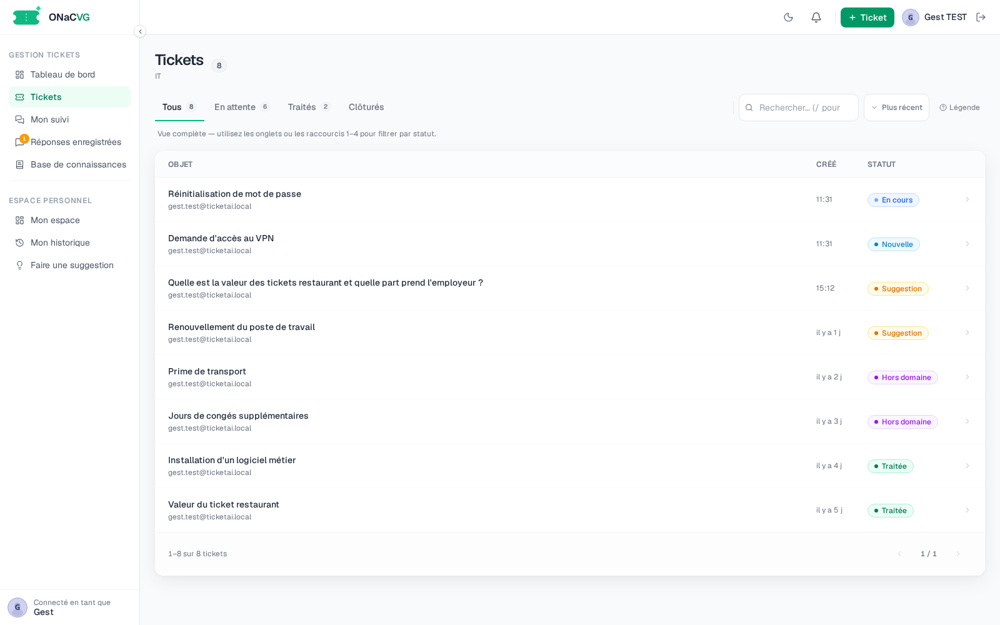
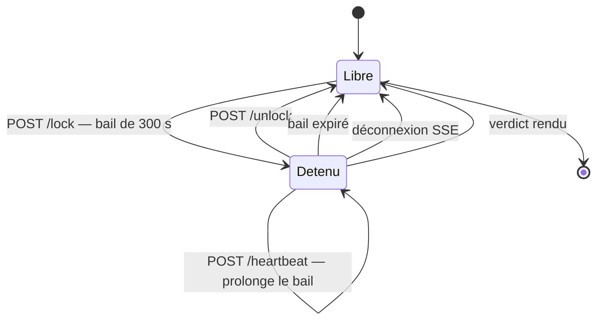
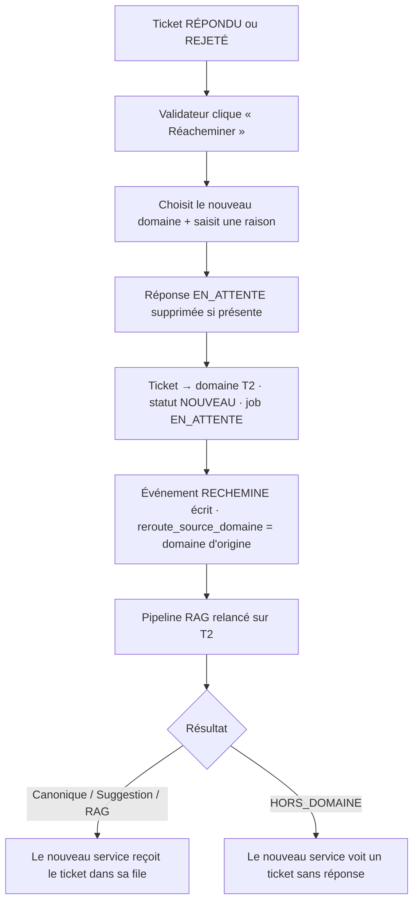
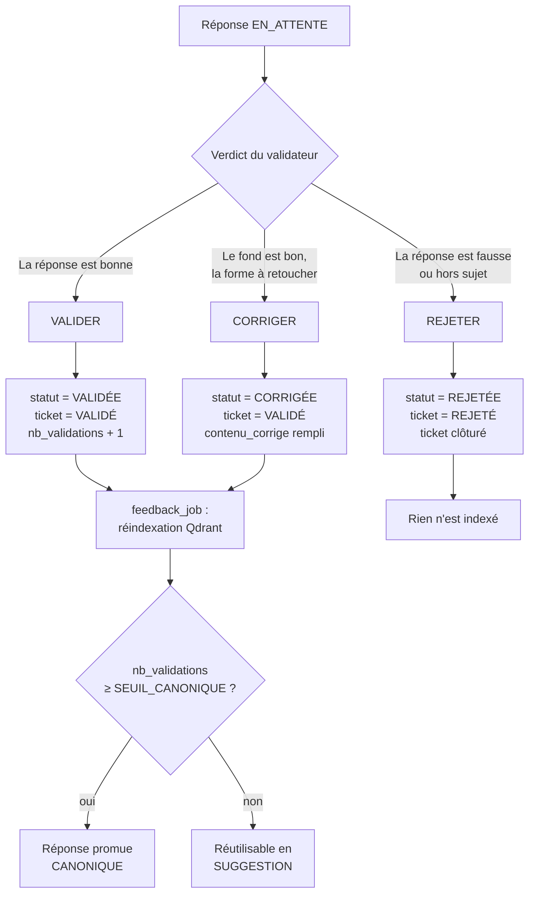
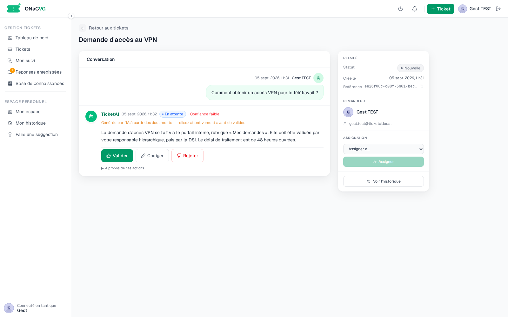
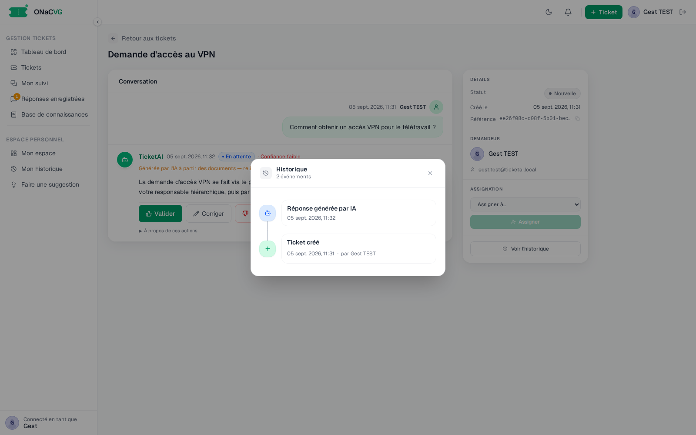
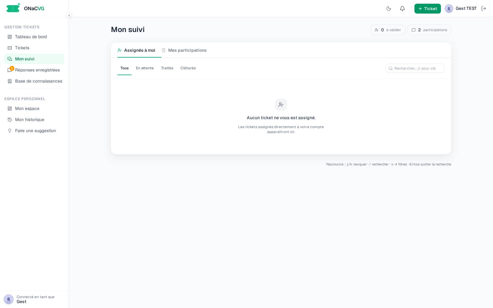

# Traiter les tickets (backoffice)

Ce document décrit le travail quotidien d'un validateur : trouver les tickets à traiter,
se les réserver, et rendre un verdict.

**Qui a accès ?** Tout utilisateur appartenant à au moins un groupe, plus les
administrateurs. Un validateur ne voit que les tickets **de ses domaines** — le filtre est
appliqué en base, pas seulement dans l'interface.

---

## 1. Les pages du backoffice

| Page | Adresse | Contenu |
|---|---|---|
| **Tableau de bord** | `/` | Compteurs, graphiques, file d'attente — voir [Statistiques](statistiques-et-pilotage.md) |
| **Tickets** | `/tickets` | La file de travail : liste, filtres, onglets |
| **Détail d'un ticket** | `/tickets/{id}` | Le fil, les actions de validation, la barre latérale |
| **Mon suivi** | `/mon-suivi` | Les tickets auxquels *vous* avez participé |
| **Réponses enregistrées** | `/reponses-enregistrees` | La base de réponses — voir [Réponses enregistrées](reponses-enregistrees.md) |
| **Base de connaissances** | `/base-de-connaissances` | Les documents — voir [Base de connaissances](base-de-connaissances.md) |

---

## 2. La liste des tickets

### Pourquoi on fait ça

Avoir une file de travail propre, filtrée sur ses domaines, sans être noyé dans les
tickets des autres services. Les onglets et les filtres permettent de prioriser : traiter
d'abord les demandes urgentes, retrouver un ticket spécifique, ou surveiller les insatisfaits.

### Comment ça fonctionne

La page `/tickets` présente quatre onglets :

| Onglet | Contenu |
|---|---|
| **Tous** | Tous les tickets ouverts (non clôturés) |
| **En attente** | Ceux qui réclament une action humaine |
| **Traités** | Réponse canonique servie, ou réponse validée par un humain |
| **Clôturés** | Requête serveur séparée (`closed=true`) |

Les onglets portent leur compteur (`Tous 8`, `En attente 6`, `Traités 2`). La colonne de
droite affiche les badges de statut dans leurs différents états : **En cours**, **Nouvelle**,
**Suggestion**, **Hors domaine**, **Traitée**. La pastille orange sur *Réponses enregistrées*
dans la barre latérale indique le nombre de réponses à relire.

Raccourcis clavier : `/` pour mettre le focus sur la recherche, `1`–`4` pour changer
d'onglet, `j`/`k` pour naviguer entre les lignes.

> 📸 **[CAPTURE D'ÉCRAN COMPLÉMENTAIRE]** : *Un ticket verrouillé par un autre validateur (cadenas) et un ticket assigné (avatar) — cela demande deux comptes validateurs connectés simultanément.*

### Détails techniques

Endpoint : `GET /api/v1/tickets`. Paramètres disponibles :

| Paramètre | Effet |
|---|---|
| `page`, `limit` | Pagination (défaut : page 1, 10 par page) |
| `domaine` / `domaines` | Un domaine, ou plusieurs séparés par des virgules. **Toujours intersecté avec vos domaines autorisés** |
| `statut` | Filtre sur `statut_ticket` (`NOUVEAU`, `RÉPONDU`, `VALIDÉ`, `REJETÉ`) |
| `closed` | `true` = clôturés, `false` = ouverts |
| `search` | Cherche dans l'objet et la question. **Si la valeur est un UUID valide, cherche le ticket par son identifiant** |
| `user_id` | Tickets d'un utilisateur donné |
| `disponibles` | Ne garde que les tickets non assignés, ou assignés à vous |
| `note_max` | Tickets dont la note qualité **ou** délai est ≤ à cette valeur |
| `periode` | `semaine` / `mois` / `annee`, appliqué sur la **date de clôture** |
| `exclure_canonique` | Écarte les tickets répondus automatiquement |

> **Garde-fou :** un utilisateur sans groupe qui appelle cet endpoint ne reçoit que ses
> propres tickets, quels que soient les filtres passés.

---

## 3. Le verrou collaboratif

### Pourquoi on fait ça

Empêcher deux validateurs du même domaine de travailler sur le même ticket en même temps,
ce qui produirait deux verdicts contradictoires ou écraserait le travail de l'un avec
celui de l'autre.

### Comment ça fonctionne

Ouvrir un ticket en prend automatiquement le **verrou**. Un badge *« En cours de
traitement par marie@entreprise.fr »* apparaît sur le ticket pour tous les autres
validateurs — ils voient qu'il est pris mais peuvent toujours le lire.

Le verrou n'est pas permanent : c'est un *bail* de 5 minutes. Tant que vous travaillez
sur le ticket, l'interface prolonge le bail automatiquement. Si vous fermez l'onglet ou
vous déconnectez, le bail expire et le ticket redevient disponible.

Un verdict rendu (valider, corriger, rejeter) libère le verrou immédiatement.

### Détails techniques

| Mécanisme | Détail |
|---|---|
| **Durée du bail** | `LOCK_TTL_SECONDS`, **défaut 300 s** (5 minutes) |
| **Prolongation** | Un *heartbeat* périodique repousse l'échéance tant que l'onglet est ouvert |
| **Libération explicite** | `POST /tickets/{id}/unlock` — idempotent, n'agit que si vous détenez le verrou |
| **Libération à la déconnexion** | Quand le flux SSE se ferme, **tous** les verrous de cet utilisateur sont relâchés |
| **Libération après verdict** | Valider, corriger ou rejeter libère le verrou automatiquement |

L'acquisition est **atomique** : un `UPDATE` conditionnel qui ne réussit que si le ticket
est libre, déjà à vous, ou si le bail précédent a expiré. Si le verrou est déjà pris,
l'API répond `409` avec l'e-mail du détenteur et la date d'expiration.

**Verrou vs assignation** — deux notions différentes :

| | **Verrou** | **Assignation** |
|---|---|---|
| Durée | quelques minutes | jusqu'à changement explicite |
| Objectif | éviter la collision d'édition | répartir la charge dans l'équipe |
| Posé par | celui qui ouvre le ticket | n'importe quel validateur du domaine |
| Expire seul | oui | non |

Un ticket **assigné à quelqu'un d'autre** ne peut pas être verrouillé par vous : l'API
répond `409` avec `is_assigned: true`. L'assignation prime donc sur le verrou.

---

## 4. L'assignation

### Pourquoi on fait ça

Répartir explicitement la charge entre les experts d'une équipe, et donner à chacun une
liste de travail personnelle. Un ticket assigné n'apparaît que dans la file de la personne
concernée — elle sait ce qui lui revient sans avoir à fouiller toute la file du domaine.

### Comment ça fonctionne

Ouvrez le ticket à assigner. Dans la barre latérale, dépliez la section **Assignation**.
La liste des validateurs disponibles (membres du domaine) s'affiche. Cliquez sur un nom
pour lui confier le ticket — l'assigné reçoit immédiatement une notification.

Pour remettre le ticket dans le pot commun, cliquez **Désassigner** : le ticket redevient
disponible pour toute l'équipe.

> 📸 **[CAPTURE D'ÉCRAN REQUISE]** : *Le menu d'assignation ouvert sur un ticket, listant les validateurs du domaine avec leurs avatars. Annoter pour montrer que seuls les membres du domaine apparaissent.*

### Détails techniques

Endpoints :
- `POST /tickets/{id}/assigner` (corps : `{ "assignee_id": uuid }`) — l'assigné doit être
  **membre du domaine du ticket** (`422` sinon) ; l'action libère le verrou au passage.
- `POST /tickets/{id}/desassigner` — remet le ticket dans le pot commun.

Pour peupler le sélecteur, l'interface appelle `GET /tickets/domaines/{domaine}/validateurs`.
Les deux actions écrivent un événement dans la timeline (`ASSIGNE` / `DESASSIGNE`) et
diffusent un événement SSE sur le domaine et sur le canal personnel de l'assigné.
Page dédiée : `GET /tickets/mes-assignations` (voir [§ 8 Mon suivi](#8-mon-suivi)).

---

## 5. Réacheminer un ticket

### Pourquoi on fait ça

Réparer une mauvaise destination sans que l'employé ait à reformuler sa question ou à
créer un nouveau ticket. La demande arrive dans la bonne file sans perdre l'historique de
la conversation ni l'identifiant du ticket.

### Comment ça fonctionne

Ce que voient les différents acteurs :

| Acteur | Ce qu'il voit |
|---|---|
| **Ancien domaine** | Le ticket disparaît de sa file |
| **Nouveau domaine** | Le ticket arrive en `NOUVEAU`, avec une note « Ticket transmis depuis le service X » dans le fil et un badge « Provenance : X » dans la barre latérale |
| **Employé propriétaire** | Une note « Demande transmise au service X » s'insère dans son fil, entre la question initiale et la prochaine réponse |

### Détails techniques

Conditions pour pouvoir réacheminer :

| Condition | Règle |
|---|---|
| Statut du ticket | `RÉPONDU` uniquement — un ticket validé, rejeté ou clôturé ne peut pas être réacheminé |
| Domaine d'origine | Le validateur doit être **membre du domaine d'origine** (`check_domain_write`) |
| Précisions | Un ticket ayant reçu au moins une **question de suivi** ne peut pas être réacheminé |

Endpoint : `POST /tickets/{id}/recheminer` (corps : `{ "nouveau_domaine": "RH", "raison": "..." }`).
La raison est **obligatoire** (champ non vide). Le nouveau domaine doit exister et être
différent du domaine actuel (`422` sinon).
Effets : la réponse en attente éventuelle est supprimée ; le ticket est remis à zéro
(`statut_ticket = NOUVEAU`, verrou et assignation effacés) ; `reroute_source_domaine`
mémorise le service d'origine. Les deux domaines reçoivent un événement SSE `ticket_rerouted`.

---

## 6. Rendre un verdict

### Pourquoi on fait ça

Vérifier que la réponse produite par le système est correcte avant de la montrer à
l'employé. C'est la garantie que rien de faux ne lui parvient sans qu'un humain l'ait
relu. Si le fond est bon mais la forme perfectible, la correction permet d'améliorer sans
rejeter.

### Comment ça fonctionne

Trois issues possibles sur une réponse `EN_ATTENTE` :

**Valider** — la réponse est bonne : cliquez **Valider** et confirmez dans le panneau.
Avant de confirmer, deux éléments sont à renseigner :

- **Catégorie (tag)** — pré-rempli automatiquement. Relisez-le et corrigez-le si besoin :
  préférez le thème large (`"ticket restaurant"`) au terme précis (`"carte Swile"`), et
  réutilisez un tag existant chaque fois que possible.
- **Inclure dans la FAQ** — cochez si la réponse est générale et utile à plusieurs employés.
  Par défaut, une réponse nouvellement canonique n'apparaît pas dans la FAQ.

**Corriger** — le fond est bon mais la forme à retoucher : cliquez **Corriger**, saisissez
la version améliorée dans le champ de texte, et confirmez. Le texte original de l'IA est
conservé en base — c'est votre correction qui est servie.

**Rejeter** — la réponse est fausse ou hors sujet : cliquez **Rejeter**, saisissez un
motif (obligatoire), et confirmez. Le ticket est clôturé immédiatement.

> 📸 **[CAPTURE D'ÉCRAN COMPLÉMENTAIRE]** : *La zone de saisie du motif de rejet ouverte, pour montrer qu'elle est obligatoire.*

### Détails techniques

Raccourcis clavier : `v` pour Valider, `e` pour Corriger (`e` comme *Edit*), `r` pour Rejeter.

Endpoints :
- `POST /reponses/{id}/valider` (corps : `{ "faq_visible": bool }`) — incrémente
  `nb_validations` (sur la source si c'est une copie SUGGESTION) ; déclenche `feedback_job` ;
  notifie l'employé. Le champ `faq_visible` est le seul dans le payload — la catégorie
  est envoyée séparément via `PATCH /reponses/{id}/tag` si elle a été modifiée dans le
  formulaire.
- `PUT /reponses/{id}/corriger` (corps : `{ "contenu_corrige": "..." }`) — le corps doit
  être non vide (`400` sinon) ; **ne** incrémente **pas** `nb_validations` ; lève le
  drapeau `a_relire` si la réponse était signalée.
- `POST /reponses/{id}/rejeter` (corps : `{ "raison": "..." }`) — motif obligatoire ;
  ferme le ticket (`closed_at` renseigné) ; notifie l'employé (`REPONSE_REJETEE`).

Quand `nb_validations` atteint `SEUIL_CANONIQUE` (défaut : 3), la réponse devient canonique.

**Quatre gardes avant tout verdict (dans cet ordre) :**

| Garde | Refus | Message |
|---|---|---|
| **État initial** | `409` | La réponse est déjà `VALIDÉE` / `REJETÉE` / `CORRIGÉE` |
| **Domaine** | `403` | Vous devez être **membre** du domaine du ticket. *Sans exception pour l'admin* |
| **Anti-auto-validation** | `403` | Vous ne pouvez pas trancher sur **votre propre ticket** |
| **Verrou** | `409` | Le ticket doit être libre ou verrouillé par vous |

---

## 7. La timeline d'un ticket

### Pourquoi on fait ça

Comprendre l'histoire complète d'un ticket : qui l'a créé, quand l'IA a répondu, qui a
assigné à qui, si l'employé a relancé, quel validateur a rendu quel verdict, et pourquoi.
C'est aussi la piste d'audit qui permet de trancher en cas de désaccord.

### Comment ça fonctionne

Depuis le détail d'un ticket, cliquez **Voir l'historique** dans la barre latérale. Une
fenêtre s'ouvre avec tous les événements triés chronologiquement. Chaque ligne indique
l'heure, le type d'événement, et l'acteur si connu.

> 📸 **[CAPTURE D'ÉCRAN COMPLÉMENTAIRE]** : *La même fenêtre sur un ticket ayant vécu — création, réponse générée, assignation, relance, seconde réponse, validation, clôture.*

### Détails techniques

Endpoint : `GET /tickets/{id}/workflow`.

| Type d'événement | Origine | Signification |
|---|---|---|
| `CREE` | ticket | Le ticket a été créé |
| `SUIVI` | réponse avec `question_suivi` | L'employé a relancé le fil |
| `REPONSE_GENEREE` | réponse | L'IA a produit une réponse (le `meta` porte la branche) |
| `ASSIGNE` / `DESASSIGNE` | table `ticket_events` | Changement d'assignation, avec l'acteur |
| `VALIDE` / `CORRIGE` / `REJETE` | réponse validée | Verdict humain, avec l'acteur et le motif de rejet |
| `RECHEMINE` | table `ticket_events` | Ticket réacheminé — `meta` porte `from`, `to` et `raison` |
| `CLOTURE` | ticket | Le ticket a été fermé |

Les événements portent l'e-mail et le nom complet de l'acteur quand il est connu. À
horodatage égal, un ordre de type départage l'affichage (création < suivi < réponse <
verdict < clôture) pour que la timeline reste lisible.

---

## 8. Mon suivi

### Pourquoi on fait ça

Retrouver rapidement les tickets sur lesquels vous êtes intervenu — ou qui vous ont été
confiés — sans devoir filtrer toute la file du domaine. C'est votre liste de travail
personnelle, distincte de la file commune.

### Comment ça fonctionne

La page `/mon-suivi` regroupe vos tickets en deux onglets :

| Onglet | Contenu |
|---|---|
| **Assignés à moi** | Tickets qui vous ont été explicitement confiés par un collègue |
| **Mes participations** | Tickets sur lesquels vous êtes intervenu : validés, corrigés ou rejetés |

Dans chaque onglet, des filtres de statut permettent de restreindre l'affichage (Tous /
En attente / En cours / Clôturés), et une barre de recherche filtre par objet ou question.

L'onglet **Mes participations** est paginé (10 par page) ; l'onglet **Assignés à moi**
charge tout d'un coup car le nombre de tickets assignés est généralement faible.

Raccourcis clavier (identiques à la liste de tickets) : `/` pour la recherche, `1`–`4`
pour les filtres de statut, `j`/`k` pour naviguer.

### Détails techniques

Fichier : `frontend/src/pages/backoffice/TicketTracking.tsx`.
Endpoints :
- `GET /api/v1/tickets/mes-assignations` — tickets assignés à l'utilisateur courant,
  non paginé, retourne les tickets ouverts uniquement.
- `GET /api/v1/tickets/participated` — tickets où l'utilisateur figure comme validateur,
  paginé (paramètres `page`, `limit`, `statut`, `search`).

---

## 9. Ce qui bouge tout seul

Le backoffice n'a pas besoin d'être rafraîchi. Chaque action diffuse un événement temps
réel sur le canal du domaine, et les listes concernées se rechargent seules :

| Événement | Ce qui se met à jour |
|---|---|
| `ticket_created`, `ticket_answered` | La file de tickets |
| `ticket_locked`, `ticket_unlocked` | Les cadenas dans la liste |
| `ticket_assigned`, `ticket_unassigned` | La liste et « Mes assignations » |
| `ticket_rerouted` | La file, « Mes assignations », le détail du ticket et sa timeline |
| `reponse_validated`, `reponse_corrected`, `reponse_rejected` | Le ticket, les réponses enregistrées **et la liste des tags disponibles** |
| `saved_answers_updated` | Les trois onglets de Réponses enregistrées et la liste des tags |
| `ticket_closed` | La file et les compteurs |

Le mécanisme complet est décrit dans
[Notifications et temps réel](notifications-et-temps-reel.md).
