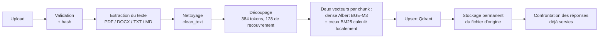
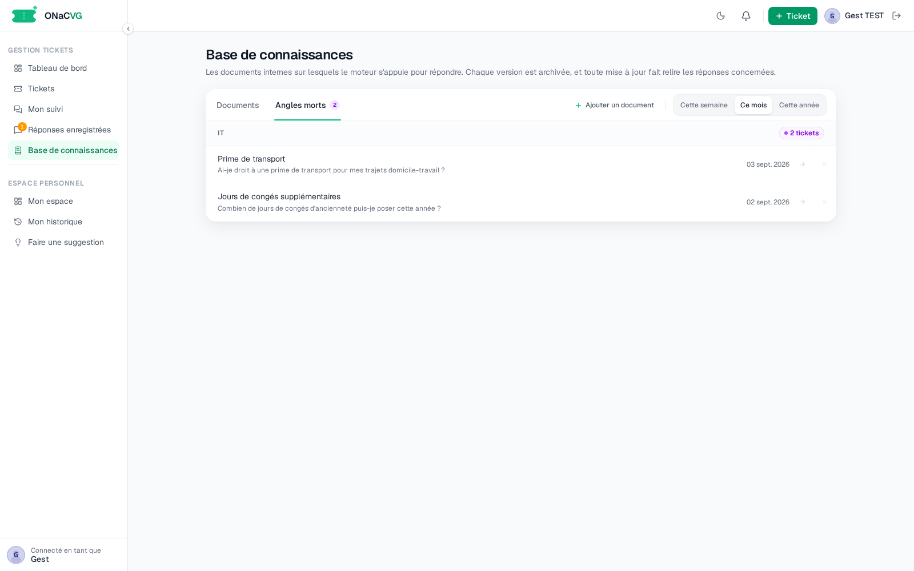

# Base de connaissances

Page `/base-de-connaissances`. C'est le corpus documentaire sur lequel l'IA s'appuie pour
répondre : règlements, procédures, chartes, accords d'entreprise.

Pas de document indexé dans un domaine ⇒ aucune question de ce domaine ne peut recevoir de
réponse **RAG**.

**Qui a accès ?** Les membres du backoffice. La lecture est ouverte aux administrateurs
sur tous les domaines ; **l'écriture — importer, remplacer, supprimer — exige d'être
membre du domaine, sans exception pour l'admin.**

> Les anciennes adresses `/Documentations`, `/documents-indexes` et `/angles-morts`
> redirigent vers cette page. Les favoris existants continuent de fonctionner.

---

## 1. Les deux onglets

| Onglet | Contenu |
|---|---|
| **Documents** | Le corpus indexé : importer, consulter, mettre à jour, supprimer |
| **Angles morts** | Les questions auxquelles le système n'a pas su répondre — ce qui *manque* au corpus |

La colonne **Passages** correspond au nombre de chunks indexés, et **Version** au numéro
de version courante du document.

> 📸 **[CAPTURE D'ÉCRAN COMPLÉMENTAIRE]** : *La même table avec un document en version v2 ou plus, pour montrer l'accès à l'historique des versions.*

---

## 2. Importer un document

### Pourquoi on fait ça

Enrichir le corpus d'un domaine, c'est directement améliorer la qualité des réponses que
le système peut produire sur ce sujet. Sans document, l'IA répond *« je n'ai pas
l'information »*. Avec un document à jour et bien structuré, elle répond correctement et
ses réponses peuvent devenir canoniques.

### Comment ça fonctionne

Cliquez **Importer un document** (ou le bouton `+` dans la barre d'outils). Un panneau
latéral s'ouvre. Déposez votre fichier dans la zone prévue (ou cliquez pour le parcourir),
sélectionnez le domaine, ajoutez éventuellement une description, et confirmez.

L'import est **asynchrone** : le panneau se ferme immédiatement et un suivi de tâche
apparaît en haut de la page avec une barre de progression. Vous pouvez continuer à
travailler pendant ce temps.

Si vous importez un fichier déjà présent dans ce domaine, deux situations se distinguent :

| Situation | Ce qui se passe |
|---|---|
| **Même contenu** (doublon exact) | L'API signale *« document déjà indexé »* — aucune action, pas d'erreur |
| **Même nom, contenu différent** | L'interface propose : *nouvelle version* (flux de mise à jour) ou *document distinct* (import séparé) |

> 📸 **[CAPTURE D'ÉCRAN REQUISE]** : *Le tiroir d'import de document ouvert, avec la zone de dépôt de fichier, le sélecteur de domaine et le champ description. Prendre une seconde capture pendant l'ingestion, montrant la barre de progression du suivi de tâche.*

**Un import ne fait pas qu'ajouter : il confronte**

Dès qu'un document est indexé, le système compare ses passages aux réponses déjà validées
du même domaine. Si une réponse existante pourrait avoir été rendue inexacte ou incomplète
par ce nouveau document, elle est envoyée en *À relire* avec la raison `NOUVEAU_DOC`.

Trois choses à savoir :
- Cela ne coûte aucun appel supplémentaire à Albert pour la détection.
- Aucune réponse n'est jamais retirée du service par ce chemin.
- La réponse spécifique qui manquait se crée ensuite d'elle-même via trois validations
  ordinaires — inutile de la rédiger à la main.

### Détails techniques

Formats acceptés : **PDF, DOCX, TXT, MD**. Taille maximale : **50 Mo**. Encodage (TXT/MD) :
UTF-8 obligatoire.

Validations appliquées avant tout traitement :
1. Le nom est assaini (protection contre le *path traversal*).
2. L'extension doit être supportée.
3. Le contenu doit correspondre à l'extension (vérification des octets de signature).
4. Un `content_hash` SHA-256 est calculé — c'est lui qui détecte les doublons.

Doublon : réponse `DÉJÀ_INDEXÉ` avec le document existant. Homonyme : `409 DOCUMENT_HOMONYME`.
Le contrôle porte sur le **couple (fichier, domaine)** : le même règlement peut être indexé
dans deux domaines différents.

Endpoint : `POST /documents` (multipart, champ `force_nouveau=true` pour forcer un document
distinct malgré un nom identique). Suivi : `GET /documents/{job_id}/status`.

**Pipeline d'ingestion :**

| Paramètre de découpage | Valeur | Pourquoi |
|---|---|---|
| Taille de chunk | **384 tokens** BGE-M3 | Compromis entre contexte suffisant et précision de la recherche |
| Recouvrement | **128 tokens** | Évite qu'une phrase coupée en deux devienne introuvable |

> ⚠️ **Ne modifiez pas ces paramètres ni `clean_text` à la légère.** Le pipeline de mise à
> jour documentaire compare les versions paragraphe par paragraphe : changer l'extraction
> ferait apparaître des différences fantômes sur *tous* les documents existants. Voir
> [Mettre à jour un document](../technique/mise-a-jour-documents.md).

**Chaque chunk reçoit deux vecteurs, pas un.** Le dense vient d'Albert ; le creux (BM25)
est calculé sur la machine. Changer les paramètres BM25 invalide les vecteurs creux déjà
écrits — utilisez `scripts/reencoder_vecteurs_creux.py` pour les recalculer sans réingérer.

Le champ **description** est facultatif et purement documentaire — il n'entre pas dans l'index.

---

## 3. Consulter un document

### Pourquoi on fait ça

Vérifier ce que l'IA voit vraiment. Quand une réponse RAG est mauvaise, c'est souvent
parce que le découpage a coupé au mauvais endroit, ou que l'extraction a mal lu le PDF.
La vue des chunks montre exactement le texte que le système a indexé et peut retourner.

### Comment ça fonctionne

Sur la ligne d'un document, trois actions sont disponibles :

| Action | Ce que ça fait |
|---|---|
| **Passages** (icône loupe) | Ouvre une fenêtre avec tous les chunks numérotés — c'est *ce que l'IA a vu* |
| **Télécharger** | Récupère le fichier original tel qu'il a été importé |
| **Historique** (icône horloge) | Liste les versions successives du document |

La vue des passages est l'outil de diagnostic le plus utile : si un chunk contient du
texte illisible ou est coupé à mi-phrase, c'est le signe que l'extraction n'a pas bien
fonctionné et qu'une ingestion sur un fichier corrigé est nécessaire.

> 📸 **[CAPTURE D'ÉCRAN REQUISE]** : *La fenêtre modale des chunks d'un document, montrant plusieurs chunks numérotés avec leur contenu.*

### Détails techniques

Endpoints :
- `GET /documents` — Documents vivants uniquement, triés par date de mise à jour. Cap à 500 (max 1 000).
- `GET /documents/{doc_id}/chunks` — Les morceaux réellement indexés, dans l'ordre, lus depuis Qdrant.
- `GET /documents/{doc_id}/download` — Le fichier d'origine tel qu'il a été importé.

---

## 4. Mettre à jour un document

### Pourquoi on fait ça

Quand une procédure change, importer la nouvelle version sans perdre l'identifiant du
document, l'historique des versions, et les réponses validées qui s'appuyaient dessus. Une
mise à jour propre évite d'avoir deux documents homonymes et garantit que les réponses
obsolètes sont signalées automatiquement.

### Comment ça fonctionne

Cliquez l'icône de mise à jour sur la ligne du document. Une fenêtre s'ouvre en deux étapes :

1. **Prévisualisation** — déposez le nouveau fichier. L'interface calcule le diff entre
   les deux versions (paragraphes ajoutés, supprimés, modifiés) et l'affiche pour que
   vous puissiez vérifier ce qui change. **Rien n'est modifié à cette étape.**
2. **Confirmation** — si le diff correspond à vos attentes, confirmez. Le pipeline se
   lance, la nouvelle version est indexée, et les réponses concernées sont envoyées en
   *À relire*.

Un document en cours de mise à jour porte le statut `EN_MAJ` et **ne peut pas être
supprimé** (`409`) tant que l'opération n'est pas terminée.

**Restaurer une version antérieure** : cliquez l'icône *Historique* sur la ligne du document
pour accéder à la liste des versions. Le bouton **Restaurer** sur une version archivée
lance le même flux prévisualisation/confirmation — la restauration crée une version N+1,
elle ne revient pas en arrière.

### Détails techniques

Endpoints :

| Endpoint | Rôle |
|---|---|
| `POST /documents/{doc_id}/versions/preview` | Analyse le nouveau fichier et montre l'impact **sans rien modifier** |
| `POST /documents/{doc_id}/versions/confirm` | Applique le changement |
| `GET /documents/{doc_id}/versions` | Historique des versions |
| `GET /documents/{doc_id}/versions/{v}/download` | Télécharge une version archivée |
| `POST /documents/{doc_id}/versions/{v}/restaurer` | Prévisualise une restauration (même flux) |

Le bouton **Restaurer** est désactivé si le fichier archivé est introuvable. La restauration
est une mise à jour normale, elle ne passe pas par un mécanisme spécial.

**Le fonctionnement complet** — diff, entonnoir de décision, distinction *obsolète* vs
*à relire* — est documenté dans :
[Mettre à jour un document](../technique/mise-a-jour-documents.md). C'est une lecture
obligatoire avant toute intervention sur ce pipeline.

---

## 5. Supprimer un document

### Pourquoi on fait ça

Retirer du corpus un document périmé, incorrect ou hors périmètre, sans effacer
l'historique des tickets ni des réponses qu'il a nourries. Les employés qui ont reçu une
réponse basée sur ce document peuvent toujours la retrouver dans leurs tickets.

### Comment ça fonctionne

Cliquez l'icône de suppression sur la ligne du document. Une fenêtre de confirmation
s'affiche, listant le nombre de réponses qui seront marquées obsolètes. Confirmez pour
lancer la suppression.

La suppression est **plus brutale qu'une mise à jour** : elle ne passe pas par le juge LLM.
Un document supprimé signifie que ce qu'il disait n'a plus de source, donc toute réponse
qui s'appuyait dessus est retirée du service. Ces réponses restent restaurables depuis
l'onglet *Obsolètes*.

### Détails techniques

Endpoint : `DELETE /documents/{doc_id}` — suppression **douce** :

| Ce qui est fait | Ce qui est conservé |
|---|---|
| Les chunks sont retirés de Qdrant | La ligne en base, avec `statut = SUPPRIMÉ` et `deleted_at` |
| Le répertoire de stockage est effacé | L'historique des tickets et des réponses |
| `nb_chunks` retombe à 0 | |

Les réponses **citant** ce document sont marquées obsolètes (`DOC_SUPPRIMÉ`). Les réponses
encore `EN_ATTENTE` qui en dépendaient sont **remises dans le pipeline RAG** pour ne pas
rester bloquées sur un document qui n'existe plus.

---

## 6. Les angles morts

### Pourquoi on fait ça

Identifier les lacunes du corpus en analysant les questions auxquelles le système n'a pas
su répondre. Une même question qui revient dix fois avec la réponse *« hors domaine »* est
un signal fort : il manque un document sur ce sujet, ou le document existant ne couvre pas
ce cas.

### Comment ça fonctionne

Dans l'onglet **Angles morts**, sélectionnez la période d'analyse (semaine / mois / année,
défaut : mois). Les questions apparaissent groupées par domaine, chacune accompagnée du
nombre de tickets concernés.

Pour écarter une question qui n'est pas une vraie lacune (test, question mal formulée,
sujet délibérément hors périmètre), cliquez la **croix** en fin de ligne. La question
disparaît de la liste. Le ticket lui-même n'est pas touché — seule sa contribution à
cette vue est retirée.

Ce qui reste après le nettoyage est une liste exploitable de sujets à documenter.

Les questions sont regroupées par domaine avec leur compteur (`2 tickets`), le sélecteur
de période est en haut à droite, et la croix en fin de ligne masque la question de cette
vue **sans toucher au ticket**.

### Détails techniques

Endpoint : `GET /stats/hors-domaine?periode={semaine|mois|annee}`.
Retourne les 50 questions les plus récentes par domaine (filtré sur les domaines de
l'appelant).

Masquage : `DELETE /stats/hors-domaine/{ticket_id}` — positionne
`masque_angles_morts = true` sur le ticket. Opération idempotente et réversible uniquement
en base.

Le signal *hors domaine* est produit quand le LLM préfixe sa réponse par `[HORS_DOMAINE]`
(constante `_HORS_DOMAINE_MARKER` dans `services/llm.py`), la réponse est alors enregistrée
avec `source = "HORS_DOMAINE"`.

---

## 7. Récapitulatif des règles d'accès

| Action | Permission requise |
|---|---|
| Lister / télécharger / voir les chunks | Membre du domaine — **ou admin** |
| Importer | Membre du domaine — **sans exception admin** |
| Mettre à jour / restaurer une version | Membre du domaine — **sans exception admin** |
| Supprimer | Membre du domaine — **sans exception admin** |
| Voir / masquer les angles morts | Membre du domaine |

Le détail de ces règles est dans [Auth & rôles](../technique/auth-et-roles.md).
