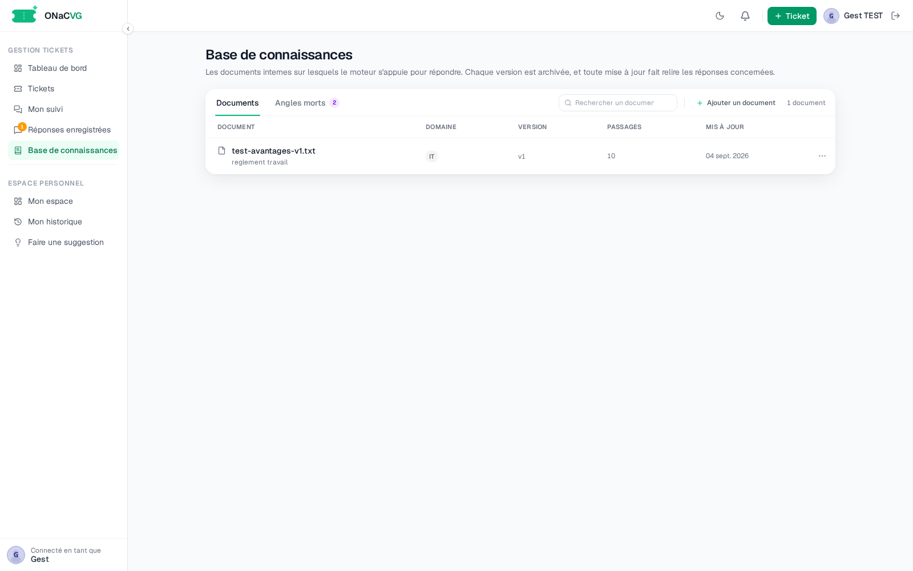
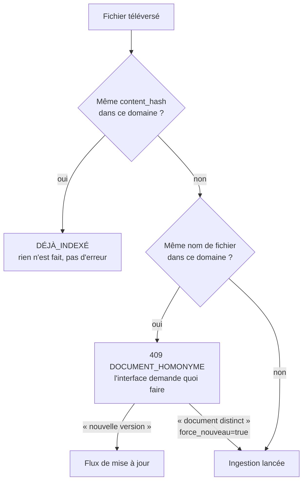
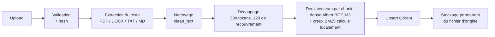

# Base de connaissances

Page `/base-de-connaissances`. C'est le corpus documentaire sur lequel l'IA s'appuie pour
répondre : règlements, procédures, chartes, accords d'entreprise.

Pas de document indexé dans un domaine ⇒ aucune question de ce domaine ne peut recevoir de
réponse **RAG**.

**Qui a accès ?** Les membres du backoffice. La lecture est ouverte aux administrateurs
sur tous les domaines ; **l'écriture — importer, remplacer, supprimer — exige d'être
membre du domaine, sans exception pour l'admin.**

> Les anciennes adresses `/Documentations`, `/documents-indexes` et `/angles-morts`
> redirigent vers cette page. Les favoris existants continuent de fonctionner.

---

## 1. Les deux onglets

| Onglet | Contenu |
|---|---|
| **Documents** | Le corpus indexé : importer, consulter, mettre à jour, supprimer |
| **Angles morts** | Les questions auxquelles le système n'a pas su répondre — ce qui *manque* au corpus |

La colonne **Passages** correspond au nombre de chunks indexés, et **Version** au numéro
de version courante du document.

> 📸 **[CAPTURE D'ÉCRAN COMPLÉMENTAIRE]** : *La même table avec un document en version v2 ou plus, pour montrer l'accès à l'historique des versions.*

---

## 2. Importer un document

### Formats et limites

| Contrainte | Valeur |
|---|---|
| Formats acceptés | **PDF, DOCX, TXT, MD** |
| Taille maximale | **50 Mo** |
| Encodage (TXT / MD) | UTF-8 obligatoire |

Le fichier est validé avant tout traitement :

1. **Le nom est assaini** — chemins, octets nuls et caractères exotiques sont neutralisés
   (protection contre le *path traversal*).
2. **L'extension doit être supportée**.
3. **Le contenu doit correspondre à l'extension** : les octets de signature sont vérifiés.
   Un exécutable renommé en `.pdf` est refusé.
4. **Un `content_hash` SHA-256 est calculé** — c'est lui qui détecte les doublons.

### Doublons et homonymes

Deux situations différentes, deux comportements différents :

- **Doublon exact** (même contenu) : l'API répond `DÉJÀ_INDEXÉ` avec le document existant.
  Ce n'est pas une erreur — réimporter deux fois le même fichier ne crée pas de doublon.
- **Homonyme** (même nom, contenu différent) : l'API répond `409` avec le code
  `DOCUMENT_HOMONYME`. C'est presque toujours le signe qu'il s'agit d'une **nouvelle
  version**. L'interface propose alors soit le flux de mise à jour, soit de forcer la
  création d'un document distinct (`force_nouveau=true`).

Le contrôle porte sur le **couple (fichier, domaine)** : le même règlement peut être
indexé dans deux domaines différents.

### Le pipeline d'ingestion

Le traitement est **asynchrone** : l'API renvoie un `job_id` immédiatement et le travail
part sur la file `queue_ingestion`. L'interface suit l'avancement via
`GET /documents/{job_id}/status` et le suivi de tâches.

| Paramètre de découpage | Valeur | Pourquoi |
|---|---|---|
| Taille de chunk | **384 tokens** BGE-M3 | Compromis entre contexte suffisant et précision de la recherche |
| Recouvrement | **128 tokens** | Évite qu'une phrase coupée en deux devienne introuvable |

> ⚠️ **Ne modifiez pas ces paramètres ni `clean_text` à la légère.** Le pipeline de mise à
> jour documentaire compare les versions paragraphe par paragraphe : changer l'extraction
> ferait apparaître des différences fantômes sur *tous* les documents existants. Voir
> [Mettre à jour un document](../technique/mise-a-jour-documents.md).

**Chaque chunk reçoit deux vecteurs, pas un.** Le dense vient d'Albert ; le creux (BM25) est
calculé sur la machine, Albert n'en expose pas. Conséquence pour l'exploitation : changer les
paramètres BM25 ou la tokenisation invalide les vecteurs creux déjà écrits, et se répare avec
`scripts/reencoder_vecteurs_creux.py` — **sans** réingérer, donc sans racheter un embedding
Albert par chunk. Détail dans
[Onboarding développeur § 9](../onboarding-dev.md#9-la-recherche-est-réellement-hybride--ce-quil-faut-savoir-avant-dy-toucher).

Le champ **description** est facultatif et purement documentaire : il aide les validateurs
à s'y retrouver, il n'entre pas dans l'index.

> 📸 **[CAPTURE D'ÉCRAN REQUISE]** : *Le tiroir d'import de document ouvert, avec la zone de dépôt de fichier, le sélecteur de domaine et le champ description. Prendre une seconde capture pendant l'ingestion, montrant la barre de progression du suivi de tâche.*

---

## 3. Consulter un document

| Action | Endpoint | Détail |
|---|---|---|
| **Lister** | `GET /documents` | Documents vivants uniquement, triés par date de mise à jour. Cap à 500 (max 1 000) |
| **Voir les chunks** | `GET /documents/{doc_id}/chunks` | Les morceaux réellement indexés, dans l'ordre, lus depuis Qdrant |
| **Télécharger** | `GET /documents/{doc_id}/download` | Le fichier d'origine tel qu'il a été importé |

La vue des chunks est l'outil de diagnostic le plus utile de cette page : quand une
réponse RAG est mauvaise, c'est souvent parce que le découpage a coupé au mauvais endroit,
ou que l'extraction a mal lu le PDF. Les chunks montrent exactement ce que l'IA a vu.

> 📸 **[CAPTURE D'ÉCRAN REQUISE]** : *La fenêtre modale des chunks d'un document, montrant plusieurs chunks numérotés avec leur contenu. C'est la capture qui explique le mieux « ce que l'IA voit du document ».*

---

## 4. Mettre à jour un document

Remplacer le fichier d'un document **conserve son `doc_id`** et crée la version N+1. La
version sortante est archivée et reste téléchargeable.

C'est le mécanisme le plus délicat du produit : changer un document peut rendre fausses
des réponses déjà validées. Le flux se déroule en deux temps (prévisualisation puis
confirmation) et déclenche une ré-vérification automatique des réponses concernées.

| Endpoint | Rôle |
|---|---|
| `POST /documents/{doc_id}/versions/preview` | Analyse le nouveau fichier et montre l'impact **sans rien modifier** |
| `POST /documents/{doc_id}/versions/confirm` | Applique le changement |
| `GET /documents/{doc_id}/versions` | Historique des versions |
| `GET /documents/{doc_id}/versions/{v}/download` | Télécharge une version archivée |
| `POST /documents/{doc_id}/versions/{v}/restaurer` | Revient à une version antérieure |

**Le fonctionnement complet — le diff, l'entonnoir de décision, ce qui devient « obsolète »
plutôt que « à relire », et pourquoi — est documenté à part :
[Mettre à jour un document](../technique/mise-a-jour-documents.md).** C'est une lecture
obligatoire avant toute intervention sur ce pipeline.

Un document en cours de mise à jour porte le statut `EN_MAJ` et **ne peut pas être
supprimé** (`409`).

---

## 5. Supprimer un document

`DELETE /documents/{doc_id}` — c'est une **suppression douce** :

| Ce qui est fait | Ce qui est conservé |
|---|---|
| Les chunks sont retirés de Qdrant | La ligne en base, avec `statut = SUPPRIMÉ` et `deleted_at` |
| Le répertoire de stockage est effacé | L'historique des tickets et des réponses |
| `nb_chunks` retombe à 0 | |

Puis les réponses qui **citaient** ce document sont marquées obsolètes avec la raison
`DOC_SUPPRIMÉ`. Les réponses encore `EN_ATTENTE` qui en dépendaient sont **remises dans le
pipeline RAG** — sans quoi elles resteraient bloquées sur un document qui n'existe plus.

> La suppression est plus brutale que la mise à jour : elle ne passe pas par le juge LLM.
> Un document supprimé signifie que ce qu'il disait n'a plus de source, donc toute réponse
> qui s'appuyait dessus est retirée du service. Ces réponses restent restaurables depuis
> l'onglet [Obsolètes](reponses-enregistrees.md#4-longlet-obsolètes).

---

## 6. Les angles morts

Onglet *Angles morts*, alimenté par `GET /stats/hors-domaine`.

### Ce que c'est

Quand le LLM ne trouve pas l'information dans les documents fournis, il préfixe sa réponse
par `[HORS_DOMAINE]` et la réponse est enregistrée avec `source = "HORS_DOMAINE"`.

Ces questions sont précieuses : **elles disent ce qui manque au corpus.** Une même question
qui revient dix fois en hors-domaine est un document à écrire ou à importer.

### La vue

Les questions sont regroupées par domaine, avec le nombre de tickets concernés et les 50
plus récentes. Une période est sélectionnable (`semaine` / `mois` / `annee`, défaut
`mois`). Un validateur ne voit que ses domaines.

### Masquer une question

`DELETE /stats/hors-domaine/{ticket_id}` positionne `masque_angles_morts = true` sur le
ticket. La question disparaît de la liste — **le ticket lui-même n'est pas touché**, seule
sa contribution à cette vue est retirée.

C'est pour écarter le bruit : une question mal posée, un test, une question réellement hors
sujet pour l'entreprise. Ce qui reste est une vraie liste de lacunes documentaires.

Les questions sont regroupées par domaine avec leur compteur (`2 tickets`), le sélecteur
de période est en haut à droite, et la croix en fin de ligne masque la question de cette
vue **sans toucher au ticket**.

---

## 7. Récapitulatif des règles d'accès

| Action | Permission requise |
|---|---|
| Lister / télécharger / voir les chunks | Membre du domaine — **ou admin** |
| Importer | Membre du domaine — **sans exception admin** |
| Mettre à jour / restaurer une version | Membre du domaine — **sans exception admin** |
| Supprimer | Membre du domaine — **sans exception admin** |
| Voir / masquer les angles morts | Membre du domaine |

Le détail de ces règles est dans [Auth & rôles](../technique/auth-et-roles.md).
