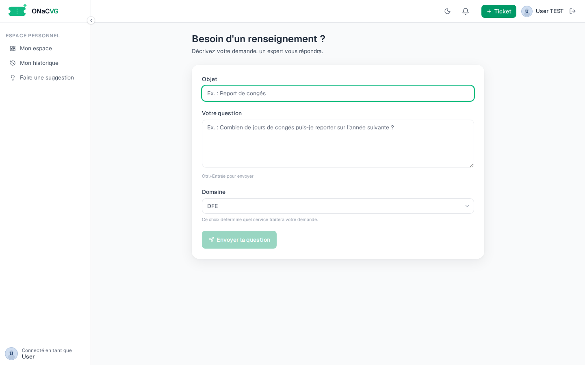
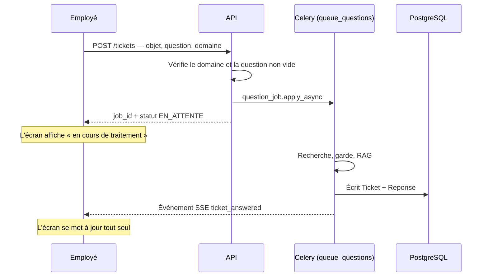
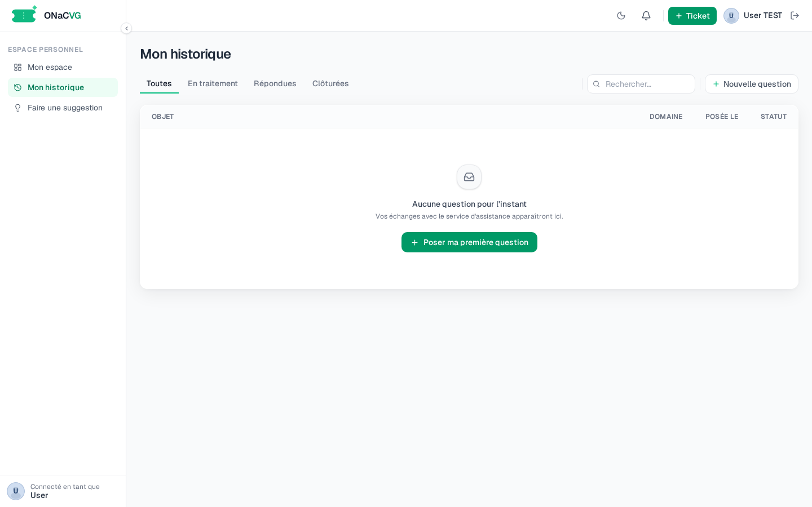
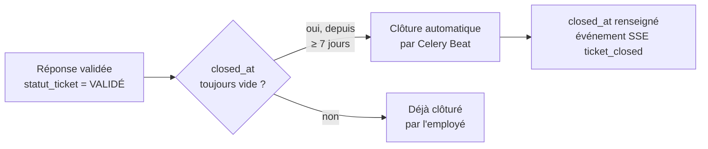
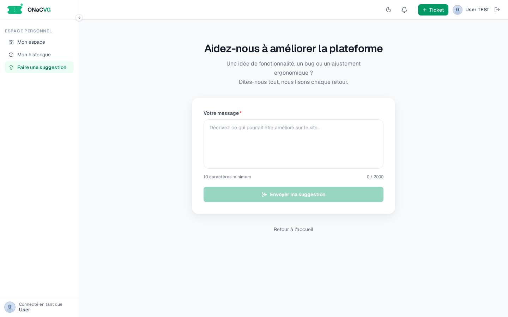

# Espace utilisateur

Ce document décrit tout ce qu'un employé peut faire dans TicketAI : poser une question,
suivre son traitement, relancer la conversation, clôturer et noter.

C'est l'espace par défaut. Un employé sans groupe n'a accès qu'à ces pages ; il n'entre
jamais dans le backoffice.

---

## 1. Les pages de l'espace utilisateur

| Page | Adresse | À quoi elle sert |
|---|---|---|
| **Mon espace** | `/mon-espace` | Tableau de bord personnel : compteurs et tickets récents |
| **Nouveau ticket** | `/nouveau-ticket` | Poser une question |
| **Mon historique** | `/historique` | Tous ses tickets, ouverts et clôturés |
| **Détail d'un ticket** | `/historique/{id}` | Le fil de conversation, les actions |
| **Questions fréquentes** | `/faq` | Chercher parmi les réponses déjà validées, sans créer de ticket |
| **Boîte à suggestions** | `/suggestion` | Proposer une amélioration du produit |

> Le menu latéral l'appelle **« Questions fréquentes »** ; le reste de la documentation et
> le code disent **FAQ**. C'est la même page. Elle a sa section dédiée :
> [§ 3. Chercher une réponse déjà validée](#3-chercher-une-réponse-déjà-validée-la-faq).

Un utilisateur qui n'appartient à aucun groupe et qui visite `/` est automatiquement
redirigé vers `/mon-espace`.


---

## 2. Poser une question

### Le formulaire

Trois champs, tous obligatoires :

| Champ | Contrainte | Rôle |
|---|---|---|
| **Objet** | non vide | Titre court affiché dans les listes. **N'entre pas dans le pipeline RAG** — il ne sert qu'à l'affichage. |
| **Question** | 10 caractères minimum | Le texte réellement envoyé au moteur de recherche et au LLM. |
| **Domaine** | valeur de la liste | Détermine quels documents sont fouillés et quel groupe d'experts traitera le ticket. |

La liste des domaines est chargée depuis `GET /api/v1/tickets/domaines`. Elle contient les
domaines des groupes existants — **si aucun groupe n'a été créé, aucune question ne peut
être soumise** et l'API répond `400 Aucun domaine configuré`. Le premier domaine de la
liste est présélectionné.

Le bouton d'envoi reste désactivé tant que les trois conditions ne sont pas réunies. Si
l'utilisateur a commencé à saisir et tente de quitter la page, le navigateur demande
confirmation.



Rappel de lecture : l'**objet** ne sert qu'à l'affichage dans les listes, seule la
**question** est envoyée au moteur de recherche et au LLM.

### Ce qui se passe après l'envoi



La réponse HTTP est immédiate : elle ne contient qu'un `job_id`, pas la réponse. Le
traitement est asynchrone. L'utilisateur n'a rien à rafraîchir — l'écran se met à jour
seul grâce au flux temps réel (voir
[Notifications et temps réel](notifications-et-temps-reel.md)).

### Combien de temps ça prend

Cela dépend de la branche empruntée par la question :

| Branche | Durée typique | Pourquoi |
|---|---|---|
| **CANONIQUE** (court-circuit) | < 1 s | Question identique à une question déjà traitée, aucun appel LLM |
| **CANONIQUE** (via le garde) | 2–5 s | Un appel LLM court (une seule décision OUI/NON) |
| **SUGGESTION** | 1–3 s | Pas de génération, on réutilise une réponse existante |
| **RAG** | 10–40 s | Reranking puis génération complète par le LLM |

Sur les branches **SUGGESTION** et **RAG**, la réponse n'est pas montrée immédiatement à
l'employé : elle attend d'être validée par un expert.

---

## 3. Chercher une réponse déjà validée (la FAQ)

Page `/faq`, intitulée **« Questions fréquentes »** dans le menu. C'est le seul endroit où
un employé obtient une réponse **sans passer par la file de validation** — précisément
parce que rien n'y est produit sur le moment : la page *montre* des réponses qu'un humain
a déjà validées au moins `SEUIL_CANONIQUE` fois (défaut : 3), tous domaines confondus.
Aucun ticket n'est créé, aucun texte n'est généré, le garde n'est pas appelé.

### Le parcours

| Étape | Ce que voit l'employé |
|---|---|
| **Accueil** | Un champ au centre, « Que cherchez-vous ? », et trois questions d'exemple cliquables. Rien d'autre : tant qu'aucune question n'est posée, il n'y a rien à montrer. |
| **Saisie** | Champ libre, 3 caractères minimum, 500 maximum. **Entrée** lance la recherche, **Maj+Entrée** va à la ligne (l'astuce n'est affichée qu'à l'accueil). |
| **Recherche** | Un squelette de chargement, puis le résultat remplace le bloc précédent. Le champ conserve la question posée. |

La recherche part **à la soumission uniquement**, jamais à la frappe : chaque recherche
consomme un embedding Albert. Reposer la même question dans les cinq minutes ne rappelle
pas Albert (cache React Query), et un usage trop rapide reçoit *« Trop de recherches
d'affilée. Patientez quelques instants. »* — c'est `FAQ_RATE_LIMIT_PAR_MINUTE`
(défaut : 20/minute/utilisateur), avec un bouton **Réessayer**.

### Ce qui s'affiche

| Cas | Affichage |
|---|---|
| **Une ou plusieurs réponses sûres** | La meilleure est dépliée en entier, avec son domaine. Les suivantes sont listées repliées sous *« Autres réponses proches »* et s'ouvrent au clic. |
| **Rien de sûr, mais des voisins plausibles** | *« Rien ne correspond exactement à votre question. Peut-être cherchiez-vous ceci ? »* suivi de 3 pistes repliées, au plus. |
| **Rien du tout** | *« Aucune réponse ne correspond à cette question pour le moment. »* |

Les **pistes ne cohabitent jamais avec des réponses** : le serveur ne les renvoie que
lorsque le premier rang est vide. C'est une garantie d'API, pas une règle d'affichage —
sans juge sur cette page, un candidat approximatif se propose sans s'affirmer. Seuils et
justification : [Référence API](../technique/reference-api.md#faq).

Dans les trois cas, une rangée **« Poser la question à un expert »** ferme l'écran. Elle
ouvre `/nouveau-ticket` **avec la question déjà recopiée dans le formulaire** — l'employé
n'a plus qu'à choisir l'objet et le domaine. C'est la porte de sortie de la page, pas son
action principale.

### Trois points qui surprennent

- **Une question à la fois, sans mémoire.** Contrairement au fil d'un ticket (§ 4), la FAQ
  n'empile rien : chaque recherche est indépendante et le serveur ne voit jamais les
  précédentes. Une relance du type *« et pour un apprenti ? »* n'y a donc aucun sens — elle
  serait cherchée telle quelle. C'est ce que le remplacement du bloc à chaque question, au
  lieu d'un transcript, sert à rendre évident.
- **La question affichée n'est pas forcément celle du ticket d'origine.** Une réponse est
  indexée sous autant de formulations qu'elle a de validations humaines ; la page montre
  **celle qui a effectivement correspondu**.
- **Aucun score n'est affiché.** Le cosinus ordonne les résultats mais ne sort jamais de
  l'API : il n'a pas de sens pour un utilisateur final et invite aux mauvaises lectures.


> La seconde est produite uniquement si `TAI_FAQ_Q` est défini (`captures_doc.py`) : elle
> déclenche une vraie recherche, donc un embedding Albert.

---

## 4. Suivre son ticket

### Le fil de conversation

Le détail d'un ticket (`/historique/{id}`) présente un fil : la question initiale, la
réponse, puis les éventuelles relances et leurs réponses.



> 📸 **[CAPTURE D'ÉCRAN COMPLÉMENTAIRE]** : *Le détail d'un ticket (`/historique/{id}`) avec un fil complet — question initiale, réponse validée, relance de l'utilisateur, réponse à la relance. L'instance de test ne contient pas encore de fil comportant une relance.*

### Relancer — les questions de suivi

L'employé peut ajouter une précision au fil : *« et pour un apprenti ? »*, *« dans ce
cas ? »*. C'est ce qu'on appelle une **question de suivi**.

Trois règles encadrent cette action :

- Seul **le créateur du ticket** peut relancer (`403` sinon).
- Un ticket **clôturé** n'accepte plus de relance (`409`).
- La relance repasse par tout le pipeline — ce n'est pas une simple recherche
  dans le fil existant.

Le point important : le moteur ne voit pas la relance isolément. Il reconstruit le fil
complet et concatène toutes les questions pour former une requête enrichie.

```
Question initiale : « Quel est le préavis de licenciement ? »
Relance           : « Et pour un apprenti ? »
                     ↓
Requête réellement recherchée :
« Quel est le préavis de licenciement ?
  Et pour un apprenti ? »
```

Sans cela, *« et pour un apprenti ? »* ne voudrait rien dire pour le moteur de recherche.
Le détail est décrit dans
[Pipeline de traitement des questions](../technique/architecture-pipeline-questions.md#mode-suivi-fil-de-conversation).

---

## 5. Clôturer un ticket et noter la réponse

### Clôture manuelle

Le créateur du ticket — et lui seul — peut le clôturer. La clôture est **définitive** :
un ticket déjà clôturé renvoie `409`. Il n'est plus possible d'y ajouter une relance.

Au moment de clôturer, l'écran propose de noter l'expérience sur deux axes, **de façon
facultative** :

| Note | Échelle | Ce qu'elle mesure |
|---|---|---|
| `note_qualite` | 1 à 5 étoiles | La qualité de la réponse reçue |
| `note_delai` | 1 à 5 étoiles | La rapidité de traitement |

L'utilisateur peut clôturer sans noter. Ces notes alimentent la carte « satisfaction » du
tableau de bord et permettent aux validateurs de filtrer les tickets mal notés (voir
[Statistiques et pilotage](statistiques-et-pilotage.md)).

> 📸 **[CAPTURE D'ÉCRAN REQUISE]** : *Le panneau « Avant de partir… » qui apparaît au clic sur « Clôturer », avec les deux sélecteurs d'étoiles « Qualité de la réponse » et « Rapidité de traitement », et les boutons de confirmation. Montrer un état où quelques étoiles sont sélectionnées.*

### Clôture automatique

Un ticket validé qu'on laisse traîner se ferme tout seul.



Une tâche planifiée (`auto_cloture_job`) tourne **chaque nuit à 02 h 00**. Elle clôture
tous les tickets `VALIDÉ`, non encore clôturés, validés depuis plus de `JOURS_AUTO_CLOTURE`
jours (**défaut : 7**).

Le compte à rebours est affiché à l'employé sur ses tickets validés : *« Clôture auto dans
3 h »*, *« Clôture auto demain »*, *« Clôture auto le 12 sept. »*. Il vire à l'ambre à
moins de deux jours, au rouge à moins d'un jour.

> Le délai se compte à partir de `validated_at`, pas de la date de création du ticket.

---

## 6. La boîte à suggestions

Page `/suggestion`. Elle permet à n'importe quel utilisateur authentifié d'envoyer un
retour libre sur le produit — ce n'est **pas** un ticket, cela ne déclenche aucun
traitement IA.

| Contrainte | Valeur |
|---|---|
| Longueur minimale | 10 caractères |
| Longueur maximale | 2 000 caractères |

Les suggestions arrivent dans l'onglet *Suggestions* de la page d'administration, où un
admin peut les marquer comme lues ou les supprimer (voir
[Administration](administration.md#5-la-boîte-à-suggestions)).

Si le compte de l'auteur est supprimé, la suggestion est conservée mais son auteur devient
anonyme (`user_id` passe à `NULL`).



> 📸 **[CAPTURE D'ÉCRAN COMPLÉMENTAIRE]** : *L'écran de confirmation « Merci pour votre retour ! » affiché après l'envoi — il nécessite de soumettre réellement une suggestion.*

---

## 7. Ce qu'un employé ne voit jamais

La séparation est appliquée côté serveur, pas seulement dans l'interface :

- Il ne voit **que ses propres tickets**. La liste des tickets filtre sur
  `Ticket.user_id == current_user.id` pour tout utilisateur sans groupe.
- Il ne voit **pas** les réponses en attente de validation d'autres personnes.
- Il ne voit **pas** les documents de la base de connaissances.
- Il n'a **pas** accès aux statistiques ni à l'administration.

Les règles complètes sont dans [Auth & rôles](../technique/auth-et-roles.md).

---

## 8. Récapitulatif des actions et de leurs règles

| Action | Endpoint | Qui | Refus possible |
|---|---|---|---|
| Poser une question | `POST /tickets` | tout utilisateur | `400` domaine invalide ou question vide |
| Relancer le fil | `POST /tickets/{id}/suivi` | le créateur | `403` pas son ticket · `409` ticket clôturé |
| Clôturer (+ noter) | `POST /tickets/{id}/cloturer` | le créateur | `403` pas son ticket · `409` déjà clôturé |
| Consulter un ticket | `GET /tickets/{id}` | le créateur, ou le backoffice du domaine | `403` |
| Voir la timeline | `GET /tickets/{id}/workflow` | idem | `403` |
| Chercher dans la FAQ | `GET /faq/recherche?q=…` | tout utilisateur | `429` quota par minute dépassé |
| Envoyer une suggestion | `POST /suggestions` | tout utilisateur | `422` longueur hors bornes |
| Marquer une notification lue | `POST /notifications/{id}/lire` | le destinataire | `404` |
