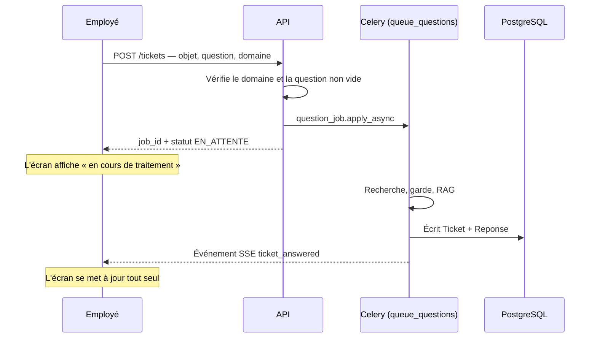
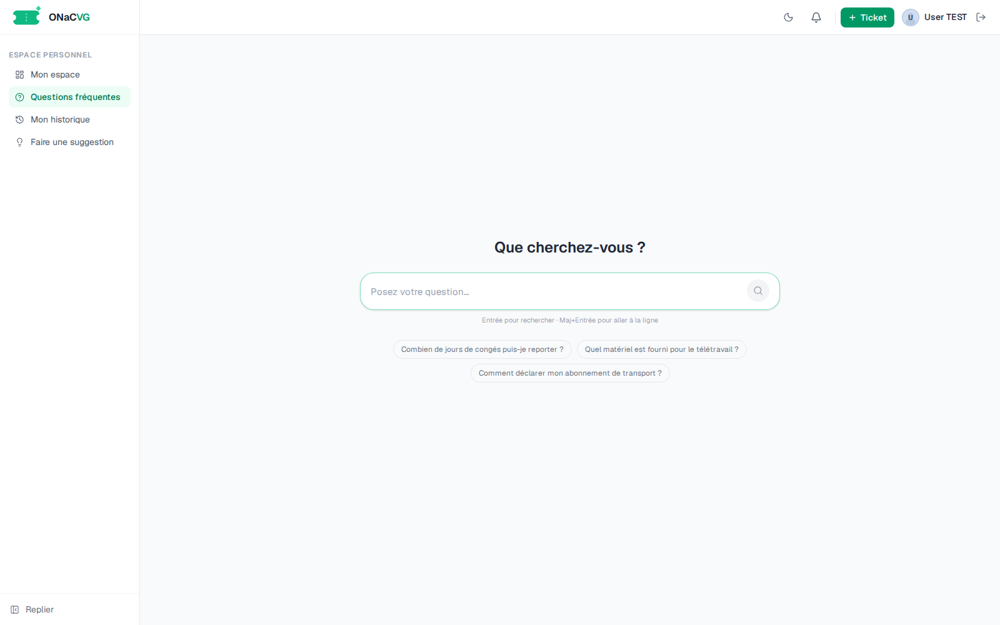
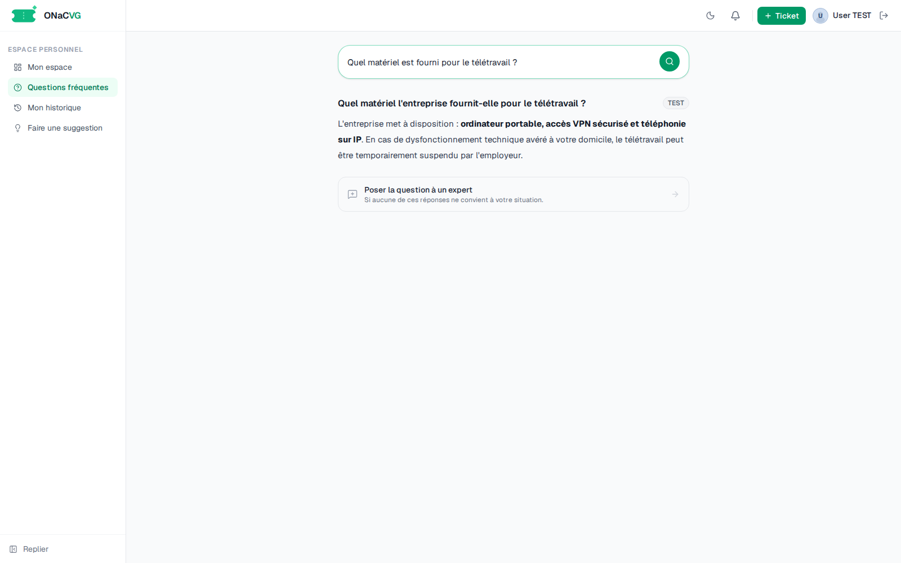
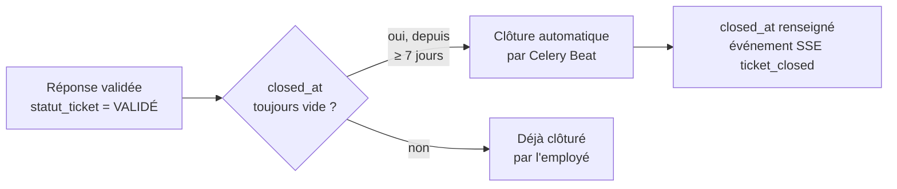

# Espace utilisateur

Ce document décrit tout ce qu'un employé peut faire dans TicketAI : consulter son tableau
de bord, poser une question, suivre son traitement, relancer la conversation, clôturer et
noter.

C'est l'espace par défaut. Un employé sans groupe n'a accès qu'à ces pages ; il n'entre
jamais dans le backoffice.

---

## 1. Les pages de l'espace utilisateur

| Page | Adresse | À quoi elle sert |
|---|---|---|
| **Mon espace** | `/mon-espace` | Tableau de bord personnel : compteurs et tickets récents |
| **Nouveau ticket** | `/nouveau-ticket` | Poser une question |
| **Mon historique** | `/historique` | Tous ses tickets, ouverts et clôturés |
| **Détail d'un ticket** | `/historique/{id}` | Le fil de conversation, les actions |
| **Questions fréquentes** | `/faq` | Chercher parmi les réponses déjà validées, sans créer de ticket |
| **Boîte à suggestions** | `/suggestion` | Proposer une amélioration du produit |

> Le menu latéral l'appelle **« Questions fréquentes »** ; le reste de la documentation et
> le code disent **FAQ**. C'est la même page. Elle a sa section dédiée :
> [§ 5. Chercher une réponse déjà validée](#5-chercher-une-réponse-déjà-validée-la-faq).

Un utilisateur qui n'appartient à aucun groupe et qui visite `/` est automatiquement
redirigé vers `/mon-espace`.


---

## 2. Tableau de bord — Mon espace

### Pourquoi on fait ça

Voir en un coup d'œil l'état de toutes ses demandes sans ouvrir chacune. Quand on revient
sur la plateforme, la page d'accueil répond immédiatement à *« est-ce qu'on m'a répondu ? »*
et *« ai-je des choses à traiter ? »*.

### Comment ça fonctionne

À l'ouverture de `/mon-espace`, quatre cartes résument l'activité :

| Carte | Ce qu'elle compte |
|---|---|
| **Total** | Toutes vos demandes, tous statuts confondus |
| **En cours** | Questions en attente d'une réponse ou d'une validation |
| **Réponse reçue** | Tickets ayant reçu une réponse validée, pas encore clôturés |
| **Clôturés** | Demandes fermées, manuellement ou automatiquement |

En dessous, la liste des tickets récents s'organise par statut : les demandes actives
d'abord, les clôturées ensuite. Cliquer sur une ligne ouvre le fil de conversation.

**Raccourci** : appuyer sur `n` depuis cette page crée directement un nouveau ticket.

Si vous avez plus de 200 tickets, un avertissement s'affiche : seuls les 200 plus récents
sont chargés. Le lien *« Voir tout l'historique »* renvoie vers la page d'historique
complète avec filtres et pagination.

La page se met à jour sans rechargement dès qu'une réponse arrive ou qu'un ticket change
de statut — voir [Notifications et temps réel](notifications-et-temps-reel.md).

### Détails techniques

Fichier : `frontend/src/pages/user/UserDashboard.tsx`.
Endpoint : `GET /api/v1/tickets?limit=200`.
La distinction employé / validateur repose sur `isBackoffice` (hook `useAuth`) : un
validateur ou admin qui navigue vers `/mon-espace` est redirigé vers le backoffice.
Invalidations SSE déclenchant un rechargement : `ticket_created`, `ticket_answered`,
`ticket_closed`.

---

## 3. Consulter son historique

### Pourquoi on fait ça

Retrouver une réponse reçue il y a plusieurs semaines, vérifier le statut d'une demande
en cours, ou s'assurer qu'un ticket a bien été clôturé. L'historique donne accès à
l'ensemble des demandes passées, ouvertes et fermées, avec des filtres pour les trier.

### Comment ça fonctionne

La page `/historique` affiche toutes vos demandes en quatre onglets :

| Onglet | Contenu |
|---|---|
| **Tous** | L'ensemble de vos tickets, quel que soit leur état |
| **En traitement** | Questions dont la réponse est en cours ou en attente de validation |
| **Répondu** | Questions ayant reçu une réponse validée |
| **Clôturé** | Demandes fermées |

Chaque onglet affiche son compteur (ex. *« Répondu 3 »*). Une barre de recherche permet
de filtrer par mot-clé dans le titre ou le texte de la question — la liste se met à jour
à mesure que vous tapez (avec un léger délai de 300 ms).

La liste est paginée à 10 tickets par page. Les flèches en bas permettent de naviguer.

Si vous avez plus de 400 tickets, seuls les 400 plus récents sont chargés dans chaque onglet.


### Détails techniques

Fichier : `frontend/src/pages/user/UserTicketHistory.tsx`.
Endpoint : `GET /api/v1/tickets` avec les paramètres `statut`, `closed`, `search`, `page`
et `limit`. La recherche par UUID dans le champ `search` renvoie directement le ticket
correspondant. L'onglet *Clôturé* passe `closed=true` ; les autres filtrent sur `statut_ticket`.

---

## 4. Poser une question

### Pourquoi on fait ça

Soumettre une demande à l'équipe d'experts du bon service — RH, IT, Juridique, etc. —
sans savoir à qui s'adresser directement. Le système cherche automatiquement dans les
documents internes et produit une réponse, ou la transmet à un expert si les documents ne
suffisent pas.

### Comment ça fonctionne

La page `/nouveau-ticket` présente un formulaire à trois champs :

| Champ | Contrainte | Rôle |
|---|---|---|
| **Objet** | non vide | Titre court affiché dans les listes. **N'entre pas dans le pipeline** — il ne sert qu'à l'affichage. |
| **Question** | 10 caractères minimum | Le texte réellement envoyé au moteur de recherche et au LLM. |
| **Domaine** | valeur de la liste | Détermine quels documents sont fouillés et quel groupe d'experts traitera le ticket. |

Le bouton d'envoi reste désactivé tant que les trois conditions ne sont pas réunies. Si
vous commencez à saisir et tentez de quitter la page, le navigateur demande confirmation.

Après envoi, l'écran indique *« en cours de traitement »*. Vous n'avez rien à rafraîchir :
la réponse arrive toute seule dans votre espace dès qu'elle est prête.

> **Rappel :** l'**objet** ne sert qu'à l'affichage — seule la **question** est envoyée au
> moteur de recherche.


### Détails techniques

Endpoint : `POST /api/v1/tickets` (corps : `{ "objet", "question", "domaine" }`).
La liste des domaines vient de `GET /api/v1/tickets/domaines` — si aucun groupe n'a été
créé, cet endpoint répond `400 Aucun domaine configuré`. Le premier domaine est pré-sélectionné.
L'API renvoie immédiatement un `job_id` ; le traitement est asynchrone sur la file
`queue_questions`. L'interface suit l'avancement via `GET /tickets/{job_id}/status` et
le flux SSE `ticket_answered`.
Raccourci clavier : `Ctrl+Entrée` (`Cmd+Entrée` sur Mac) soumet le formulaire.

**Durées typiques selon la branche empruntée :**

| Branche | Durée | Pourquoi |
|---|---|---|
| **CANONIQUE** (court-circuit) | < 1 s | Question identique à une question déjà traitée, aucun appel LLM |
| **CANONIQUE** (via le garde) | 2–5 s | Un appel LLM court (une seule décision OUI/NON) |
| **SUGGESTION** | 1–3 s | Pas de génération, on réutilise une réponse existante |
| **RAG** | 10–40 s | Reranking puis génération complète par le LLM |

Sur les branches **SUGGESTION** et **RAG**, la réponse n'est pas montrée immédiatement à
l'employé : elle attend d'être validée par un expert.



---

## 5. Chercher une réponse déjà validée (la FAQ)

### Pourquoi on fait ça

Obtenir une réponse instantanée à une question courante sans attendre la validation d'un
expert et sans créer de ticket. La page *Questions fréquentes* affiche uniquement des
réponses qu'un humain a déjà validées plusieurs fois — rien n'est généré à la volée, aucun
ticket n'est créé.

### Comment ça fonctionne

À l'ouverture de `/faq`, un champ de recherche centré vous accueille avec trois exemples
de questions cliquables. Saisissez votre question (3 à 500 caractères) et appuyez sur
**Entrée** pour lancer la recherche. **Maj+Entrée** va à la ligne si vous avez besoin de
plusieurs lignes.

Trois cas possibles :

| Cas | Affichage |
|---|---|
| **Une ou plusieurs réponses sûres** | La meilleure est dépliée en entier, avec son domaine. Les suivantes sont listées repliées sous *« Autres réponses proches »* et s'ouvrent au clic. |
| **Rien de sûr, mais des voisins plausibles** | *« Rien ne correspond exactement à votre question. Peut-être cherchiez-vous ceci ? »* suivi de 3 pistes repliées, au plus. |
| **Rien du tout** | *« Aucune réponse ne correspond à cette question pour le moment. »* |

Dans les trois cas, une rangée **« Poser la question à un expert »** est présente. Elle
ouvre `/nouveau-ticket` **avec votre question déjà recopiée** — vous n'avez plus qu'à
choisir l'objet et le domaine.

> **Trois points qui surprennent :**
> - La recherche se déclenche **à la soumission uniquement**, jamais à la frappe.
> - Les pistes (*voisins plausibles*) n'apparaissent que si aucune réponse sûre n'est
>   trouvée — les deux niveaux ne cohabitent jamais.
> - La question affichée dans les résultats n'est pas forcément celle du ticket d'origine :
>   c'est la formulation qui a effectivement correspondu à votre recherche.

### Détails techniques

Seules les réponses canoniques avec `faq_visible = true` apparaissent. Un validateur
choisit d'inclure une réponse au moment de sa première validation ou depuis *Réponses
enregistrées*.

Endpoint : `GET /api/v1/faq/recherche?q=…`.
Limite de débit : `FAQ_RATE_LIMIT_PAR_MINUTE` (défaut : 20/minute/utilisateur) — en cas
de dépassement, le message *« Trop de recherches d'affilée. Patientez quelques instants. »*
s'affiche avec un bouton **Réessayer**. Le limiteur est **fail-open** : une panne de Valkey
ne bloque pas la page.
Cache React Query : reposer la même question dans les cinq minutes ne rappelle pas Albert.
Seuils : `FAQ_SEUIL_PERTINENCE` (défaut : 0.75) pour les résultats sûrs,
`FAQ_SEUIL_INCERTAIN` (défaut : 0.55) pour les pistes. Référence complète :
[Référence API](../technique/reference-api.md#faq).





> La seconde capture est produite uniquement si `TAI_FAQ_Q` est défini (`captures_doc.py`) :
> elle déclenche une vraie recherche, donc un embedding Albert.

---

## 6. Suivre son ticket et relancer le fil

### Pourquoi on fait ça

Garder la main sur une demande en cours, lire la réponse dès qu'elle arrive, et poser une
question complémentaire si la réponse ne couvre pas complètement votre situation — sans
créer un nouveau ticket et sans perdre le fil de la conversation.

### Comment ça fonctionne

Le détail d'un ticket (`/historique/{id}`) présente un fil chronologique : la question
initiale, puis la réponse, puis les éventuelles relances avec leurs réponses.

**Relancer — les questions de suivi**

Si la réponse reçue ne couvre pas entièrement votre cas — *« et pour un apprenti ? »*,
*« dans ce cas particulier ? »* — saisissez votre complément dans le champ en bas du fil
et envoyez. Cette action est appelée **question de suivi**.

Le système ne traite pas votre précision seule : il reconstruit le fil complet et forme une
requête enrichie du contexte de toute la conversation. Votre précision y prend son sens.

```
Question initiale : « Quel est le préavis de licenciement ? »
Relance           : « Et pour un apprenti ? »
                     ↓
Requête réellement recherchée :
« Quel est le préavis de licenciement ?
  Et pour un apprenti ? »
```

> 📸 **[CAPTURE D'ÉCRAN COMPLÉMENTAIRE]** : *Le détail d'un ticket (`/historique/{id}`) avec un fil complet — question initiale, réponse validée, relance de l'utilisateur, réponse à la relance. L'instance de test ne contient pas encore de fil comportant une relance.*

### Détails techniques

Endpoint : `POST /api/v1/tickets/{id}/suivi` (corps : `{ "question": "..." }`).
Règles : seul le créateur du ticket peut relancer (`403` sinon) ; un ticket clôturé
n'accepte plus de relance (`409`). La relance repasse par tout le pipeline — ce n'est pas
une simple recherche dans le fil existant. Elle renvoie un `job_id`.
Détail du mode suivi dans le pipeline :
[Architecture pipeline questions](../technique/architecture-pipeline-questions.md#mode-suivi-fil-de-conversation).

---

## 7. Quand un ticket est réacheminé

### Pourquoi on fait ça

Si votre demande a été envoyée au mauvais service, un validateur peut la transmettre au
bon sans que vous ayez à reformuler votre question ou à créer un nouveau ticket. Votre
historique reste intact et le lien vers votre ticket continue de fonctionner.

### Comment ça fonctionne

Dans le fil de votre ticket (`/historique/{id}`), une ligne informationnelle apparaît :

> ⇄ *Demande transmise au service [NOM DU SERVICE] · [date]*

C'est purement informatif. Votre question est conservée intacte. Le pipeline repart
automatiquement dans le nouveau service : l'IA répond à nouveau, un validateur examine,
et vous recevez une réponse ou une notification exactement comme pour un ticket ordinaire.
L'identifiant du ticket reste le même — votre lien continue de fonctionner.

### Détails techniques

Un réacheminement n'est pas possible si le ticket a déjà reçu une question de suivi —
le fil est réouvert par le nouveau service, pas par vous. Le champ `reroute_source_domaine`
mémorise le service d'origine pour affichage dans la barre latérale du backoffice. Un
événement `RECHEMINE` est écrit dans la timeline avec les domaines `from`/`to` et la raison.

---

## 8. Clôturer un ticket et noter la réponse

### Clôture manuelle

#### Pourquoi on fait ça

Signaler que votre demande est satisfaite libère le ticket de la file de suivi. La notation
facultative qui accompagne la clôture alimente les indicateurs de satisfaction — elle aide
l'équipe à comprendre ce qui a bien fonctionné ou ce qui peut s'améliorer.

#### Comment ça fonctionne

Depuis le détail d'un ticket validé, cliquez **Clôturer**. Un panneau *« Avant de
partir… »* propose deux séries d'étoiles :

| Note | Échelle | Ce qu'elle mesure |
|---|---|---|
| Qualité | 1 à 5 étoiles | La qualité de la réponse reçue |
| Rapidité | 1 à 5 étoiles | La rapidité de traitement |

Vous pouvez clôturer sans noter — les deux champs sont facultatifs. Confirmez pour fermer
le ticket définitivement.

> 📸 **[CAPTURE D'ÉCRAN REQUISE]** : *Le panneau « Avant de partir… » avec les deux sélecteurs d'étoiles et les boutons de confirmation. Montrer un état où quelques étoiles sont sélectionnées.*

#### Détails techniques

Seul le créateur du ticket peut clôturer (`403` sinon). La clôture est **définitive** :
un ticket déjà clôturé renvoie `409`. Il n'est plus possible d'y ajouter une relance.
Endpoint : `POST /api/v1/tickets/{id}/cloturer` (corps : `{ "note_qualite": 1–5,
"note_delai": 1–5 }`, les deux optionnels).
Les notes alimentent `avg_qualite` et `avg_delai` dans le tableau de bord (voir
[Statistiques et pilotage](statistiques-et-pilotage.md#4-la-satisfaction)).

---

### Clôture automatique

#### Pourquoi on fait ça

Éviter que des tickets validés s'accumulent indéfiniment ouverts quand l'employé a obtenu
satisfaction mais n'a pas pensé à clôturer. Des tickets qui traînent faussent les
compteurs et occupent l'attention des équipes inutilement.

#### Comment ça fonctionne

Un compte à rebours apparaît sur chaque ticket validé non encore clôturé :

- *« Clôture auto le 12 sept. »* — plus de deux jours restants
- *« Clôture auto demain »* — moins de deux jours (compte à rebours en ambre)
- *« Clôture auto dans 3 h »* — moins d'un jour (compte à rebours en rouge)

À l'heure dite, le ticket se ferme automatiquement, sans action de votre part.

> Le délai se compte à partir de la date de **validation**, pas de la date de création du ticket.

#### Détails techniques

Tâche planifiée `auto_cloture_job` dans `backend/app/workers/auto_cloture.py`,
déclenchée **chaque nuit à 02 h 00** (UTC).
Variable : `JOURS_AUTO_CLOTURE` (défaut : 7) — délai en jours à partir de `validated_at`.
La clôture émet l'événement SSE `ticket_closed` sur le canal du domaine, mais **n'envoie
pas de notification individuelle** à l'employé.
La valeur de `JOURS_AUTO_CLOTURE` est renvoyée en lecture seule par `GET /admin/config`
pour que l'interface puisse calculer et afficher le compte à rebours.



---

## 9. La boîte à suggestions

### Pourquoi on fait ça

Permettre à n'importe quel employé d'envoyer un retour libre sur le produit — une idée
d'amélioration, un problème qui ne relève pas d'une demande métier, une fonctionnalité
manquante. Ces retours n'entrent dans aucun pipeline IA et ne créent pas de ticket : ils
arrivent directement dans la boîte de l'équipe produit.

### Comment ça fonctionne

Accédez à `/suggestion`. Rédigez votre message dans le champ de texte (qui s'agrandit
automatiquement avec votre saisie), puis envoyez.

Un compteur de caractères s'affiche en bas du champ. Il vire à l'ambre à 100 caractères
de la limite, pour vous avertir à temps.

Après envoi, un écran de confirmation *« Merci pour votre retour ! »* apparaît. Vous
pouvez soumettre une autre suggestion ou revenir à l'accueil.

> 📸 **[CAPTURE D'ÉCRAN COMPLÉMENTAIRE]** : *L'écran de confirmation « Merci pour votre retour ! » affiché après l'envoi — il nécessite de soumettre réellement une suggestion.*

### Détails techniques

Fichier : `frontend/src/pages/user/SuggestionBox.tsx`.
Endpoint : `POST /api/v1/suggestions` (corps : `{ "contenu": "..." }`).
Contraintes : entre **10 et 2 000 caractères** (`422` si hors bornes).
Raccourci : `Ctrl+Entrée` (`Cmd+Entrée` sur Mac) soumet le formulaire.
Si le compte de l'auteur est supprimé, la suggestion est conservée mais son auteur devient
anonyme (`user_id` passe à `NULL`).
Les suggestions arrivent dans l'onglet *Suggestions* de la page d'administration — voir
[Administration](administration.md#6-la-boîte-à-suggestions).


---

## 10. Ce qu'un employé ne voit jamais

La séparation est appliquée côté serveur, pas seulement dans l'interface :

- Il ne voit **que ses propres tickets**. La liste des tickets filtre sur
  `Ticket.user_id == current_user.id` pour tout utilisateur sans groupe.
- Il ne voit **pas** les réponses en attente de validation d'autres personnes.
- Il ne voit **pas** les documents de la base de connaissances.
- Il n'a **pas** accès aux statistiques ni à l'administration.

Les règles complètes sont dans [Auth & rôles](../technique/auth-et-roles.md).

---

## 11. Récapitulatif des actions et de leurs règles

| Action | Endpoint | Qui | Refus possible |
|---|---|---|---|
| Poser une question | `POST /tickets` | tout utilisateur | `400` domaine invalide ou question vide |
| Relancer le fil | `POST /tickets/{id}/suivi` | le créateur | `403` pas son ticket · `409` ticket clôturé |
| Clôturer (+ noter) | `POST /tickets/{id}/cloturer` | le créateur | `403` pas son ticket · `409` déjà clôturé |
| Consulter un ticket | `GET /tickets/{id}` | le créateur, ou le backoffice du domaine | `403` |
| Voir la timeline | `GET /tickets/{id}/workflow` | idem | `403` |
| Chercher dans la FAQ | `GET /faq/recherche?q=…` | tout utilisateur | `429` quota par minute dépassé |
| Envoyer une suggestion | `POST /suggestions` | tout utilisateur | `422` longueur hors bornes |
| Marquer une notification lue | `POST /notifications/{id}/lire` | le destinataire | `404` |
