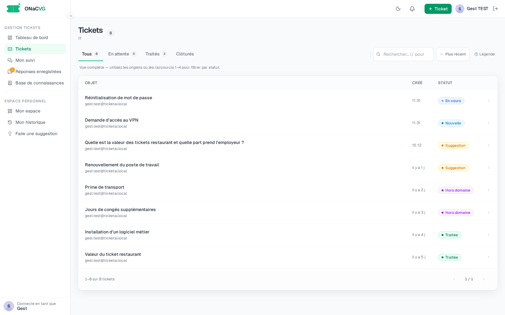
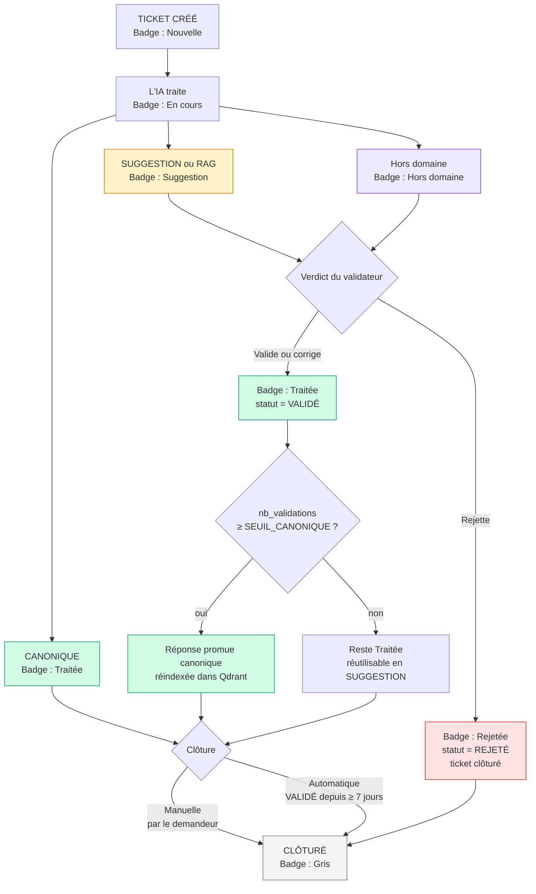
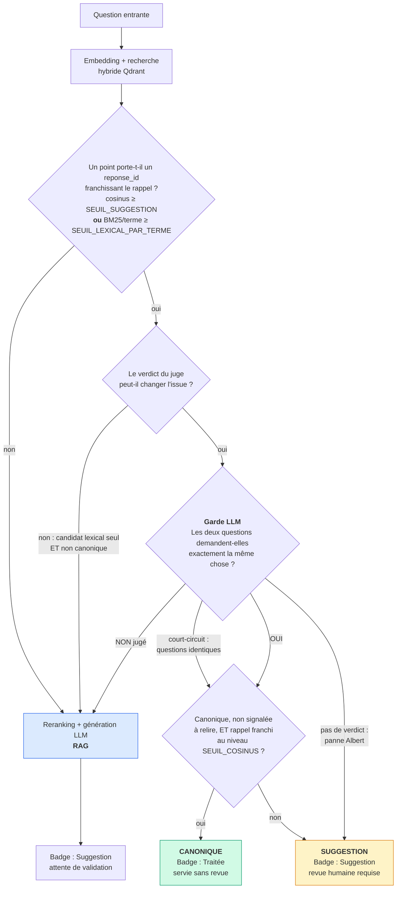

# Labels et catégories de tickets

Ce document explique la signification de chaque badge affiché sur un ticket, comment ils sont
calculés, et à quoi correspondent les onglets de filtrage dans la liste des tickets.

---

## 1. Les badges de statut

### Pourquoi on fait ça

Pour comprendre en un coup d'œil où en est un ticket sans avoir à l'ouvrir. Dans une liste
de vingt demandes, le badge répond immédiatement à *« laquelle attend encore quelque chose
de moi ? »* — sans avoir à lire le contenu de chacune.

Chaque ticket affiche un badge coloré qui reflète son état courant. Voici tous les badges
possibles, par ordre de priorité d'affichage.

| Badge | Couleur | Signification |
|---|---|---|
| **Clôturé** | Gris | Ticket fermé par le demandeur ou automatiquement après validation |
| **En cours** | Bleu | L'IA est en train de générer une réponse |
| **Traitée** | Vert émeraude | Réponse canonique servie automatiquement, ou validée par un humain |
| **Hors domaine** | Violet | La question ne relève d'aucun domaine couvert |
| **Suggestion** | Ambre | Une réponse similaire existe mais doit être confirmée |
| **Rejetée** | Rouge | La réponse a été rejetée par un validateur |
| **Nouvelle** | Bleu ciel | Le ticket vient d'arriver, pas encore de réponse |

### Règle de priorité

Quand plusieurs conditions sont vraies en même temps, le badge est choisi dans cet ordre :

```
1. Clôturé      ← priorité absolue (ticket fermé)
2. En cours     ← l'IA travaille encore
3. Traitée      ← réponse canonique ou humaine confirmée
4. Hors domaine ← question hors périmètre (RÉPONDU + source HORS_DOMAINE)
5. Suggestion   ← réponse similaire à confirmer (RÉPONDU sans canonique)
6. Rejetée      ← réponse refusée
7. Nouvelle     ← état par défaut à l'arrivée
```

> **Note :** Le badge est identique ("Traitée", vert émeraude) qu'il s'agisse d'une réponse
> canonique (servie automatiquement par Qdrant) ou d'une réponse validée manuellement par un
> expert. La distinction reste visible dans le détail du ticket via la source de réponse.



Cinq des sept badges sont visibles ci-dessus : **En cours**, **Nouvelle**, **Suggestion**,
**Hors domaine** et **Traitée**. Les deux autres — **Rejetée** (rouge) et **Clôturé**
(gris) — n'apparaissent que dans l'onglet *Clôturés*, puisqu'un rejet ferme le ticket.

---

## 2. Le cycle de vie d'un ticket

### Pourquoi on fait ça

Pour suivre le chemin qu'a pris chaque question, de l'arrivée à la clôture. Comprendre les
transitions possibles permet de diagnostiquer rapidement pourquoi un ticket se trouve dans
tel état — et de savoir s'il faut intervenir ou laisser le système finir son travail.



> **Le rejet clôture le ticket.** Contrairement à ce qu'on pourrait attendre, rejeter une
> réponse ne renvoie pas la question dans la file : le ticket passe `REJETÉ` **et**
> `closed_at` est renseigné dans la foulée.

---

## 3. La branche canonique en détail

La branche canonique est le chemin le plus automatisé : aucune intervention humaine n'est
requise. C'est aussi le seul endroit du système où une réponse atteint un employé sans que
personne ne l'ait relue — d'où la garde qui la protège.



Quatre choses à retenir de ce schéma :

| | |
|---|---|
| **Le seuil ne décide pas qui est jugé** | `SEUIL_COSINUS` est la **porte CANONIQUE** : il décide ce qu'un OUI du garde a le droit d'ouvrir, pas si le juge est consulté. Celui-ci l'est dès que son verdict peut changer l'issue — y compris sur une réponse non canonique ou signalée à relire. |
| **Un refus *jugé* repart au RAG** | Le juge vient de dire que les deux questions ne posent pas la même demande : le candidat ne répond donc pas à celle-ci. Le proposer quand même mettrait sous les yeux du relecteur quelque chose de déjà jugé hors sujet, sur l'écran où « Valider » est le bouton le moins cher. |
| **Une panne n'est pas un refus** | Albert injoignable, ou aucune question indexable : c'est une **absence de verdict**, pas « pas la même demande ». Le candidat ressort alors en SUGGESTION, comportement antérieur. Une panne réseau ne décide ni d'une branche ni d'une génération. |
| **Le court-circuit évite un appel LLM** | Si la question posée est typographiquement identique à la question indexée (casse, ponctuation, espaces), la réponse est servie sans consulter le juge. |

> **Conséquence pour le débogage :** ni un refus ni une absence de verdict ne laissent de trace
> dans le modèle `Reponse`. Une réponse RAG née d'un refus du garde est **indiscernable en base**
> d'une réponse née d'une absence de candidat ; une SUGGESTION née d'une panne Albert est
> indiscernable d'une SUGGESTION née d'un score trop bas. C'est `garde_decisions` qui porte la
> piste d'audit, et sa colonne `erreur` qui distingue les deux cas.

Le fonctionnement du garde est détaillé dans
[Garde du cache canonique](../technique/garde-cache-canonique.md).

---

## 4. Les onglets de filtrage

La liste des tickets propose quatre onglets. Voici exactement quels tickets tombent dans
chaque onglet.

### Tous

Affiche l'ensemble des tickets ouverts (non clôturés). Le compteur indique le total serveur.

### En attente

Tickets qui nécessitent une action humaine. Regroupe :

```
┌─────────────────────────────────────────────────────┐
│                   EN ATTENTE                        │
├─────────────────────────────────────────────────────┤
│  ● statut_ticket = NOUVEAU                          │
│    → ticket arrivé, l'IA n'a pas encore répondu    │
│    Badge: Nouvelle                                   │
│                                                     │
│  ● statut_ticket = RÉPONDU  ET  canonique = false   │
│    → réponse de l'IA à valider (toutes sources)     │
│    Badge: Suggestion  ou  Hors domaine              │
└─────────────────────────────────────────────────────┘
```

> **Note :** Les tickets « Hors domaine » apparaissent dans cet onglet car ils attendent
> qu'un validateur les traite manuellement. Leur badge violet reste affiché.

### Traités

Tickets qui ont reçu une réponse considérée comme satisfaisante (humaine ou automatique) :

```
┌─────────────────────────────────────────────────────┐
│                    TRAITÉS                          │
├─────────────────────────────────────────────────────┤
│  ● canonique = true                                 │
│    → réponse automatique de haute confiance         │
│    Badge: Traitée                                   │
│                                                     │
│  ● statut_ticket = VALIDÉ                           │
│    → réponse confirmée par un validateur humain     │
│    Badge: Traitée                                   │
└─────────────────────────────────────────────────────┘
```

### Clôturés

Tickets fermés. Requête séparée côté serveur (`closed=true`). Deux chemins mènent ici :

```
┌─────────────────────────────────────────────────────┐
│                    CLÔTURÉS                         │
├─────────────────────────────────────────────────────┤
│  ● Clôture manuelle par le demandeur                │
│    → via le bouton "Clôturer" dans son espace       │
│    → seul le créateur du ticket peut le faire       │
│                                                     │
│  ● Auto-clôture par Celery Beat                     │
│    → ticket VALIDÉ depuis ≥ jours_auto_cloture      │
│    → (défaut : 7 jours après validated_at)          │
│                                                     │
│  Badge: Clôturé (gris) — plus d'action requise      │
└─────────────────────────────────────────────────────┘
```

---

## 5. Récapitulatif badge × onglet

```
Badge           │ Tous │ En attente │ Traités  │ Clôturés
────────────────┼──────┼────────────┼──────────┼──────────
Nouvelle        │  ✓   │     ✓      │          │
En cours        │  ✓   │     ✓      │          │
Suggestion      │  ✓   │     ✓      │          │
Hors domaine    │  ✓   │     ✓      │          │
Traitée         │  ✓   │            │    ✓     │
Rejetée         │  ✓   │     ✓      │          │
Clôturé         │      │            │          │    ✓
```

> Un ticket « Rejeté » reste en attente car la question n'a pas de réponse valide — un
> validateur doit corriger ou escalader.

---

## 6. Exemple complet : du ticket à la canonisation

```
Jour 1 — Arrivée
  Thomas soumet : "Comment poser des RTT ?"
  └─► Badge: Nouvelle  →  onglet En attente

Jour 1 — Traitement IA (quelques secondes)
  Score cosinus : 0.87  ≥  SEUIL_SUGGESTION (0.75)
  mais aucune réponse canonique dans Qdrant
  └─► Badge: Suggestion  →  onglet En attente

Jour 1 — Validation
  Marie (RH) valide la suggestion
  nb_validations : 1
  └─► Badge: Traitée  →  onglet Traités

Jour 2 — Autre ticket similaire
  "Je veux prendre des RTT, comment faire ?"
  Score : 0.91  →  réponse validée réutilisée
  Marie valide à nouveau — nb_validations : 2
  └─► Badge: Traitée  →  onglet Traités

Jour 3 — Seuil canonique atteint (défaut : 3)
  "Procédure RTT ?"
  Marie valide — nb_validations : 3
  Réponse promue, réindexée dans Qdrant
  └─► Badge: Traitée  →  onglet Traités

Jour 4 — Ticket identique suivant
  "Procédure pour poser des RTT ?"
  Score : 0.94  ≥  SEUIL_COSINUS (0.80)  +  réponse canonique trouvée
  Garde LLM : « Procédure pour poser des RTT ? » ≡ « Procédure RTT ? »
              → OUI
  └─► Badge: Traitée  →  aucune validation requise

Jour 5 — Une question qui ressemble, mais n'est pas la même
  "Procédure pour poser des RTT quand on est en préavis ?"
  Score : 0.92  ≥  SEUIL_COSINUS  +  réponse canonique trouvée
  Garde LLM : la seconde restreint la portée de la première
              → NON
  └─► Sort en SUGGESTION  →  Badge: Suggestion  →  onglet En attente
      (le relecteur voit quand même la réponse candidate)
```

Le jour 5 est le cas qui justifie l'existence du garde : le score cosinus (0,92) est plus
élevé que celui du jour 1, et pourtant la réponse ne convient pas. **Aucun seuil, si haut
soit-il, ne sépare ces deux situations** — seule une comparaison sémantique des deux
questions le peut.

---

## 7. Voir aussi

| Document | Sujet |
|---|---|
| [Traiter les tickets](backoffice-tickets.md) | Les actions concrètes derrière ces changements d'état |
| [Espace utilisateur](espace-utilisateur.md) | La clôture manuelle et automatique, vues côté employé |
| [Garde du cache canonique](../technique/garde-cache-canonique.md) | Pourquoi le score seul ne suffit pas |
| [Pipeline de traitement des questions](../technique/architecture-pipeline-questions.md) | Le détail technique des quatre branches |
