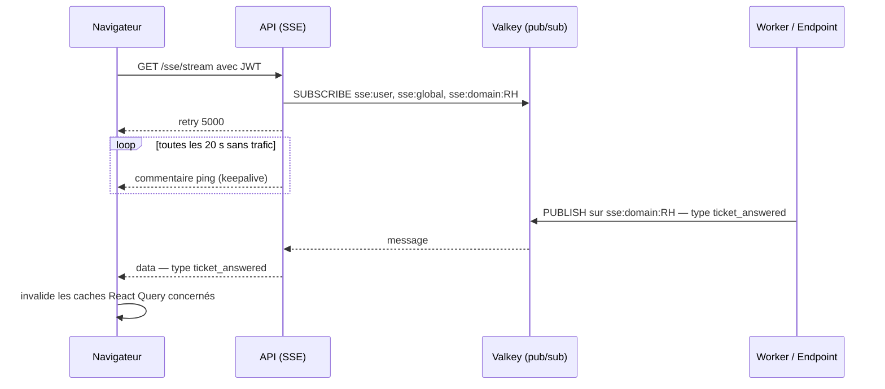

# Notifications et temps réel

TicketAI ne se rafraîchit pas à la main. Quand une réponse est validée, quand un ticket
est verrouillé, quand une bannière change, l'écran de tous les utilisateurs concernés se
met à jour en quelques dizaines de millisecondes.

Deux mécanismes distincts, souvent confondus, coexistent :

| | **Notifications** | **Flux temps réel (SSE)** |
|---|---|---|
| Nature | Un message **persistant** en base | Un signal **éphémère** |
| Destinataire | Un utilisateur précis | Tous les abonnés d'un canal |
| Survit à la déconnexion | oui | non — l'événement est perdu |
| Visible où | La cloche 🔔 de la barre de navigation | Nulle part : il rafraîchit les données |

En clair : la **notification** dit *« votre réponse a été validée »*. Le **flux SSE** dit
*« recharge la liste des tickets »*.

---

## 1. Les notifications

### Pourquoi on fait ça

Permettre à un employé d'être informé qu'une réponse à sa question est disponible, ou
qu'elle a été rejetée, sans avoir à surveiller l'écran en permanence. La notification
persiste dans la base — elle est toujours là même si l'employé était déconnecté au moment
où le verdict a été rendu.

### Comment ça fonctionne

Une pastille rouge sur la cloche 🔔 en haut à droite indique le nombre de notifications
non lues. Cliquez la cloche pour les voir apparaître dans un menu déroulant : chaque ligne
montre l'objet du ticket concerné.

- Cliquez une notification pour ouvrir le ticket directement.
- Cliquez la coche à côté d'une notification pour la marquer comme lue.
- Le bouton **Tout marquer comme lu** vide le compteur d'un coup.

Les notifications lues disparaissent du compteur mais le ticket reste accessible dans
l'historique.

> 📸 **[CAPTURE D'ÉCRAN REQUISE]** : *La cloche de notification ouverte dans la barre de navigation, avec 3 ou 4 notifications non lues affichant l'objet du ticket, et le bouton « Tout marquer comme lu » visible. Montrer aussi la pastille de compteur sur l'icône.*

### Détails techniques

**Quand une notification est créée :**

| Type | Déclencheur |
|---|---|
| `REPONSE_VALIDEE` | Un validateur a validé **ou corrigé** la réponse |
| `REPONSE_REJETEE` | Un validateur a rejeté la réponse |

Une notification est aussi créée par le pipeline lorsqu'une réponse est produite.
Pas d'auto-notification : si le validateur est lui-même le propriétaire du ticket, aucune
notification n'est créée.

Endpoints :

| Action | Endpoint | Comportement |
|---|---|---|
| Lister | `GET /notifications` | **Uniquement les non lues**, les 50 plus récentes d'abord |
| Marquer une notification lue | `POST /notifications/{id}/lire` | Idempotent. `404` si elle ne vous appartient pas |
| Tout marquer lu | `POST /notifications/tout-lire` | Vide la cloche d'un coup |

`GET /notifications` filtre sur `read_at IS NULL`. Une notification lue disparaît
définitivement de l'API — il n'y a pas d'historique des notifications consultables.
Les notifications sont supprimées en cascade si le ticket, la réponse ou l'utilisateur
associé est supprimé.

---

## 2. Le flux temps réel (SSE)

### Pourquoi on fait ça

Maintenir tous les écrans à jour sans que personne n'ait à appuyer sur « rafraîchir ».
Quand un ticket arrive dans la file d'un validateur, quand un collègue prend un verrou,
quand une bannière change, tous les onglets concernés se rerechargent seuls — la
collaboration en temps réel devient naturelle.

### Comment ça fonctionne

Ce mécanisme est **invisible pour les utilisateurs** : il n'y a rien à cliquer, rien à
activer. Les effets se voient dans les mises à jour automatiques — la liste de tickets
qui se recharge, les cadenas qui apparaissent, les compteurs qui changent.

À la connexion, le navigateur ouvre une connexion avec le serveur et reste en écoute.
Chaque fois qu'un événement se produit (nouveau ticket, verdict rendu, etc.), le serveur
envoie un signal discret qui dit au navigateur quelles données recharger. Si la connexion
est coupée (réseau instable, onglet en veille), elle se rétablit automatiquement avec un
délai croissant, et les données sont rechargées en bloc pour rattraper ce qui a été manqué.

**Un effet secondaire important** : quand vous fermez un onglet ou vous déconnectez, tous
les verrous que vous déteniez sur des tickets sont relâchés automatiquement.

### Détails techniques

Le serveur utilise **Server-Sent Events (SSE)** sur `GET /api/v1/sse/stream`. Derrière, un
`pub/sub` Valkey (Redis-compatible).



**Les canaux :**

| Canal | Contenu |
|---|---|
| `sse:user:{id}` | Événements privés : notification, réponse à *votre* ticket |
| `sse:domain:{domaine}` | Événements du domaine : tickets, verrous, assignations |
| `sse:global` | Événements système : bannière |
| `sse:admin` | Événements d'administration : groupes, réponses enregistrées |

**Abonnements par profil :**

| Profil | Abonnements |
|---|---|
| **Employé** (sans groupe) | `sse:user:{id}` + `sse:global` |
| **Validateur** (avec groupes) | idem + un `sse:domain:{d}` par domaine de ses groupes |
| **Admin avec groupes** | idem + `sse:admin` |
| **Admin sans groupe** | `sse:user` + `sse:global` + `sse:admin` + **`sse:domain:*`** (motif — tous les domaines) |

**Robustesse :**

| Mécanisme | Détail |
|---|---|
| **Keepalive** | Un commentaire `:ping` toutes les 20 s sans trafic |
| **Reconnexion** | `retry: 5000` côté serveur ; côté client, une relance avec délai croissant à partir de 1 s |
| **Rattrapage** | À la reconnexion, le client invalide en bloc `tickets`, `ticket`, `mes-tickets`, `mes-assignations`, `notifications`, `user-dash` |
| **Libération des verrous** | À la fermeture du flux, **tous les verrous détenus par cet utilisateur sont relâchés** |

Le `pub/sub` Redis ne conserve rien : les événements émis pendant une coupure réseau sont
**définitivement perdus**. Le client repart d'un état propre en rechargeant les données.

---

## 3. Catalogue des événements

Chaque événement porte un `type` et un `payload`. Voici ce que chacun déclenche côté
interface.

### Tickets

| Événement | Émis quand | Effet |
|---|---|---|
| `ticket_created` | Un ticket est créé | Recharge la file et le tableau de bord utilisateur |
| `ticket_followup` | L'employé relance le fil | Recharge la file et le ticket |
| `ticket_answered` | Le pipeline a produit une réponse | Recharge la file, « mes tickets », le tableau de bord et le ticket |
| `ticket_locked` / `ticket_unlocked` | Verrou pris ou relâché | Met à jour les cadenas |
| `ticket_assigned` / `ticket_unassigned` | Changement d'assignation | Recharge la file et « mes assignations » |
| `ticket_rerouted` | Ticket réacheminé vers un autre domaine | Recharge la file, « mes assignations », le détail du ticket et sa timeline. Émis sur les deux domaines (ancien et nouveau) **et** sur `sse:user:{id}` si le ticket a un propriétaire |
| `ticket_closed` | Clôture manuelle **ou** automatique | Recharge la file et les compteurs |

### Réponses

| Événement | Émis quand | Effet |
|---|---|---|
| `reponse_validated` | Validation | Recharge le ticket, le tableau de bord, les canoniques |
| `reponse_corrected` | Correction | idem |
| `reponse_rejected` | Rejet | idem |
| `saved_answers_updated` | Retrait, restauration, suppression, confirmation | Recharge les trois onglets Canoniques / Obsolètes / À relire |

### Documents

| Événement | Émis quand | Effet |
|---|---|---|
| `document_updated` | Fin du job de mise à jour | Recharge documents, canoniques, obsolètes, à relire, versions du document |
| `reverification_started` | Les réponses passent en « analyse en cours » | Recharge l'onglet À relire |
| `reverification_done` | Le verdict est rendu | Recharge les trois onglets |
| `job_completed` | Fin d'un job suivi | Met à jour le suivi de tâche |

### Système

| Événement | Émis quand | Effet |
|---|---|---|
| `notification_created` | Une notification est écrite | Recharge la cloche, « mes assignations », « mes tickets » |
| `banner_updated` | Un admin modifie la bannière | Recharge la configuration du site |
| `group_updated` | Un groupe ou un membre change | Recharge les écrans d'administration |

---

## 4. Pour les développeurs

### Émettre un événement

Deux fonctions dans `app/services/broadcast.py` :

```python
# Depuis un worker Celery (code synchrone)
broadcast_sync(f"sse:domain:{domaine}", "ticket_answered", {"ticket_id": str(tid)})

# Depuis un endpoint FastAPI (code asynchrone)
await broadcast_async(f"sse:user:{user_id}", "notification_created", {"ticket_id": tid})
```

Les deux **avalent leurs exceptions** et se contentent d'écrire un log. C'est délibéré :
une panne de Valkey ne doit jamais faire échouer une validation.

### Ajouter un nouvel événement

1. Publier depuis le backend avec un `type` explicite.
2. Ajouter un `case` dans `handleEvent` (`frontend/src/hooks/useSSE.ts`) et invalider les
   clés React Query concernées.

Un événement inconnu du client tombe dans le `default` et est ignoré silencieusement —
déployer le backend avant le frontend ne casse rien.

### Pièges connus

- **Ne mettez pas d'état métier dans le `payload`.** Le client doit toujours recharger
  depuis l'API. Un événement manqué ne doit jamais laisser l'interface dans un état faux.
- **Le canal `sse:admin` n'est reçu que par les admins.** Un événement qui doit atteindre
  les validateurs doit passer par `sse:domain:{domaine}`.
- **La fermeture du flux relâche les verrous.** Si vous fermez le flux SSE pour une raison
  quelconque, vous relâchez aussi les verrous de l'utilisateur.
