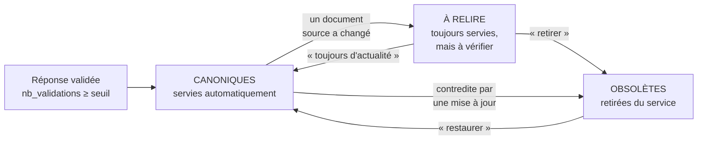

# Réponses enregistrées

Page `/reponses-enregistrees`. C'est la **base de réponses** de TicketAI : ce que le
système a appris des validations humaines et qu'il réutilisera.

La page de [traitement des tickets](backoffice-tickets.md) regarde vers l'avant (que
répondre à cette question ?). Celle-ci regarde vers l'arrière : *qu'est-ce que le système
sait déjà, et est-ce toujours vrai ?*

**Qui a accès ?** Les membres du backoffice, restreints à leurs domaines.

---

## 1. Les trois onglets



| Onglet | Ce qu'il contient | Ces réponses sont-elles servies ? |
|---|---|---|
| **Canoniques** | Les réponses promues, réutilisables sans revue humaine | **Oui**, automatiquement |
| **À relire** | Un document source a changé, la machine n'a pas su trancher | **Oui**, toujours — c'est une file de relecture, pas un retrait |
| **Obsolètes** | Réponses retirées du service | **Non**, retirées de Qdrant |

La distinction *À relire* / *Obsolète* est la plus importante de cette page : **un
signalement « à relire » ne retire rien**. La réponse continue d'être servie aux
employés. Le drapeau demande une relecture, il ne suspend pas le service.


Chaque ligne porte le nombre de **validations** accumulées et, à droite, le compteur
d'**occurrences** (`3×` = la question a été posée trois fois). Les onglets affichent leur
propre compteur — ici 1 réponse à relire et 1 obsolète.

---

## 2. L'onglet Canoniques

`GET /reponses/canoniques`

### Ce qui est listé

Uniquement les **réponses sources** : celles dont `reponse_source_id` est vide, non
obsolètes, avec `canonique = true`. Les copies SUGGESTION créées au fil des tickets ne
sont pas listées — elles pointent toutes vers la même source, et c'est la source qui
porte le compteur `nb_validations`.

Chaque ligne affiche :

| Champ | Signification |
|---|---|
| `question` | La question de suivi si c'en est une, sinon la question du ticket |
| `contenu` / `contenu_corrige` | Le texte servi est **`contenu_corrige` s'il existe**, sinon `contenu` |
| `nb_validations` | Combien de fois des humains ont validé cette réponse |
| `occurence` | Combien de fois la question a été reposée |
| `a_relire` | Si un signalement est en cours sur cette réponse |

Tri par date de validation décroissante. Recherche (`q`) sur la question du ticket et sur
la question de suivi. Pagination classique.

### Filtres

La barre de filtres apparaît uniquement sur l'onglet Canoniques (les deux autres onglets
n'ont pas de tags).

**Domaine** — visible seulement si l'utilisateur appartient à plusieurs domaines. Permet
de restreindre la liste à un domaine précis ; changer de domaine réinitialise le filtre
tag.

**Tag** — combobox déroulant alimenté par `GET /tags?canoniques=true&domaine=<d>`.
N'affiche que les tags effectivement utilisés sur des réponses canoniques non obsolètes du
domaine sélectionné. La liste est fraîche à chaque ouverture de l'onglet (pas de cache
côté client) et se met à jour en temps réel via SSE lorsqu'une réponse est validée,
corrigée, rejetée ou modifiée.

Au-delà de 5 tags disponibles, un champ de recherche apparaît en tête de liste. La
sélection d'un tag filtre la liste et affiche un bouton ✕ pour effacer le filtre sans
rouvrir le combobox. Sélectionner le tag déjà actif le désélectionne.

### Tags — génération automatique

Chaque réponse reçoit un **tag thématique** au moment où la question est traitée par le
pipeline, avant toute validation humaine. Le tag est produit par un appel LLM distinct
(`GET /tags?canoniques=true` → `suggerer_tag`) :

```
Question + contenu de la réponse (800 premiers caractères)
    + liste des tags déjà utilisés dans le domaine
  ──────────────────────────────────────────────────
  → tag : 1 à 3 mots, lettres et espaces uniquement
```

Le modèle reçoit deux consignes complémentaires :

1. **Nommer la catégorie thématique, pas l'objet précis de la question** — exemples
   contrastés fournis dans le prompt (`"perte carte Swile"` → `"ticket restaurant"`, pas
   `"Carte Swile"`).
2. **Réutiliser un tag existant s'il convient** — la liste des tags déjà en production
   pour ce domaine est injectée dans le contexte. Le modèle en crée un nouveau uniquement
   si aucun existant ne couvre le thème.

Ce mécanisme converge progressivement : les premiers tickets créent le vocabulaire, les
suivants le consolident. Il n'y a pas de liste fermée imposée a priori — un thème nouveau
produit un tag nouveau.

Le tag est nettoyé après génération : les caractères spéciaux (`"`, `'`, `-`, `/`…) sont
remplacés par des espaces, les espaces multiples normalisés, la longueur plafonnée à 100
caractères. Si l'appel LLM échoue, `tag = null` et la réponse reste non taguée.

Le tag peut être modifié manuellement depuis le backoffice via `PATCH /reponses/{id}/tag`.

### Les actions

| Action | Endpoint | Effet |
|---|---|---|
| **Éditer** | `PUT /reponses/{id}/editer` | Réécrit `contenu_corrige`, puis **réindexe** la réponse. Si elle était *à relire*, le drapeau tombe |
| **Supprimer** | `DELETE /reponses/{id}` | Suppression **définitive**, avec toutes ses copies |

L'édition ne touche jamais `contenu` : le texte d'origine produit par l'IA reste en base.
C'est `contenu_corrige` qui est servi et réindexé.

> **La suppression est irréversible** et emporte toute la *famille* de la réponse (la
> source et ses copies SUGGESTION). Les copies encore `EN_ATTENTE` sont remises dans le
> pipeline RAG pour qu'aucun ticket ne reste sans réponse. Pour un retrait réversible,
> utilisez « retirer » depuis l'onglet À relire.

---

## 3. L'onglet À relire

`GET /reponses/a-relire`

### D'où viennent ces signalements

Quand un document est remplacé par une nouvelle version, le système compare les deux
versions et cherche quelles réponses validées pourraient ne plus tenir. Le détail complet
de ce raisonnement est dans
[Mettre à jour un document](../technique/mise-a-jour-documents.md).

Une réponse atterrit ici quand la machine **n'a pas pu conclure seule** :

| Raison | Ce qui s'est passé |
|---|---|
| `CONTREDITE_PROBABLE` | La réponse ne cite pas le document, mais son sujet est proche d'un passage modifié |
| `INCERTAIN` | Le juge LLM a hésité |
| Panne Albert | L'API n'a pas répondu |
| Budget épuisé | Trop d'appels nécessaires, ou plus de 40 unités de changement |

Le point commun : **aucune de ces situations ne justifie de retirer la réponse**. Un
humain doit regarder.

### Ce que la ligne affiche

L'API joint le document et la version concernés, ce qui permet à l'interface de montrer le
diff AVANT/APRÈS du passage qui a déclenché le signalement, la justification du juge
(`analyse_justification`) et les extraits retenus.

Les réponses sont groupées par document (`nb_documents` donne le nombre de documents
concernés), pour qu'un validateur puisse traiter une mise à jour d'un bloc.


Le bandeau rappelle l'essentiel : *« 1 document mis à jour — 1 réponse concernée à
vérifier (servies en l'état jusqu'à décision humaine) »*. Les réponses sont regroupées
sous le document qui les a déclenchées, avec un bouton **Tout confirmer** pour traiter le
lot. Sous chaque réponse figure la justification du juge, puis les trois issues :
**Toujours d'actualité**, **Modifier**, **Retirer**.

### Les trois issues

| Action | Endpoint | Effet |
|---|---|---|
| **Toujours d'actualité** | `POST /reponses/{id}/confirmer-actualite` | Le drapeau tombe, la réponse retourne dans Canoniques |
| **Confirmer tout le lot** | `POST /reponses/confirmer-actualite` | Lève le drapeau sur **toutes** les réponses signalées par une version de document |
| **Retirer** | `POST /reponses/{id}/retirer` | La réponse passe en Obsolètes et sort de Qdrant |
| **Corriger** | `PUT /reponses/{id}/editer` | Réécrit le contenu **et** lève le drapeau en une seule opération |

La confirmation en lot est restreinte aux domaines de l'appelant : les réponses des autres
domaines signalées par le même document ne sont pas touchées.

Toutes ces actions opèrent sur la **famille** de la réponse (source + copies), jamais sur
une seule ligne — sinon une copie resterait indexée avec un contenu périmé.

---

## 4. L'onglet Obsolètes

`GET /reponses/obsoletes`

Les réponses retirées du service. Elles ne sont plus dans Qdrant et ne seront plus jamais
resservies, mais **elles restent visibles sur les tickets des employés** : la réponse a
bien été donnée à l'époque, et la retirer de l'historique réécrirait le passé.

C'est pourquoi l'obsolescence est un **drapeau** (`obsolete = true`) et non une valeur de
`statut`. Le statut reste `VALIDÉE` ou `CORRIGÉE`.

Chaque ligne indique :

| Champ | Signification |
|---|---|
| `obsolete_raison` | `CONTREDITE_PAR_MAJ`, `DOC_SUPPRIMÉ`, retrait manuel… |
| `obsolete_version` | La version du document qui a déclenché le retrait |
| `document_filename` | Le document en cause |
| `document_supprime` | `true` si le document lui-même n'existe plus |
| `analyse_justification` | L'explication du juge LLM |

### Restaurer

`POST /reponses/{id}/restaurer` remet la réponse en service : les drapeaux `obsolete`
**et** `a_relire` sont effacés sur toute la famille, et chaque réponse concernée est
réindexée dans Qdrant.

C'est le filet de sécurité du pipeline de mise à jour documentaire : si la machine a
retiré une réponse à tort, un humain la remet en circulation en un clic.


La ligne porte le motif (`contredite`), le nombre de validations conservées, le document
en cause **avec sa version**, et la justification du juge. Le bandeau résume la règle :
*« Ces réponses ne sont plus servies. Leurs validations sont conservées — les restaurer
les remet en service telles quelles. »*

---

## 5. Récapitulatif des actions

| Action | Depuis | Réversible ? | Réindexe ? |
|---|---|---|---|
| Éditer | Canoniques, À relire | oui (rééditer) | oui |
| Confirmer l'actualité | À relire | oui (nouveau signalement possible) | non |
| Confirmer en lot | À relire | oui | non |
| Retirer | À relire | **oui** — via Restaurer | retire de Qdrant |
| Restaurer | Obsolètes | oui (re-retirer) | oui |
| Supprimer | Canoniques, Obsolètes | **non** | supprime de Qdrant |

Toutes exigent d'être **membre du domaine** du ticket d'origine — sans exception pour
l'administrateur.

---

## 6. Pour aller plus loin

- Comment une réponse devient canonique : [Cycle de vie et labels](labels-et-categories.md)
- Comment les signalements sont produits : [Mettre à jour un document](../technique/mise-a-jour-documents.md)
- Comment une réponse canonique est resservie : [Garde du cache canonique](../technique/garde-cache-canonique.md)
