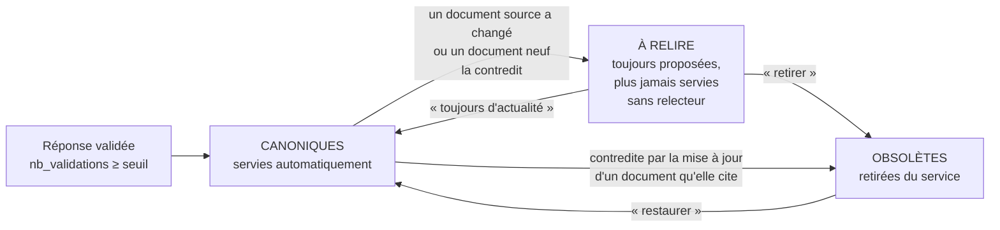
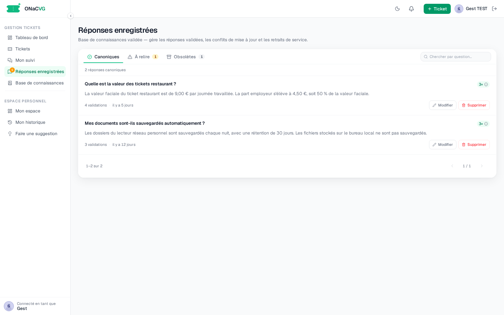
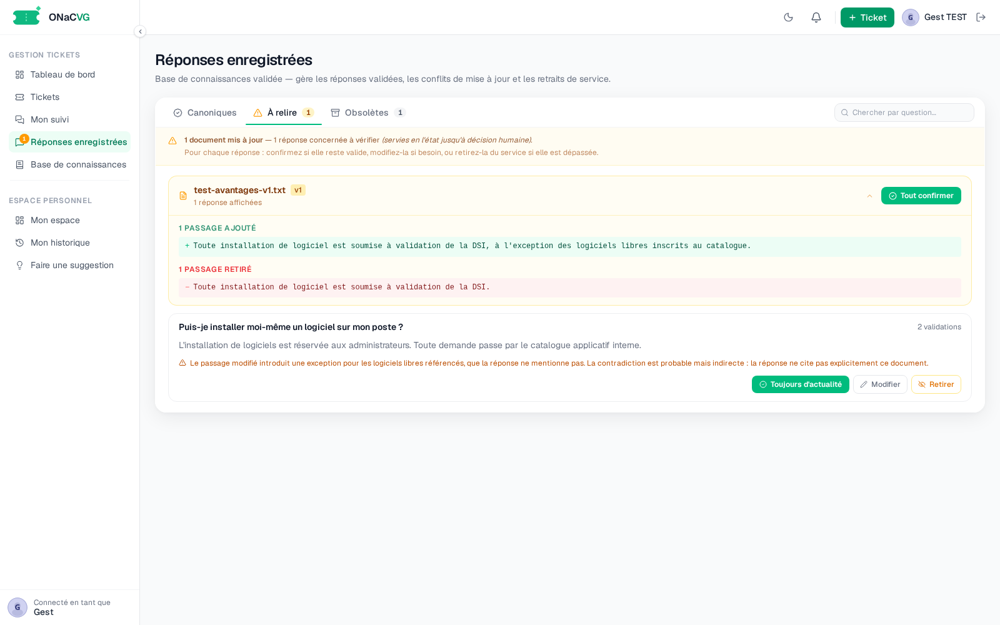
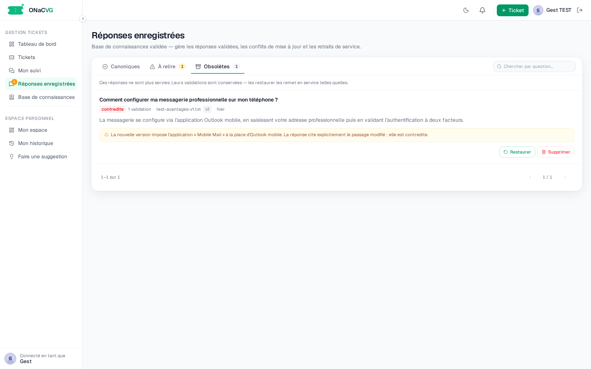

# Réponses enregistrées

Page `/reponses-enregistrees`. C'est la **base de réponses** de TicketAI : ce que le
système a appris des validations humaines et qu'il réutilisera.

La page de [traitement des tickets](backoffice-tickets.md) regarde vers l'avant (que
répondre à cette question ?). Celle-ci regarde vers l'arrière : *qu'est-ce que le système
sait déjà, et est-ce toujours vrai ?*

**Qui a accès ?** Les membres du backoffice, restreints à leurs domaines.

---

## 1. Les trois onglets

### Pourquoi on fait ça

Centraliser toute la mémoire accumulée du système en un seul endroit, avec une séparation
claire entre ce qui est sûr de servir (*Canoniques*), ce qui est suspect (*À relire*), et
ce qui a été retiré (*Obsolètes*). Sans ce tableau de bord, il serait impossible de savoir
ce que le système sert en ce moment ni d'intervenir dessus.

### Comment ça fonctionne

| Onglet | Ce qu'il contient | Ces réponses sont-elles servies ? |
|---|---|---|
| **Canoniques** | Les réponses promues, réutilisables sans revue humaine | **Oui**, automatiquement — si le garde LLM juge que la question posée demande bien la même chose |
| **À relire** | Un document source a changé, **ou un document neuf vient les contredire**, et la machine n'a pas su trancher | **Plus sans relecteur.** Elles restent *proposées*, en SUGGESTION, et disparaissent de *Questions fréquentes* tant que le drapeau tient |
| **Obsolètes** | Réponses retirées du service | **Non**, retirées de Qdrant |

### Détails techniques

La distinction *À relire* / *Obsolète* est fondamentale et elle n'est **pas** « servie »
contre « retirée » — c'est **servie sans revue** contre **détruite**.

Un signalement « à relire » **ne retire rien et ne supprime rien** : la réponse reste
proposée aux relecteurs, son compteur `nb_validations` est intact, et elle s'amende en un
seul geste (« Modifier »). Ce qu'elle perd, c'est le privilège de la branche CANONIQUE
et la page *Questions fréquentes*, qui n'a aucun relecteur pour rattraper une erreur. Elle
retrouve les deux dès que le drapeau est levé.

> Pourquoi pas « on la laisse servir » : le système vient de soupçonner qu'un document la
> contredit, et l'invariant du produit est de **ne jamais servir une réponse fausse**, même
> au prix de travail supplémentaire pour les validateurs.
>
> Pourquoi pas non plus « on la détruit » : le lien n'est qu'une proximité vectorielle entre
> un paragraphe et une question. Un `CONTREDITE` erroné retirerait en silence une bonne
> canonique, et la remettre en service coûterait trois revalidations pour un état final
> identique. **Suspendre coûte une relecture et ne détruit rien.**

Chaque ligne porte le nombre de **validations** accumulées et, à droite, le compteur
d'**occurrences** (`3×` = la question a été posée trois fois). Les onglets affichent leur
propre compteur — ici 1 réponse à relire et 1 obsolète.

---

## 2. L'onglet Canoniques

### Pourquoi on fait ça

Piloter ce que le système sert automatiquement : corriger une réponse devenue inexacte,
la retirer, gérer sa visibilité dans la FAQ publique, ou s'assurer que les tags sont
cohérents pour que la recherche reste utilisable.

### Comment ça fonctionne

L'onglet liste toutes les réponses canoniques du domaine. Vous pouvez les filtrer par
domaine (si vous en gérez plusieurs), par tag thématique, et par recherche textuelle.

Le sélecteur de tri en haut à droite offre deux ordres :

| Ordre | Comportement |
|---|---|
| **Date** (défaut) | Date de dernière validation, décroissante |
| **Fois servie** | Nombre d'occurrences, décroissant — met en tête les réponses les plus sollicitées |

Sur chaque ligne, un badge **FAQ** indique si la réponse apparaît dans la page *Questions
fréquentes*. Cliquer sur ce badge bascule la visibilité immédiatement, sans confirmation.

Les trois actions disponibles sur une réponse canonique :

| Action | Ce qu'elle fait |
|---|---|
| **Éditer** | Réécrire le contenu de la réponse et la réindexer |
| **Badge FAQ** | Inclure ou retirer la réponse de la page FAQ publique |
| **Supprimer** | Suppression définitive et irréversible de toute la famille |

### Détails techniques

Endpoint : `GET /reponses/canoniques`.
Seules les **réponses sources** sont listées : celles dont `reponse_source_id` est vide,
non obsolètes, avec `canonique = true`. Les copies SUGGESTION pointent toutes vers leur
source, qui porte le compteur `nb_validations`.

Champs affichés :

| Champ | Signification |
|---|---|
| `question` | La question de suivi si c'en est une, sinon la question du ticket |
| `contenu` / `contenu_corrige` | Le texte servi est **`contenu_corrige` s'il existe**, sinon `contenu` |
| `nb_validations` | Combien de fois des humains ont validé cette réponse |
| `occurence` | Combien de fois la question a été reposée automatiquement |
| `faq_visible` | Si la réponse apparaît dans la page FAQ (badge **FAQ** cliquable) |
| `a_relire` | Si un signalement est en cours sur cette réponse |

Actions et endpoints :

| Action | Endpoint | Effet |
|---|---|---|
| **Badge FAQ** | `PATCH /reponses/{id}/faq-visible` | Bascule `faq_visible` |
| **Éditer** | `PUT /reponses/{id}/editer` | Réécrit `contenu_corrige`, réindexe. Si la réponse était *à relire*, le drapeau tombe |
| **Supprimer** | `DELETE /reponses/{id}` | Suppression **définitive**, avec toutes ses copies. Les copies `EN_ATTENTE` sont remises dans le pipeline RAG |

**Tags — filtres et génération automatique**

Les tags sont le seul mécanisme de filtrage thématique de cette page. Chaque réponse en
reçoit un automatiquement au moment du traitement (`GET /tags?canoniques=true` →
`suggerer_tag`) : le modèle reçoit la question, le contenu et les tags déjà utilisés dans
le domaine. Il choisit le thème large (`"ticket restaurant"`, pas `"carte Swile"`) et
réutilise un tag existant si possible.

Le tag peut être modifié manuellement via `PATCH /reponses/{id}/tag`. La liste de
complétion dans le formulaire de validation est fraîche à chaque ouverture (pas de cache
côté client) et se met à jour en temps réel via SSE.

---

## 3. L'onglet À relire

### Pourquoi on fait ça

Regrouper les réponses que la machine suspecte d'être devenues inexactes ou incomplètes,
pour qu'un humain tranche. Ce n'est pas un retrait définitif — c'est une mise en suspens
qui préserve tout le travail accumulé, le temps d'une relecture.

### Comment ça fonctionne

Deux événements déclenchent un signalement :

1. **Un document est remplacé par une nouvelle version.** Le système compare les deux
   versions et cherche quelles réponses validées pourraient ne plus tenir.
2. **Un document neuf est importé.** Il n'y a alors aucun diff à comparer, mais le
   nouveau texte peut parfaitement contredire une réponse déjà servie — typiquement quand
   il *précise* une règle générale (« le télétravail est possible trois jours par semaine »
   ← « les alternants n'y ont pas droit »).

Les réponses sont groupées par document pour pouvoir traiter une mise à jour d'un bloc.
Un bandeau résume la situation : *« 1 document concerné — 1 réponse à vérifier (plus
servies sans relecture jusqu'à votre décision) »*.

**Les trois issues disponibles :**

| Action | Ce qu'elle fait |
|---|---|
| **Toujours d'actualité** | Le drapeau tombe, la réponse retourne dans Canoniques |
| **Confirmer tout le lot** | Lève le drapeau sur toutes les réponses signalées par une même version de document |
| **Modifier** | Réécrit le contenu **et** lève le drapeau en une seule opération — à préférer à « Retirer » quand le fond reste juste mais incomplet |
| **Retirer** | La réponse passe en Obsolètes et sort de Qdrant |

**Le cas le plus fréquent : un document précise une règle déjà couverte**

1. La réponse générale est signalée et quitte Canoniques (mais reste proposée en SUGGESTION).
2. Préférez **Modifier** à **Retirer** : le document neuf ne rend généralement pas la
   réponse fausse — il ajoute un cas qu'elle passe sous silence.
3. La question spécifique ne reçoit plus la réponse générale : le garde refuse la
   réutilisation, et la question repart dans le pipeline RAG.
4. La réponse spécifique se crée d'elle-même via trois validations ordinaires.
5. Les deux coexistent alors, chacune servant sa propre question.

> La capture ci-dessus est antérieure au 18/09/2026 et porte encore l'ancien libellé.
> À reprendre à la prochaine campagne de captures (`scripts/captures_doc.py`).

### Détails techniques

Endpoint : `GET /reponses/a-relire`.

Raisons possibles de signalement :

| Raison | Ce qui s'est passé |
|---|---|
| `CONTREDITE_PROBABLE` | Réponse non citante dont le sujet est proche d'un passage modifié ou d'un document neuf |
| `DOC_MODIFIÉ` | Le juge LLM a hésité sur une mise à jour de document |
| `NOUVEAU_DOC` | Le juge LLM a hésité face à un document **neuf** — pas de diff à afficher |
| Panne Albert | L'API n'a pas répondu |
| Budget épuisé | Trop d'appels nécessaires, ou plus de 40 unités de changement |

Endpoints des actions :

| Action | Endpoint |
|---|---|
| Confirmer (une) | `POST /reponses/{id}/confirmer-actualite` |
| Confirmer (lot) | `POST /reponses/confirmer-actualite` |
| Retirer | `POST /reponses/{id}/retirer` |
| Modifier | `PUT /reponses/{id}/editer` |

Toutes ces actions opèrent sur la **famille** de la réponse (source + copies), jamais sur
une seule ligne — sinon une copie resterait indexée avec un contenu périmé. La confirmation
en lot est restreinte aux domaines de l'appelant.

---

## 4. L'onglet Obsolètes

### Pourquoi on fait ça

Conserver une trace de ce qui a existé sans pour autant le servir, et offrir un filet
de sécurité si la machine a retiré une réponse à tort. L'historique des tickets reste
intact — l'employé qui a reçu cette réponse peut toujours la relire.

### Comment ça fonctionne

L'onglet liste toutes les réponses retirées du service. Sur chaque ligne, vous voyez la
raison du retrait, le document en cause, et la justification éventuelle du juge LLM.

Un seul geste possible : **Restaurer**. La réponse revient dans Canoniques, réindexée
dans Qdrant, prête à être resservie. C'est le filet de sécurité du pipeline de mise à
jour documentaire : si la machine a retiré une réponse à tort, un humain la remet en
circulation en un clic.

La ligne porte le motif (`contredite`), le nombre de validations conservées, le document
en cause **avec sa version**, et la justification du juge. Le bandeau résume la règle :
*« Ces réponses ne sont plus servies. Leurs validations sont conservées — les restaurer
les remet en service telles quelles. »*

### Détails techniques

Endpoint : `GET /reponses/obsoletes`.
L'obsolescence est un **drapeau** (`obsolete = true`), pas un statut : le statut reste
`VALIDÉE` ou `CORRIGÉE`. C'est pourquoi les réponses obsolètes restent visibles sur les
tickets des employés — la réponse a bien été donnée à l'époque.

Champs affichés :

| Champ | Signification |
|---|---|
| `obsolete_raison` | `CONTREDITE_PAR_MAJ`, `DOC_SUPPRIMÉ`, retrait manuel… |
| `obsolete_version` | La version du document qui a déclenché le retrait |
| `document_filename` | Le document en cause |
| `document_supprime` | `true` si le document lui-même n'existe plus |
| `analyse_justification` | L'explication du juge LLM |

Restauration : `POST /reponses/{id}/restaurer` — efface les drapeaux `obsolete` **et**
`a_relire` sur toute la famille, et réindexe dans Qdrant.

---

## 5. Récapitulatif des actions

| Action | Depuis | Réversible ? | Réindexe ? |
|---|---|---|---|
| Éditer | Canoniques, À relire | oui (rééditer) | oui |
| Confirmer l'actualité | À relire | oui (nouveau signalement possible) | non |
| Confirmer en lot | À relire | oui | non |
| Retirer | À relire | **oui** — via Restaurer | retire de Qdrant |
| Restaurer | Obsolètes | oui (re-retirer) | oui |
| Supprimer | Canoniques, Obsolètes | **non** | supprime de Qdrant |

Toutes exigent d'être **membre du domaine** du ticket d'origine — sans exception pour
l'administrateur.

---

## 6. Pour aller plus loin

- Comment une réponse devient canonique : [Cycle de vie et labels](labels-et-categories.md)
- Comment les signalements sont produits : [Mettre à jour un document](../technique/mise-a-jour-documents.md)
- Comment une réponse canonique est resservie : [Garde du cache canonique](../technique/garde-cache-canonique.md)
