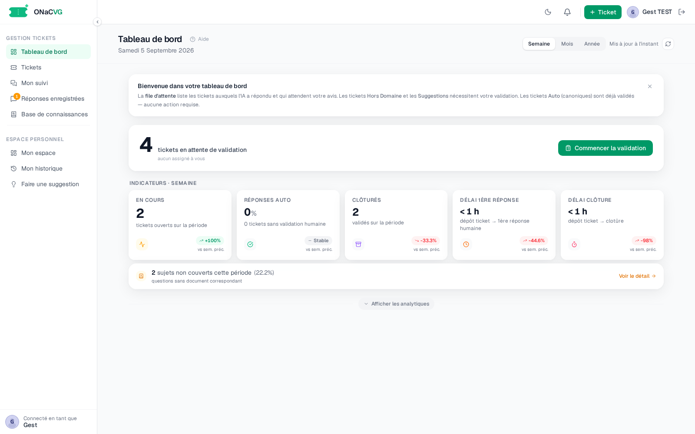

# Statistiques et pilotage

TicketAI expose trois vues chiffrées, destinées à trois publics différents :

| Vue | Page | Public | Question à laquelle elle répond |
|---|---|---|---|
| **Tableau de bord** | `/` | Validateurs | *Où en est mon domaine ?* |
| **Statistiques d'équipe** | `/mon-suivi` → stats du groupe | Chefs de groupe, admins | *Qui fait quoi dans mon équipe ?* |
| **Vue globale** | `/admin/dashboard` | Admins | *Comment se porte la plateforme ?* |

---

## 1. Le périmètre : ce que chacun voit

C'est le point à comprendre en premier, car il conditionne l'interprétation de tous les
chiffres.

| Profil | Périmètre des statistiques |
|---|---|
| **Validateur** | Uniquement les domaines de ses groupes |
| **Admin avec groupes** | Uniquement les domaines de ses groupes |
| **Admin sans groupe** | Tous les domaines |

Un filtre `domaine` peut restreindre davantage, mais **jamais élargir** : il est toujours
intersecté avec les domaines autorisés.

> Deux validateurs de domaines différents regardant « le » tableau de bord ne voient donc
> pas les mêmes chiffres. C'est voulu — les totaux sont locaux à un domaine.

---

## 2. Les périodes et la comparaison

Toutes les vues acceptent une période : `semaine`, `mois` ou `annee`.

| Période | Début | Comparée à |
|---|---|---|
| `semaine` | Lundi de la semaine en cours | La semaine précédente |
| `mois` | 1ᵉʳ du mois en cours | Le mois précédent |
| `annee` | 1ᵉʳ janvier | L'année précédente |

Chaque carte affiche donc une valeur **et** sa variation par rapport à la période
équivalente précédente. Les bornes sont calculées en UTC.

> **Attention aux périodes en cours.** Le mardi matin, la « semaine » ne compte que deux
> jours, tandis que la semaine précédente en compte sept. Une baisse affichée en début de
> période n'est pas nécessairement une baisse réelle.

---

## 3. Le tableau de bord du validateur

`GET /stats/dashboard`, période par défaut : `semaine`.

### Les six cartes

| Carte | Ce qu'elle compte |
|---|---|
| **Nouveaux** | Tickets créés sans réponse validée |
| **En cours** | Tickets en cours de traitement |
| **Tickets clôturés** | Tickets fermés sur la période |
| **Répondu canonique** | **Un taux** : part des tickets traités automatiquement, sans intervention humaine |
| **Temps de première réponse** | Délai moyen entre création et première réponse |
| **Temps de clôture** | Délai moyen entre création et clôture |

La carte **Répondu canonique** est l'indicateur de valeur du produit : c'est la proportion
de questions auxquelles personne n'a eu à répondre. Elle monte à mesure que la base de
réponses validées s'enrichit.

### La répartition par branche

Un anneau montre comment se répartissent les tickets entre les quatre issues possibles :

| Branche | Signification |
|---|---|
| `CANONIQUE` | Servie automatiquement, sans revue humaine |
| `SUGGESTION` | Réponse validée réutilisée, mais revue humaine requise |
| `LLM` | Génération RAG complète, revue humaine requise |
| `HORS_DOMAINE` | L'IA n'a pas trouvé l'information dans le corpus |

C'est la lecture la plus instructive du tableau de bord :

- Beaucoup de `HORS_DOMAINE` ⇒ **le corpus a des trous.** Allez voir
  [les angles morts](base-de-connaissances.md#6-les-angles-morts).
- Beaucoup de `LLM` ⇒ les questions sont variées, ou la base de réponses est encore jeune.
- Beaucoup de `CANONIQUE` ⇒ le système fait son travail.

### Les autres blocs

| Bloc | Contenu |
|---|---|
| **Répartition des statuts** | Nouveau / En cours / Clôturé, en nombre et en pourcentage |
| **Tickets par jour** | Courbe d'activité (agrégée par mois quand la période est `annee`) |
| **Temps de traitement par jour** | Évolution des délais |
| **Derniers tickets** | Les 5 plus récents, avec la branche empruntée |
| **Satisfaction** | Moyennes des notes (voir ci-dessous) |

On y voit la file d'attente en tête (« 1 ticket en attente de validation »), puis les
indicateurs de la période avec leur variation. Les graphiques et la répartition par
branche se déplient via **Afficher les analytiques**.

> 📸 **[CAPTURE D'ÉCRAN COMPLÉMENTAIRE]** : *Le bloc « analytiques » déplié sur une instance chargée : anneau de répartition des branches, courbe des tickets par jour, carte satisfaction. L'instance de test n'a pas assez de volume pour que ces graphiques soient parlants.*

---

## 4. La satisfaction

Quand un employé clôture son ticket, il peut noter deux choses de 1 à 5 (voir
[Espace utilisateur](espace-utilisateur.md#4-clôturer-un-ticket-et-noter-la-réponse)) :

| Mesure | Champ |
|---|---|
| Moyenne de la qualité perçue | `avg_qualite` |
| Moyenne de la rapidité perçue | `avg_delai` |
| Nombre de tickets notés | `nb_avec_notes` |

Deux précisions indispensables pour lire ces chiffres :

- Les moyennes portent sur les tickets **clôturés dans la période**, pas créés dans la
  période.
- **La notation est facultative.** `nb_avec_notes` est donc souvent bien inférieur au
  nombre de tickets clôturés. Une moyenne de 4,8 sur 3 tickets ne dit pas grand-chose —
  regardez toujours l'effectif.

Quand aucun ticket n'a été noté, les moyennes valent `null` et l'interface affiche un état
vide plutôt qu'un zéro trompeur.

### Retrouver les insatisfaits

Le filtre `note_max` de `GET /tickets` renvoie les tickets dont la note qualité **ou** la
note délai est inférieure ou égale à la valeur donnée. C'est ce qui alimente la fenêtre
« tickets insatisfaits » du tableau de bord : un clic depuis la carte satisfaction ouvre
directement la liste des tickets mal notés.

> 📸 **[CAPTURE D'ÉCRAN REQUISE]** : *La carte « Satisfaction » du tableau de bord avec ses deux moyennes et l'effectif, puis la fenêtre modale « Tickets insatisfaits » ouverte listant les tickets mal notés avec leurs notes.*

---

## 5. Les statistiques par membre

`GET /stats/groupe/{groupe_id}/membres`

### Qui peut les consulter

| Profil | Accès |
|---|---|
| **Chef de groupe** (`is_chef = true`) | Les stats de **son** groupe |
| **Admin** | Les stats de **tous** les groupes |
| Membre simple | `403 Accès réservé au chef du groupe` |

C'est d'ailleurs la **seule** permission supplémentaire qu'apporte le statut de chef de
groupe.

### Ce qui est mesuré

Pour chaque membre du groupe, sur la période choisie : le nombre de réponses traitées (là
où le membre figure comme validateur) et sa contribution documentaire. Les chefs
apparaissent en tête de liste.

L'objectif est la répartition de charge, pas le classement individuel : voir qui croule
sous les tickets et qui peut en prendre.

> 📸 **[CAPTURE D'ÉCRAN REQUISE]** : *La page de statistiques d'équipe montrant le tableau des membres du groupe avec leurs compteurs, le chef identifié, et le sélecteur de période.*

---

## 6. La vue globale de l'administrateur

Page `/admin/dashboard`, réservée au rôle `ADMIN`.

Elle agrège la santé technique et l'activité fonctionnelle de toute la plateforme. Les
indicateurs de supervision (services, files Celery, quotas Albert, incidents) sont
détaillés dans [Administration](administration.md).

> 📸 **[CAPTURE D'ÉCRAN REQUISE]** : *La page « Vue globale » de l'administration (`/admin/dashboard`), montrant l'agrégation multi-domaines et les indicateurs de plateforme.*

---

## 7. Notes de lecture

Quelques pièges connus, à garder en tête avant de tirer des conclusions :

| Piège | Détail |
|---|---|
| **Les périodes en cours sont tronquées** | Comparer un lundi à une semaine complète produit une fausse baisse |
| **Les branches se comptent par ticket** | Un ticket avec plusieurs réponses (relances) compte une fois par branche distincte |
| **La satisfaction est déclarative et facultative** | Regardez `nb_avec_notes` avant d'interpréter une moyenne |
| **Les périmètres diffèrent** | Deux validateurs voient des totaux différents ; c'est normal |
| **Les tickets masqués** | Un ticket masqué des angles morts sort de cette vue, mais reste dans tous les autres compteurs |
