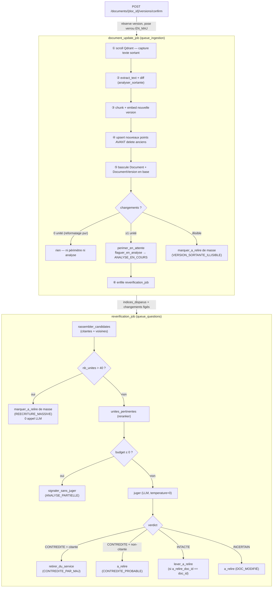

# Guide de test — Pipeline de mise à jour de document

## Architecture du pipeline

Le pipeline s'étend sur deux workers Celery et quatre services :



**Propriété centrale garantie** : `ANALYSE_EN_COURS` est le seul état transitoire.
`reverification_job` est obligé de le résoudre pour chaque réponse traitée, via trois
filets de sécurité : repli par réponse, rabattement final `rabattre`, et `on_failure`.

---

## Stratégie de test

### Deux catégories

| Catégorie | Marqueur | Infrastructure | Vitesse |
|-----------|----------|---------------|---------|
| Unitaires | _(aucun)_ | Aucune | Instantané |
| Intégration | `@pytest.mark.integration` | Postgres réel | Quelques secondes |

Les tests d'intégration sont **automatiquement ignorés** (`skip`) si Postgres est
inaccessible. En local sans `make up`, un simple `pytest` reste vert.

### Ce qui est mocké, ce qui est réel

| Composant | Unitaires | Intégration |
|-----------|-----------|-------------|
| Postgres | ❌ | ✅ réel |
| Qdrant | MagicMock | MagicMock |
| Albert (embed, rerank, chat) | MagicMock | MagicMock |
| Broker Celery/Valkey | Patch `apply_async` | Patch `apply_async` |
| Disque (fichiers) | `tmp_path` | `tmp_path` |

Les tests ne parlent jamais à Albert ni au broker. Qdrant est mocké dans tous les
cas car les assertions portent sur le comportement (ordre des appels), pas sur un
état vectoriel.

---

## Inventaire complet des cas

### API (endpoint `documents.py`)

| Cas | Fichier | Classe / Test |
|-----|---------|--------------|
| Upload : validation (magic bytes, taille max 50 Mo) | test_documents.py | TestUploadValidation |
| Upload : détection doublon (même content_hash) | test_documents.py | TestDuplicateDetection |
| Upload : détection homonyme (même nom + domaine) | test_documents.py | TestGardeFouHomonyme |
| Aperçu (`preview`) — calcule impact sans modifier | test_documents.py | TestPreviewMaj |
| Aperçu : détection des ajouts | test_documents.py | TestAjoutsSignales |
| Aperçu : détection des retraits | test_documents.py | TestRetraitsSignales |
| Confirmation (`confirm`) — verrouille + enfile le job | test_documents.py | TestConfirmMaj |
| Verrou concurrent : 409 si document EN_MAJ | test_documents.py | TestConfirmMaj |
| Liste des versions + téléchargement d'une version archivée | test_documents.py | TestListerVersions |
| Restauration d'une version antérieure (aperçu + confirmation) | test_documents.py | TestRestaurerVersion |
| Suppression douce : SUPPRIMÉ + retrait Qdrant | test_documents.py | TestDeleteDocument |

### Worker `document_update_job`

| Cas | Fichier | Classe / Test |
|-----|---------|--------------|
| Filtre Qdrant cible le seul document (pas les réponses indexées) | test_document_update.py | TestFiltreAnciens |
| Pagination de `scroll` jusqu'au dernier chunk | test_document_update.py | TestCapturerChunks |
| Ordre critique : scroll → upsert → delete | test_document_update.py | TestOrdonnancement |
| Bascule `Document.version` et archivage `DocumentVersion` | test_document_update.py | TestJobComplet |
| IDs de points Qdrant déterministes (idempotence des retries) | test_document_update.py | TestJobComplet |
| **Idempotence** : deuxième appel → no-op (version déjà en place) | test_document_update.py | TestJobComplet.test_reprise_idempotente |
| Réponse VALIDÉE citant chunk modifié → ANALYSE_EN_COURS, pas obsolète | test_document_update.py | TestMiseSousAnalyse |
| Réponse VALIDÉE citant chunk intact → aussi ANALYSE_EN_COURS (périmètre = document entier) | test_document_update.py | TestMiseSousAnalyse |
| **Reformatage pur (0 unité) → zéro action, aucune VALIDÉE touchée** | test_document_update.py | TestMiseSousAnalyse.test_reformatage_ne_declenche_rien |
| Réponse EN_ATTENTE citante + changement → périmée (obsolete = True) | test_document_update.py | TestMiseSousAnalyse.test_en_attente_marquee_obsolete |
| **Réponse EN_ATTENTE citante + 0 unité → non périmée** | test_pipeline_complet.py | TestEnAttenteReformatage |
| Version sortante illisible → marquer_a_relire de masse | test_document_update.py | TestSignalementARelire |
| `on_failure` : `ANALYSE_EN_COURS` rabattu en relecture si le job plante | test_document_update.py | TestOnFailure |

### Service `obsolescence.py`

| Cas | Fichier | Classe / Test |
|-----|---------|--------------|
| `indices_modifies` : détection modification locale | test_obsolescence.py | TestIndicesModifies |
| `indices_modifies` : normalisation espaces, ignore vides | test_obsolescence.py | TestIndicesModifies |
| `unites_de_changement` : appariement avant/après | test_obsolescence.py | TestUnitesDeChangement |
| `unites_de_changement` : déplacement sans modification ignoré | test_obsolescence.py | TestUnitesDeChangement |
| `reponses_obsoletes` : remonte copies transitives via `fermeture_copies` | test_obsolescence.py | TestReponsesObsoletes |
| `marquer_obsoletes` : horodatage + idempotent | test_obsolescence.py | TestMarquerObsoletes |
| `marquer_a_relire` : signale tout le document sans filtre | test_obsolescence.py | TestMarquerARelire |

### Service `reverification.py`

| Cas | Fichier | Classe / Test |
|-----|---------|--------------|
| `unites_pertinentes` : repli si reranker muet | test_reverification.py | TestUnitesPertinentes |
| `juger` : robustesse JSON (indentation, troncature) | test_reverification.py | TestLireVerdict |
| `decider` : citante + CONTREDITE → retirée | test_reverification.py | TestDecider |
| `decider` : non-citante + CONTREDITE → a_relire seulement (garde-fou central) | test_reverification.py | TestDecider |
| `decider` : INTACTE lève le drapeau | test_reverification.py | TestDecider |
| **`decider` : INTACTE ne lève PAS le drapeau d'un autre document** | test_reverification.py | TestDecider.test_intacte_ne_leve_pas_le_signalement_d_un_autre_document |
| `decider` : INCERTAIN → a_relire | test_reverification.py | TestDecider |
| **Copies SUGGESTION fermées avec la source via `fermeture_copies`** | test_reverification.py | TestDecider.test_la_copie_canonique_part_avec_la_graine |

### Worker `reverification_job`

| Cas | Fichier | Classe / Test |
|-----|---------|--------------|
| Verdicts appliqués : CONTREDITE retire + résout ANALYSE_EN_COURS | test_reverification_worker.py | TestVerdictsAppliques |
| Verdicts appliqués : INTACTE blanchit + résout ANALYSE_EN_COURS | test_reverification_worker.py | TestVerdictsAppliques |
| Réécriture massive (>40 unités) → aucun appel LLM | test_reverification_worker.py | TestPlafonds |
| Budget épuisé (>25 jugements) → surplus en ANALYSE_PARTIELLE | test_reverification_worker.py | TestPlafonds |
| Panne Albert → réponse conservée + relecture (jamais destruction) | test_reverification_worker.py | TestReplis |
| Version dépassée (v+1 arrivée) → abandon + rabattre | test_reverification_worker.py | TestReplis |
| `on_failure` → ANALYSE_EN_COURS rabattu en relecture (filet dernier recours) | test_reverification_worker.py | TestFiletDernierRecours |
| Bout-en-bout (état pré-constitué) : contredite / épargnée / non-citante / témoins | test_reverification_worker.py | TestBoutEnBout |

### Chaîne complète (les deux workers enchaînés)

| Cas | Fichier | Classe / Test |
|-----|---------|--------------|
| **document_update_job → reverification_job : verdict CONTREDITE** | test_pipeline_complet.py | TestBoutEnBoutComplet |
| **document_update_job → reverification_job : verdict INTACTE** | test_pipeline_complet.py | TestBoutEnBoutComplet |
| **document_update_job → reverification_job : verdict INCERTAIN** | test_pipeline_complet.py | TestBoutEnBoutComplet |

---

## Comment lancer les tests

### Tests unitaires seuls (sans infra)

```bash
cd backend
source .venv/bin/activate
pytest tests/test_pipeline_complet.py -v
pytest tests/test_document_update.py tests/test_reverification.py tests/test_reverification_worker.py tests/test_obsolescence.py -v
```

### Tests d'intégration (avec Postgres)

```bash
# Démarrer l'infra
make up

cd backend
source .venv/bin/activate

# Toute la suite pipeline
pytest tests/test_pipeline_complet.py tests/test_document_update.py \
       tests/test_reverification.py tests/test_reverification_worker.py \
       tests/test_obsolescence.py -v -m integration

# Un cas précis
pytest tests/test_pipeline_complet.py::TestBoutEnBoutComplet::test_contredite_bout_en_bout -v
pytest tests/test_document_update.py::TestMiseSousAnalyse::test_reformatage_ne_declenche_rien -v
```

### Régression globale

```bash
cd backend
pytest tests/ --tb=short -q
```

> **Remarque locale** : sans `make up`, les tests d'intégration sont automatiquement
> ignorés (`skip`) — `pytest` reste vert.

---

## Ajouter un nouveau cas

1. **Identifier la couche** : API, worker, service ou chaîne complète ?
2. **Choisir le fichier** correspondant dans la table ci-dessus.
3. **Reproduire le pattern de fixture** du fichier ciblé (ne pas créer une nouvelle fixture sans raison).
4. **Unitaire ou intégration ?**
   - Unitaire si la logique ne touche pas Postgres.
   - Intégration (`@pytest.mark.integration`) si le test lit ou écrit en base.
5. **Écrire l'assertion sur l'état final** (colonne `r.obsolete`, `r.a_relire`, `r.a_relire_raison`), pas seulement sur les appels de mock.
6. **Vérifier que `restees_en_analyse(db, doc_id, version) == []`** si le test touche un `ANALYSE_EN_COURS`.

---

## Zones sensibles et pièges connus

### L'ordre scroll → upsert → delete est une question de correction

Capturer après suppression rend la détection d'obsolescence aveugle (silencieusement).
Supprimer avant d'upserter ouvre un trou de service de plusieurs dizaines de secondes.
`TestOrdonnancement` porte sur `mock_client.method_calls`, pas sur l'état final.

### `analyser_sortante` lit le fichier V1 sur disque, pas Qdrant

Ne jamais reconstruire le texte sortant en concaténant les chunks : le chevauchement
de 128 tokens du splitter fabriquerait une fausse suppression à chaque couture. Si
le fichier V1 est absent de la fixture, tous les tests tombent dans la branche
dégradée `VERSION_SORTANTE_ILLISIBLE` sans avertissement apparent.

### `indices_modifies` est un signal, pas un verdict

Rétrogradé depuis une version antérieure. Il ne prononce plus d'obsolescence ; il
désigne les réponses à analyser en priorité (`prioritaire=True` dans `Candidate`).
Lire `[]` comme « rien à faire » est une erreur — le périmètre est le document entier.

### `fermeture_copies` est transitive

Une copie SUGGESTION d'une copie CANONIQUE doit être fermée aussi. `decider` appelle
`_famille` qui appelle `fermeture_copies` — ne jamais appeler `retirer_du_service`
directement sur une seule réponse.

### ANALYSE_EN_COURS ne doit jamais survivre

Tout test qui crée une réponse flaguée `ANALYSE_EN_COURS` doit vérifier qu'elle est
résolue à la fin : `restees_en_analyse(db, doc_id, version) == []`. Un test qui
oublie cette assertion valide silencieusement un bug majeur.

### `INTACTE` ne lève le drapeau que si `a_relire_doc_id == doc_id`

Sans ce garde, la mise à jour d'un document effacerait la relecture posée par la
mise à jour d'un autre. Le test correspondant est
`TestDecider.test_intacte_ne_leve_pas_le_signalement_d_un_autre_document`.

### `requeuer_en_attente` appelle `question_job.delay`

Patcher `requeuer_en_attente` dans les fixtures évite toute connexion au broker dans
les tests qui n'exercent que la logique de périmètre. Dans les tests qui veulent
exercer la file d'attente, le broker Valkey doit être disponible (CI uniquement).
