# Le système en schémas

Tout ce que fait TicketAI, en onze schémas et sans une ligne de technique. Chaque schéma est
autonome : on peut entrer par n'importe lequel. Le schéma 7 raconte l'histoire complète — c'est
celui à lire si vous n'en lisez qu'un.

**Le code couleur est le même partout :**

| | Signification |
|---|---|
| 🟩 **vert** | envoyé à l'employé **sans relecture humaine** |
| 🟨 **ambre** | proposé au validateur — **rien ne part avant qu'un humain ait lu** |
| 🟦 **bleu** | rédigé par l'IA à partir des documents |
| ⬜ **gris** | le système s'abstient |

---

## 1. Les quatre issues possibles d'une question

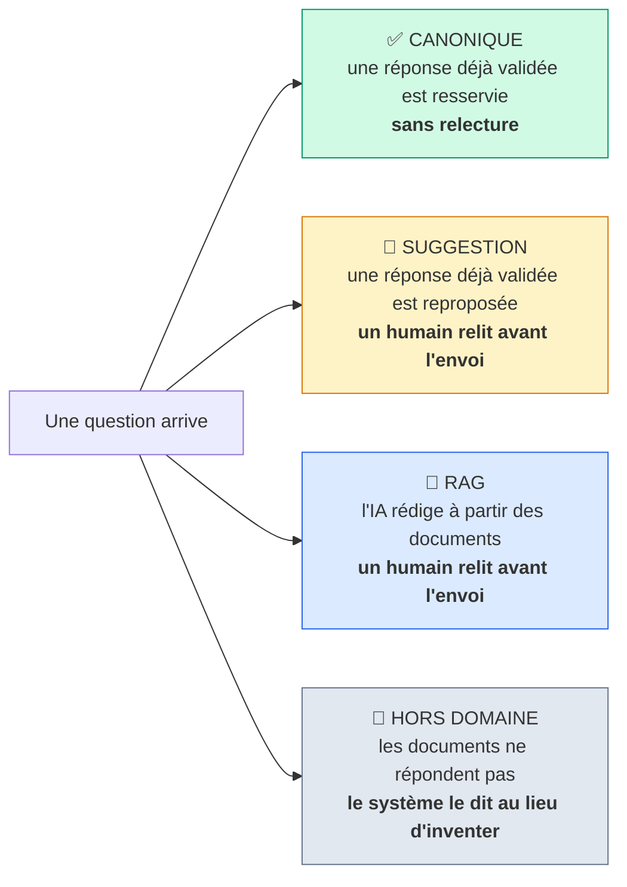

*Une seule de ces quatre issues se passe d'un humain. C'est celle que tout le reste du système surveille.*

---

## 2. Une question, de bout en bout

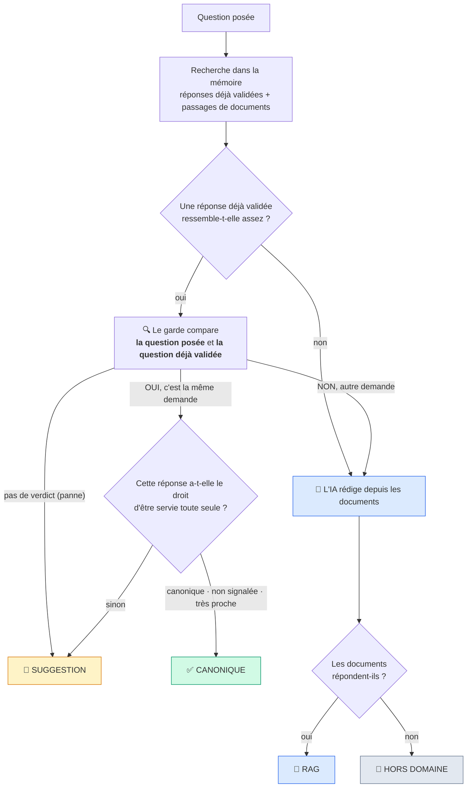

*Une panne ne décide de rien : sans verdict du garde, rien n'est jamais servi sans relecture.*

---

## 3. Les deux portes d'entrée de la mémoire

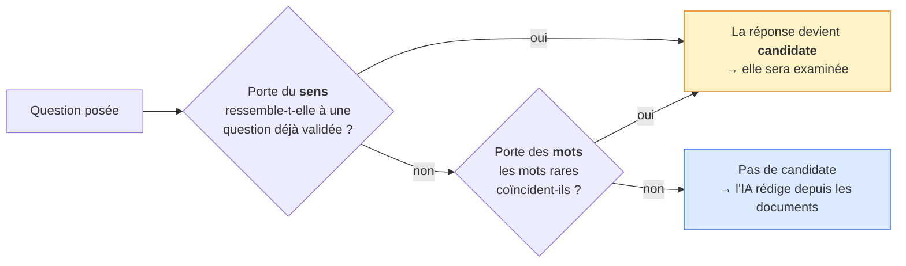

*Deux portes séparées, jamais un mélange : un sigle, un numéro d'article ou un nom propre que l'IA ne « comprend » pas passe quand même par la porte des mots.*

---

## 4. Les deux moments où le garde intervient

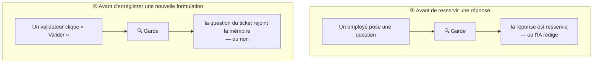

*Le second est le plus important : une formulation enregistrée à tort serait resservie plus tard **sans que le garde soit rappelé**. On le consulte donc avant d'écrire, pas après.*

---

## 5. Ce qu'un OUI ouvre, ce qu'un NON ferme

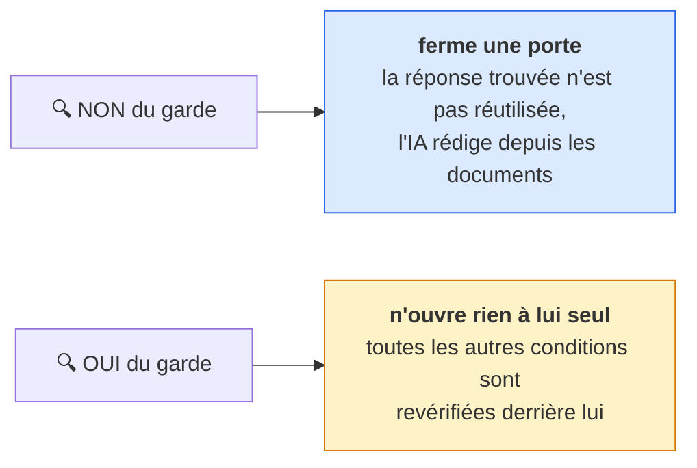

*On se sert du refus du juge, jamais de son accord. C'est ce déséquilibre volontaire qui rend son élargissement sans risque : lui donner la parole plus souvent ne peut que **fermer** des portes.*

---

## 6. Ce qui se passe quand un document arrive

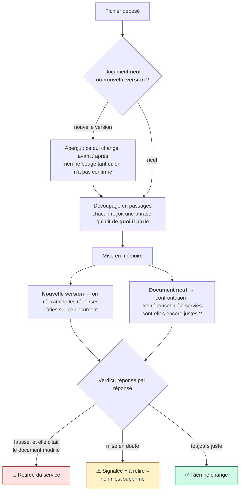

*Un document **neuf** ne retire jamais rien : il ne peut que poser une question à un humain. Seule une réponse qui citait vraiment un document peut être retirée quand ce document change.*

---

## 7. Le scénario complet : le document A, puis le document B

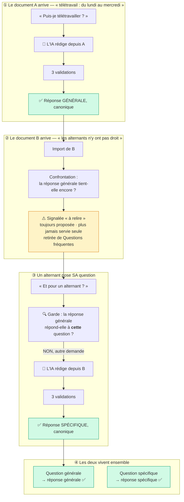

*Deux réponses canoniques sur un même sujet, ce n'est pas un doublon à nettoyer : c'est le fonctionnement normal. Personne n'a rédigé la seconde à la main — elle est née de la question posée.*

---

## 8. Le bon geste sur une réponse signalée

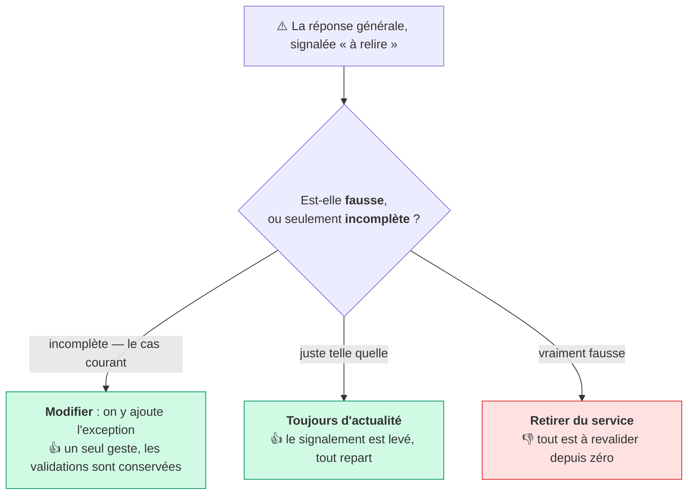

*Inutile de cliquer « Corriger » pour rédiger la réponse spécifique : elle arrivera toute seule dans la file (schéma 7, acte ③).*

---

## 9. Ce que le signalement « à relire » change vraiment

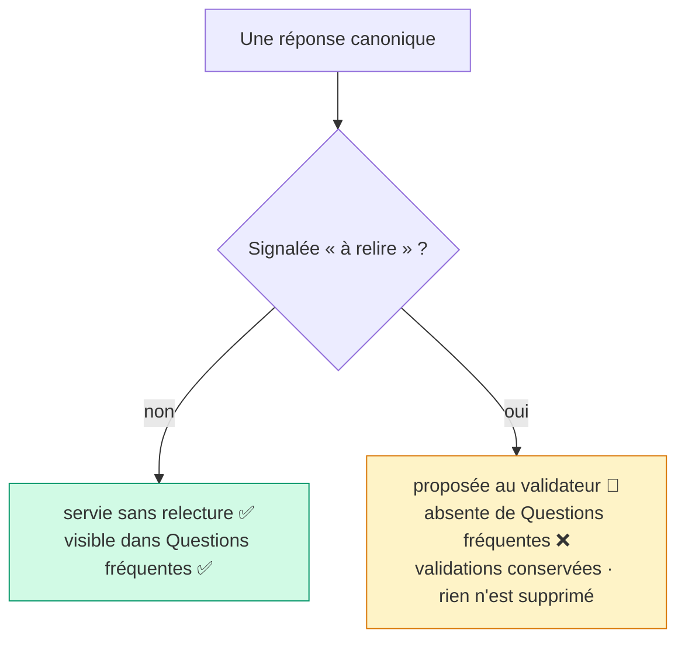

*Un signalement ne détruit rien : il retire le droit d'être servi **sans relecture**. Coût pour l'équipe : une lecture. Coût d'un retrait : trois revalidations.*

---

## 10. Cycle de vie d'une réponse

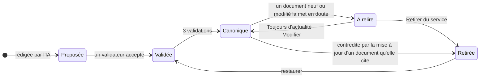

*Une réponse validée mais pas encore canonique est déjà réutilisée — sous relecture. La canonisation ne change qu'une chose : le droit de partir sans relecture.*

---

## 11. Qui décide quoi

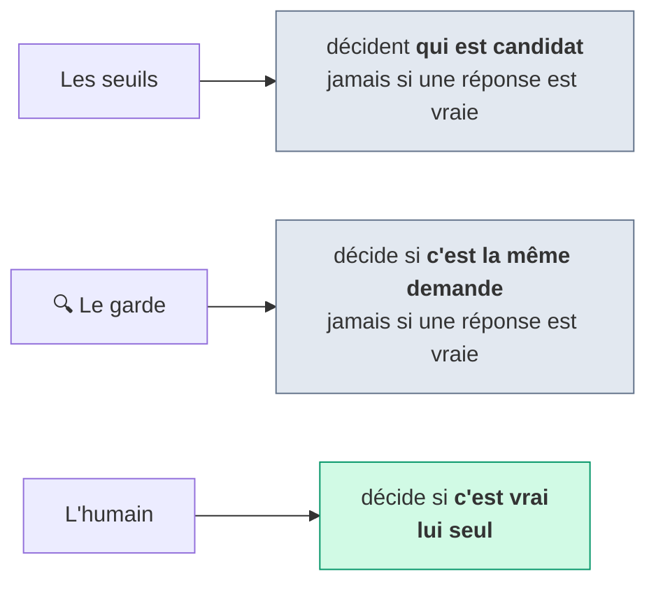

*Toute la machine sert une seule règle : **ne jamais servir une réponse fausse**, même si cela demande plus de travail aux validateurs.*

---

## Pour aller plus loin

| Le détail de… | se lit dans |
|---|---|
| les schémas 2, 3, 5 | [Pipeline de traitement des questions](technique/architecture-pipeline-questions.md) |
| les schémas 4, 5, 11 | [Garde du cache canonique](technique/garde-cache-canonique.md) |
| les schémas 6, 7 | [Quand le corpus bouge](technique/mise-a-jour-documents.md) |
| les schémas 8, 9, 10 | [Réponses enregistrées](fonctionnalites/reponses-enregistrees.md) |
| l'import d'un document | [Base de connaissances](fonctionnalites/base-de-connaissances.md) |
| les chiffres derrière le schéma 7 | [Campagnes de mesure](technique/rapport-test-cache-semantique.md) § 17 |
