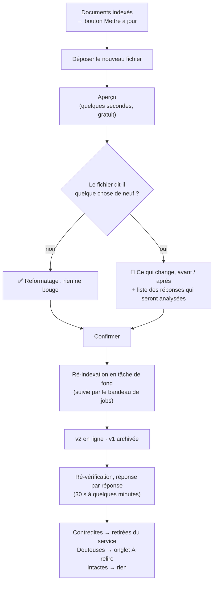

# Mettre à jour un document

## 1. Le problème

Les réponses enregistrées ont été rédigées **sur les documents tels qu'ils étaient** au moment
de leur validation. Quand la charte télétravail passe de 2 à 3 jours, la réponse canonique qui
disait « 2 jours » continue d'être servie automatiquement, sans qu'aucun humain la relise.

Il fallait donc trois choses : pouvoir **remplacer** le fichier d'un document sans casser ce qui
s'y rattache ; **savoir lesquelles** des réponses enregistrées ce remplacement rend fausses ; et,
pour tout ce que cette dernière question ne peut pas trancher seule, **poser la question à un
humain** au lieu de continuer à servir en silence.

## 2. Le parcours

Tout part de **Documents indexés**. Le système ne devine pas quel document vous mettez à jour :
c'est la ligne sur laquelle vous cliquez qui le désigne. Le fichier déposé peut porter
n'importe quel nom.



**L'aperçu n'est plus un verdict.** Il montre le diff réel — ce que la nouvelle version ajoute,
retire ou réécrit — et nomme les réponses qui seront **examinées** ensuite. Il ne promet plus
« ces N réponses vont disparaître » : cette question ne se tranche qu'en lisant les réponses, ce
qui coûte des appels au modèle et se fait donc après confirmation, en tâche de fond. Rien n'est
modifié tant que vous n'avez pas confirmé — vous pouvez fermer la fenêtre sans conséquence.

**Le document garde son identifiant.** Ce n'est pas un nouveau document : c'est la version
suivante du même, et l'ancienne reste téléchargeable dans l'historique.

### Si vous passez par la page *Ingestion*

Déposer un fichier qui porte le nom d'un document déjà présent dans le même domaine ne crée
plus un second document en silence — c'était le moyen le plus simple de se retrouver avec deux
versions qui se contredisent. Une alerte propose trois issues : **mettre à jour** le document
existant (l'analyse démarre directement, sans re-déposer le fichier), **créer quand même** un
nouveau document, ou annuler.

Un fichier **renommé** passe à travers ce garde-fou : il n'y a pas de signal fiable dans ce cas.

## 3. Comment on décide qu'une réponse ne tient plus

C'est le cœur du dispositif, et il a une histoire : la première version ne lisait **jamais** le
texte des réponses. Elle comparait le document à lui-même — pour chaque passage ayant servi à
rédiger une réponse, elle vérifiait s'il figurait encore *mot pour mot* dans la nouvelle version.
Absent ⇒ réponse détruite.

C'était élégant, et faux dans les deux sens :

| | Ce qui se passait |
|---|---|
| **Faux positifs** | Un passage fait ~1 500 caractères. Y corriger une virgule le rend introuvable en sous-chaîne : la réponse était archivée alors qu'elle restait parfaitement juste. |
| **Faux négatifs** | Un « article 7 bis » ajouté ailleurs, qui suspend le télétravail, ne touche aucun passage cité. Rien ne bougeait, et la réponse continuait d'être servie. |
| **Bruit** | Toute retouche déposait **l'intégralité** des réponses validées du document dans l'onglet *À relire*. Une liste qu'on ne lit plus ne protège de rien. |

Les trois défauts ont la même racine : **la seule question qui compte est « cette réponse est-elle
encore vraie ? », et elle ne se répond qu'en lisant la réponse.**

### L'entonnoir

Quatre étages, du gratuit au coûteux. Chacun ne fait que **réduire** le lot transmis au suivant ;
**seul le dernier prononce un verdict.**

```
┌─ 0 ─ Unités de changement ──────────────────── gratuit, déterministe ─┐
│  Diff aligné entre l'ancien et le nouveau texte, paragraphe par       │
│  paragraphe : AJOUT · RETRAIT · RÉÉCRITURE (avant ↔ après appariés).  │
│  Liste vide ⇒ on s'arrête là. C'est le cas du reformatage pur.        │
└──────────────────────────────────────────────────────────────────────┘
                                 ↓
┌─ 1 ─ Candidates ───────────────────────── une requête vectorielle ────┐
│  (a) toutes les réponses validées qui citent ce document ;            │
│  (b) + les réponses du même domaine dont la *question* ressemble à    │
│      un changement — celles qu'aucun lien de citation ne désigne.     │
└──────────────────────────────────────────────────────────────────────┘
                                 ↓
┌─ 2 ─ Unités pertinentes ─────────────── un appel reranker / réponse ──┐
│  Parmi les changements, lesquels portent sur *cette* question ?       │
│  Aucun ⇒ la réponse sort du pipeline sans coûter un appel au modèle.  │
└──────────────────────────────────────────────────────────────────────┘
                                 ↓
┌─ 3 ─ Verdict ──────────────────────────────── un appel LLM / réponse ─┐
│  On montre au modèle : la question, la réponse servie, et les         │
│  changements en AVANT / APRÈS. Il rend CONTREDITE, INTACTE ou         │
│  INCERTAIN, plus une phrase de justification.                         │
└──────────────────────────────────────────────────────────────────────┘
```

Trois choix méritent d'être explicités.

**Le modèle voit le diff, pas le document.** « Ce qui a changé contredit-il cette réponse ? » est
une question fermée dont les deux termes sont sous ses yeux. « Cette réponse est-elle déductible
du document ? » ferait re-juger tout le pipeline RAG et condamnerait des réponses correctes au
seul motif que la recherche ne les retrouve pas — on remplacerait une machine à faux positifs
par une autre.

**L'appariement avant/après n'est pas cosmétique.** Deux listes indépendantes (« ces paragraphes
ont disparu », « ceux-là sont apparus ») ne permettent pas de juger : c'est le couple
« 2 jours → 3 jours » qui rend le verdict évident.

**Chaque étage penche vers le rappel.** Un faux positif coûte un appel au modèle ; un faux négatif
laisse servir une réponse fausse en silence. Les seuils sont donc bas, et **toute panne se replie
vers « fais lire un humain »** — jamais vers « laisse passer », jamais vers « détruis ».

### Ce que le système s'interdit

| Règle | Pourquoi |
|---|---|
| Une réponse qui **ne cite pas** le document ne peut jamais être retirée automatiquement, même jugée CONTREDITE. Elle plafonne à *À relire*. | Elle n'a été rapprochée du changement que par similarité vectorielle entre un paragraphe et une question — deux objets de nature différente. Détruire à tort une canonique à douze validations coûte bien plus cher que vingt relectures. |
| Le modèle **n'a pas le droit de rédiger une correction**. | Le verdict est « cette réponse ne tient plus », pas « voici la nouvelle ». Réécrire à la place d'un humain, c'est publier du contenu que personne n'a validé. |
| Une panne d'Albert ne détruit **rien**. | La réponse reste servie et part en relecture avec la mention explicite que l'analyse n'a pas eu lieu. |
| Un document réécrit de fond en comble (> 40 unités) déclenche **zéro** appel au modèle. | Quand tout a changé, il n'y a plus rien à discriminer : tout est signalé en bloc, ce qui est à la fois plus honnête et gratuit. |

## 3 bis. Un exemple pour chaque cas

---

### Cas 1 — Reformatage pur

Le fichier est réexporté depuis Word : l'indentation a changé, les tirets ont été normalisés. Le
fond est identique.

```
v1 : « Le télétravail est limité à 2 jours par semaine. »
v2 : « Le télétravail est limité à 2 jours par semaine. »  ← identique après normalisation

unites_de_changement(v1, v2) → []
```

**Résultat :** zéro unité, donc **aucun job d'analyse n'est même enfilé**. Zéro obsolète, zéro à
relire, zéro appel API. Le document est ré-indexé, c'est tout. C'est ce qui règle le défaut de
bruit : le silence est le comportement par défaut.

---

### Cas 2 — Un chiffre change dans un passage cité

La charte télétravail passe de 2 à 3 jours.

```
unités : [RÉÉCRITURE]
   AVANT : « Le télétravail est limité à 2 jours par semaine, sur accord du manager. »
   APRÈS : « Le télétravail est limité à 3 jours par semaine, sur accord du manager. »

Réponse VALIDÉE, canonique, 12 validations, cite le chunk #3 (disparu)
   « Vous pouvez télétravailler jusqu'à deux jours hebdomadaires… »
        ↓  prioritaire : le reranker ne peut pas l'écarter
   juger(…) → CONTREDITE, « La durée hebdomadaire passe de 2 à 3 jours. »
        ↓  elle cite le document → sévérité maximale autorisée
   obsolete = True (CONTREDITE_PAR_MAJ), point Qdrant supprimé, copies comprises
```

**Résultat :** la réponse quitte l'index. La prochaine question sur le télétravail repart en
génération sur la v2 et obtient « 3 jours ». Elle reste consultable dans l'onglet Obsolètes,
**avec la phrase de justification** — c'est elle qui rend un retrait sans correction acceptable.

---

### Cas 3 — Le jumeau innocent

Même mise à jour, mais une seconde réponse du même document parle des **notes de frais**.

```
unités pertinentes pour « Comment se faire rembourser un déplacement ? » → aucune
        ↓  le tri est fiable, il ne retient rien
   pas d'appel au modèle, pas de drapeau : la réponse n'est pas dérangée
```

**Résultat :** l'ancien système l'aurait déposée dans *À relire* avec toutes les autres. Ici elle
sort du pipeline sans coûter un appel ni une seconde d'attention humaine.

---

### Cas 4 — L'article ajouté ailleurs

Un « article 7 bis » est inséré : pendant les périodes de forte activité, le télétravail est
suspendu. Il ne touche aucun passage cité, et la réponse concernée s'appuie sur un **autre**
document.

```
unités : [AJOUT] « Article 7 bis : le télétravail est suspendu pendant les périodes… »
        ↓  rappel vectoriel dans le domaine RH
   « Le télétravail est-il de droit ? » remonte — ne cite pas Charte_RH
        ↓
   juger(…) → CONTREDITE, « Un nouvel article suspend le dispositif en pointe d'activité. »
        ↓  non-citante : plafond
   a_relire = True (CONTREDITE_PROBABLE) — **elle continue d'être servie**
```

**Résultat :** c'est exactement le cas que l'ancien système ne voyait pas. Il est désormais
détecté, mais il aboutit à une **question posée à un humain**, pas à une destruction : le lien
n'est que vectoriel, il n'est pas assez sûr pour retirer quoi que ce soit tout seul.

---

### Cas 5 — Réponse EN_ATTENTE lors de la mise à jour

Un ticket vient d'être déposé. Le RAG a généré une réponse (`EN_ATTENTE`) mais personne ne l'a
validée. À ce moment, la charte est mise à jour.

```
→ perimer_en_attente : obsolete = True (la valider aurait indexé un texte disparu)
→ requeuer_en_attente : ticket remis en EN_ATTENTE / NOUVEAU
     question_job.delay(…, retraiter=True)
→ le pipeline RAG redémarre sur la v2
```

**Résultat :** aucun jugement requis — ces réponses n'ont jamais été servies ni indexées. Le
validateur voit simplement le ticket revenir en file avec une réponse à jour. Ce chemin ne
s'active que s'il existe **au moins une unité de changement**.

---

### Cas 6 — Albert injoignable

Le reranker répond, le modèle non (timeout, quota, panne).

```
juger(…) lève
     ↓  jamais de destruction sur une panne
a_relire = True (ANALYSE_INDISPONIBLE)
justification : « Le service d'analyse n'a pas répondu : la réponse reste servie, à vérifier. »

Après 3 échecs consécutifs, le reste du lot y part directement :
insister coûterait 60 s de timeout par réponse pour un résultat connu d'avance.
```

**Résultat :** rien n'est perdu, rien n'est détruit, et l'onglet dit *pourquoi* il est rempli.

---

### Cas 7 — Suppression du document

Le document est supprimé (`DELETE /documents/{doc_id}`). Pas de nouvelle version, donc pas de
diff et pas de ré-vérification : `marquer_obsoletes` est appelé sans filtre d'indices.

```
3 réponses VALIDÉE → obsolete = True, retirées de Qdrant (non restaurables : le document n'existe plus)
1 réponse EN_ATTENTE → obsolete = True, ticket re-soumis au pipeline RAG sur le corpus restant
```

---

## 4. Ce qui arrive à une réponse retirée du service

Avant le détail : ne pas confondre les deux états.

| | **Obsolète** | **À relire** |
|---|---|---|
| Ce qu'on sait | Un changement du document **contredit** cette réponse, et elle s'appuyait dessus. | Un doute subsiste : contradiction probable, analyse impossible, ou budget épuisé. |
| Est-elle encore servie ? | **Non** — retirée de l'index. | **Oui** — rien n'a changé pour elle. |
| Ce qu'on vous demande | Vérifier que le retrait était mérité. | Trancher ce que la machine n'a pas pu trancher. |
| Le geste normal | Restaurer, ou laisser. | Confirmer, corriger, ou retirer du service. |

L'obsolescence est une **décision**, faillible et réversible ; le signalement est une **question**
posée à un humain. Les deux portent désormais une **justification en clair** : sans elle, un
retrait sec serait indéfendable.

| | |
|---|---|
| Elle est **retirée du service** | Plus jamais resservie automatiquement. La question repartira en génération sur le document à jour. |
| Elle **n'est pas supprimée** | Ses validations, son auteur, son historique sont conservés intacts. |
| Les **tickets clos ne bougent pas** | La réponse reste affichée telle quelle là où elle a été donnée : elle *était* correcte à l'époque, l'historique n'est pas réécrit. |
| Elle est **consultable** | Onglet **Obsolètes**, avec le document, la version, la justification et les extraits qui ont fondé le verdict. |
| Elle est **restaurable** | Un clic la remet en service, telle quelle. |

Le bouton **Restaurer** reste la soupape. Il sert moins souvent qu'avant — le retrait n'est plus
prononcé sur un critère de sous-chaîne mais sur une lecture — et quand il sert, la justification
affichée permet de juger en trois secondes au lieu de rouvrir le document.

## 4 bis. L'onglet *À relire*

Il ne reçoit plus « toutes les réponses du document ». Il reçoit exactement ce que la machine n'a
pas pu trancher, et chaque entrée dit laquelle de ces situations elle est :

| Raison | Ce qu'elle veut dire | Ce qu'on attend de vous |
|---|---|---|
| `CONTREDITE_PROBABLE` | Le modèle juge la réponse contredite, mais elle ne cite pas le document : le lien n'est que vectoriel. | Trancher. C'est la file la plus urgente. |
| `ANALYSE_EN_COURS` | État **transitoire** : la version est en ligne, le verdict n'est pas encore rendu. | Rien. Aucune action proposée ; il se résout tout seul en quelques minutes. |
| `ANALYSE_INDISPONIBLE` | Albert n'a pas répondu, ou une v(n+1) a rendu ce lot caduc. | Relire à la main. |
| `ANALYSE_PARTIELLE` | Budget d'appels épuisé pour cette mise à jour (25 jugements). | Relire à la main. |
| `REECRITURE_MASSIVE` | Plus de 40 unités : le document a été réécrit, pas modifié. | Relire le document, puis confirmer en lot. |
| `DOC_MODIFIÉ` | Verdict `INCERTAIN` : le modèle a vu les changements et n'a pas su conclure. | Trancher. |
| `VERSION_SORTANTE_ILLISIBLE` | Le fichier de la version précédente n'était plus sur le disque : aucun diff n'était calculable. | Relire à la main. |

Les réponses signalées **continuent d'être servies** pendant tout ce temps : le drapeau est une
file de relecture, pas un retrait.

```
Réponses enregistrées   [ Canoniques ]  [ À relire ② ]  [ Obsolètes 3 ]
                                                 ▲
                              le badge compte les DOCUMENTS, pas les réponses
┌──────────────────────────────────────────────────────────────────────┐
│ Charte_RH.md  v3                              [ ✓ Tout confirmer ]   │
│ 2 réponses sur cette page                                            │
│ 1 passage ajouté                                                     │
│ ▌ Article 7 bis : le télétravail est suspendu pendant les            │
│   périodes de forte activité déclarées par la direction.             │
│ ─────────────────────────────────────────────────────────────────── │
│  Le télétravail est-il de droit ?             canonique      5 val.  │
│  Le télétravail est un droit ouvert à tout collaborateur…            │
│  ⚠ contradiction probable — « Un nouvel article suspend le           │
│    dispositif en période de forte activité. »                        │
│                        [ ✓ Toujours d'actualité ]  [ ✎ ]  [ 👁 ]     │
└──────────────────────────────────────────────────────────────────────┘
```

Le **diff du document** est affiché **une seule fois en tête de groupe** — c'est lui qu'on lit
pour juger l'ensemble. Il est *figé* au moment de la mise à jour, pas recalculé : trois jours
plus tard, l'archive de la version sortante peut avoir été purgée. La **justification**, elle, est
propre à chaque réponse : c'est ce qui distingue « ce document a bougé » de « voici pourquoi
cette réponse-là est en cause ».

**Le badge compte les documents.** « 2 documents à relire » se traite ; « 39 réponses » se subit.

Trois issues par réponse, plus une en lot :

| Action | Effet |
|---|---|
| **Toujours d'actualité** | Le signalement tombe, rien d'autre ne change. La réponse continue d'être servie. |
| **Modifier** | On réécrit la réponse. Le signalement tombe : l'avoir éditée *est* le jugement demandé. |
| **Retirer du service** | La réponse bascule dans **Obsolètes**, d'où elle reste restaurable. |
| **Tout confirmer** | La sortie normale d'une `REECRITURE_MASSIVE` : on lève le lot d'un document et d'une version. |

La **version** fait partie de la clé du lot : si le document a été remis à jour entre-temps, ses
réponses ont été reflaguées sur v(n+1), et une confirmation partie de l'écran de v(n) ne doit pas
balayer un signalement que personne n'a vu.

Une réponse signalée reste visible dans l'onglet **Canoniques**, où elle porte une pastille ambre :
elle est toujours servie, elle a sa place dans la liste des réponses actives — mais l'écran ne
doit pas la présenter comme acquise.

Enfin, si une réponse signalée devient **obsolète** lors d'une mise à jour ultérieure, son
signalement est levé : une réponse ne siège jamais dans les deux onglets à la fois.

## 5. Versions et restauration

Chaque mise à jour archive la version sortante. L'**historique** liste les versions de la plus
récente à la plus ancienne : date, auteur, taille, nombre de passages, et un bouton de
téléchargement pour chacune.

**Restaurer ne revient pas en arrière.** Restaurer la v1 depuis la v3 ne recrée pas la v1 : elle
crée une **v4** dont le contenu est celui de la v1, marquée « restaurée depuis la v1 ». Le fil
des versions n'est jamais réécrit — on sait toujours ce qui a été en ligne, et quand.

```
v1 ──── v2 ──── v3 ──── v4  (contenu de la v1, restaurée depuis v1)
                        ▲
                        └── une restauration est une mise à jour comme une autre
```

Et puisque c'est une mise à jour comme une autre, elle **change le texte du document** : elle
déclenche donc son propre diff, son propre lot de candidates et sa propre ré-vérification. Le
même écran d'aperçu s'affiche avant de confirmer, avec les mêmes garanties.

Symétriquement, restaurer une version **ne ressuscite pas** les réponses qu'elle avait rendues
obsolètes. Elles restent dans l'onglet Obsolètes, où vous les restaurez explicitement si elles
redeviennent valables.

## 6. Les limites, dites franchement

- **Le verdict final est celui d'un modèle de langage.** Il se trompe. Deux garde-fous seulement :
  il ne voit qu'une question fermée (le diff, pas le document), et il ne peut retirer du service
  qu'une réponse qui cite réellement le document modifié. Tout le reste plafonne à la relecture.
- **Le rappel vectoriel est le maillon faible.** Les points de réponse sont indexés sur la
  **question**, et on les interroge avec un **paragraphe de document** : deux objets de nature
  différente. Une réponse d'un autre document contredite par le changement peut ne pas remonter.
  C'est pourquoi le seuil est bas (0,35) et pourquoi les citantes, elles, sont connues sans réseau.
- **Le budget tronque, mais le dit.** Au-delà de 25 jugements par mise à jour, le reliquat part en
  `ANALYSE_PARTIELLE` — jamais ignoré en silence. L'ordre de dépense n'est pas neutre : les
  prioritaires, puis les canoniques, puis les plus validées.
- **Un délai de quelques minutes existe.** Entre la publication de la v2 et le verdict, les
  réponses continuent d'être servies. Elles le sont, mais plus jamais sans que l'interface le
  dise : elles portent `ANALYSE_EN_COURS`. Les retirer préventivement créerait un trou de service
  pour rien, l'écrasante majorité étant intacte.
- **Un seul signalement à la fois par réponse.** Si un second document la fait signaler, les
  colonnes sont écrasées : dernier arrivé gagne.
- **Un fichier renommé échappe au garde-fou homonyme** de la page Ingestion.
- **Le domaine d'un document n'est pas modifiable** par une mise à jour.
- **Supprimer un document efface aussi ses archives** — toutes les versions, définitivement.

---

## Annexe — pour les développeurs

### Endpoints

| Étape | Route | Effet |
|---|---|---|
| Aperçu | `POST /documents/{doc_id}/versions/preview` | Met le fichier en staging, calcule le diff. **Ne modifie rien, n'appelle ni reranker ni LLM.** |
| Confirmation | `POST /documents/{doc_id}/versions/confirm` | Réserve le numéro de version, lance le job Celery. |
| Historique | `GET /documents/{doc_id}/versions` | Versions décroissantes ; `fichier_disponible` signale les archives absentes du disque. |
| Archive | `GET /documents/{doc_id}/versions/{v}/download` | Fichier de la version `v`. |
| Restauration | `POST /documents/{doc_id}/versions/{v}/restaurer` | Stage le fichier archivé → **renvoie le même aperçu**, à confirmer par `confirm`. |

Le flux en deux temps existe pour que la confirmation porte sur **exactement** le fichier analysé.
Une restauration n'a pas de chemin de code propre : elle appelle `stager_et_analyser`, partagé
avec la mise à jour, puis le même `confirm`.

L'aperçu renvoie `nb_unites` + `unites[]` (avant/après tronqués), `nb_prioritaires` + `items[]`
(réponses dont un passage cité a bougé) et `nb_a_analyser` + `a_analyser[]`. La nuance porte tout
le projet : la confirmation ne crée plus N tâches humaines mais N tâches machine, dont une
minorité seulement remontera. `diff_analysable: False` masque le panneau quand la version courante
est illisible — afficher « 0 changement » se lirait comme une garantie.

### Le diff — `app/services/obsolescence.py`

`unites_de_changement(ancien, nouveau)` rend une liste d'`Unite(sens, avant, apres)` :

1. `decouper_en_passages` sur les deux textes. L'unité est le **paragraphe**, pas le chunk : un
   chunk fait 384 tokens, donc un extrait illisible et une granularité telle que la moindre
   retouche marquerait 1 500 caractères. Les blocs de moins de 40 caractères (titres,
   numérotation, artefacts PDF) sont écartés.
2. `difflib.SequenceMatcher(None, anciens, nouveaux, autojunk=False)`. `replace` →
   `REECRITURE` appariée par position, surplus en `AJOUT`/`RETRAIT` ; `insert` → `AJOUT` ;
   `delete` → `RETRAIT`.
3. **`_requalifier`** — filtre anti-reflow : une unité dont le texte normalisé est déjà
   sous-chaîne du texte d'en face est jetée (paragraphe déplacé, refusionné, repaginé). Sans
   cette passe, un redécoupage de pages génère des dizaines d'unités fantômes. C'est aussi lui
   qui rattrape le cas des documents à en-têtes répétés.

**Pas de seuil de ratio global.** Sur une charte de 60 000 caractères, « 2 jours » → « 3 jours »
donne un ratio de 0,9999 : tout filtre par ratio classerait « cosmétique » précisément le
changement le plus dangereux. Le garde-fou anti-reformatage est la normalisation + sous-chaîne,
exacte au caractère près.

`analyser_changements(ancien, nouveau)` est la **fonction pure** partagée par l'aperçu et le
worker — les deux avaient chacun leur copie, dont l'une se déclarait « le jumeau » de l'autre,
sans aucun test pour garantir qu'elles restent d'accord. Elle rend `nb_unites`, `nb_ajoutes`,
`nb_retires`, `extraits_*` (conservés : les lignes `DocumentVersion` déjà écrites les portent) et
les unités sérialisées.

`indices_modifies` **est rétrogradé** : il ne prononce plus l'obsolescence, il désigne des
réponses **prioritaires** dont les unités court-circuitent le filtre de pertinence. C'est le
correctif du défaut n° 1. `passages_ajoutes` n'est plus qu'une primitive interne du filtre
anti-reflow.

### La ré-vérification — `app/services/reverification.py`

Sans Celery, donc testable en unitaire. Quatre fonctions, une par étage :

| Fonction | Rôle | Point de vigilance |
|---|---|---|
| `rassembler_candidates` | citantes + voisines du domaine, triées par exposition | Réduit aux `racines` : une réponse réutilisée cinq fois coûterait sinon cinq jugements identiques. |
| `unites_pertinentes` | un appel `rerank` par **réponse** (pas par couple) | Rend `(unites, fiable)`. `rerank` renvoie `[]` **sans lever** si la réponse d'Albert change de forme (`reranker.py`, pas de `else`) : lire ce `[]` comme « rien de pertinent » ferait sortir tout le monde du pipeline en silence. `fiable=False` ⇒ jugement quand même. |
| `juger` | un appel `chat` (`temperature=0`, JSON strict) | Lève sur panne HTTP — l'appelant n'a pas les mêmes options face à une panne et face à une hésitation. Sortie illisible ⇒ `INCERTAIN`, **jamais `INTACTE`**. |
| `decider` | applique, rend l'action pour le comptage | Passe par `_famille` (`fermeture_copies`) : décider sur la seule graine laisserait la copie CANONIQUE indexée, donc resservie. |

`lever_a_relire` n'est appelé que si `r.a_relire_doc_id == doc_id` : sans cette garde, ce job
effacerait le signal posé par la mise à jour d'un **autre** document.

Le rappel vectoriel est **dense uniquement**. `embed_texts` renvoie toujours un vecteur sparse
vide (`{"indices": [], "values": []}`) — bug préexistant, hors périmètre — et `search_hybrid` ne
sait de toute façon pas cibler les points de réponse. Ceux-ci sont écrits par `feedback_job` avec
`{reponse_id, ticket_id, contenu, domaine}` et **sans `doc_id`** : `must_not=[IsEmpty("reponse_id")]`
est le seul moyen de les isoler. Pas d'index de payload sur `reponse_id`, Qdrant filtre donc en
scan — acceptable à cette volumétrie, et payé une fois par mise à jour.

### Le worker — `app/workers/reverification.py`, file `queue_questions`

Pas `queue_ingestion` : ce job n'est que de l'attente réseau Albert, il n'a rien à faire dans la
file qui sérialise les ingestions. Enfilé par `apply_async` explicite et non par `chain()` ou
`link()` — un `link` ne se rejoue pas depuis le retry admin, et le dépôt enfile déjà ainsi.

Plafonds : `MAX_UNITES = 40` (au-delà, signalement en bloc, **zéro appel LLM**),
`MAX_JUGEMENTS = 25`, `TOP_K_UNITE = 20`, `SEUIL_RAPPEL = 0.35`, `SEUIL_RERANK = 0.15`,
`MAX_UNITES_PAR_REPONSE = 3`, `MAX_ECHECS = 3`. Les trois seuils sont **calés empiriquement** :
ce sont les seuls chiffres non déductibles du reste.

**Les unités transitent par la base, pas par le broker.** `DocumentVersion.changements` reçoit une
clé `unites` (plafond 256 Ko, marqueur `unites_tronquees`). Le worker les **relit** au lieu de
recalculer le diff : l'archive sortante peut avoir été purgée, et surtout le modèle doit juger
exactement ce que l'humain a vu à l'écran d'aperçu. `GET /reponses/a-relire` en retire la clé
`unites` avant de répondre — c'est la matière du worker, pas de l'écran.

### `ANALYSE_EN_COURS` — le seul état transitoire du modèle de données

Un état transitoire qui survit est un bug silencieux : la réponse reste servie, l'interface
annonce une analyse qui n'aura jamais lieu, et personne n'est sollicité. Le drapeau est posé par
`flaguer_en_analyse` **dans la foulée du commit de version**, pas par le worker — c'est ce qui
ferme la fenêtre de course. Le worker a ensuite l'**obligation de le résoudre** pour chaque
réponse du lot. Trois filets :

1. le repli par réponse en cas de panne (`signaler_sans_juger`) ;
2. le balayage final `rabattre(...)`, qui rattrape ce qui a été flagué mais n'a pas été candidate
   (session concurrente, famille recomposée) ;
3. `TacheReverif.on_failure`, pour le worker tué net, après épuisement des retries.

Un garde `doc.version != version` en tête de tâche abandonne le lot si une v(n+1) est passée
entre-temps : elle a reflagué le même périmètre à son propre numéro et porte son propre job.

### Ordre du job de mise à jour — `app/workers/document_update.py`, file `queue_ingestion`

```
scroll (capture du texte des anciens passages, AVANT toute suppression : seule source)
  → extraction + diff → découpage + embeddings
  → upsert des nouveaux points → delete des anciens          (jamais l'inverse)
  → commit Postgres
  → étape 9  : perimer_en_attente + requeuer_en_attente      (si ≥ 1 unité)
  → étape 10 : flaguer_en_analyse                            (si ≥ 1 unité)
  → étape 12 : reverification_job.apply_async(queue_questions)
```

L'upsert précède le delete : l'ordre inverse ouvrirait un trou de service pendant toute la durée
des embeddings. Le prix est une fenêtre de quelques centaines de millisecondes où les deux
versions coexistent dans l'index. L'étape 10 vient après la 9 : les EN_ATTENTE qui viennent d'être
périmées n'ont pas à être analysées, et `reponses_obsoletes` les écarte une fois le commit passé.
Le chemin du fichier sortant se lit dans le pré-vol, avec le domaine : la session est fermée
ensuite et `doc` devient détaché.

**Ne jamais** reconstituer le texte sortant en concaténant les chunks capturés : le chevauchement
de 128 tokens du splitter fabriquerait une fausse suppression à chaque couture.

Sans texte sortant lisible (`changements is None`), aucun diff n'est calculable : on retombe sur
`marquer_a_relire(..., RAISON_ILLISIBLE)` et **aucun job n'est enfilé**. C'est le seul survivant
du signalement en bloc côté mise à jour.

### Colonnes

**Obsolescence** : un **drapeau** `Reponse.obsolete` (+ `obsolete_raison`, `obsolete_doc_id`,
`obsolete_version`, `obsolete_at`), et non une valeur de `statut`. `statut` porte le workflow du
ticket ; y écrire « obsolète » ferait apparaître comme périmée, sur des tickets clos, une réponse
qui *a bien été* validée et *était* correcte.

**Signalement** : cinq colonnes en miroir exact — `a_relire`, `a_relire_raison`, `a_relire_doc_id`,
`a_relire_version`, `a_relire_at`. `marquer_a_relire` / `poser_a_relire` **ne touchent pas à
Qdrant** : c'est toute la différence avec l'obsolescence. Ils flaguent la famille entière et non
les seules `racines` — `racines` garde les copies dont la source est hors ensemble, que le filtre
`reponse_source_id IS NULL` des listes rendrait invisibles donc indéboulonnables.

**Analyse** (migration `c3f5a91e7b204`) : `analyse_justification` (Text) porte la phrase du modèle,
`analyse_extraits` (JSON) fige les unités qui ont fondé le verdict — l'archive sera purgée un
jour. Ces deux colonnes **ne sont pas effacées par `lever_a_relire`** (qui efface pourtant
`correction_suggeree` et `passages_pertinents`) : sinon on perdrait la justification d'une
obsolescence prononcée après un `a_relire`. Elles sont exposées par `GET /reponses/obsoletes` et
`GET /reponses/a-relire`.

Toutes les raisons tiennent dans `String(30)` — aucun ALTER, aucun enum à migrer.

### Ce qui lève / ne lève pas le drapeau

Lèvent : `confirmer_actualite`, `PUT /reponses/{id}/editer`, `corriger_reponse`,
`marquer_obsoletes` (une réponse ne siège jamais dans les deux onglets), `restaurer_reponse`
(restaurer *est* le jugement demandé), le verdict `INTACTE` du worker (à condition que
`a_relire_doc_id` désigne bien ce document), et le reset des copies détachées par `DELETE`.
Ne lève **pas** : `valider_reponse` — le validateur d'un nouveau ticket ne sait pas que le
document a bougé.

| Route | Effet |
|---|---|
| `GET /reponses/a-relire` | Liste paginée des **sources** signalées, avec le diff de la version (allégé), `analyse_justification`, `analyse_extraits` et `nb_documents` (le badge). |
| `POST /reponses/{id}/confirmer-actualite` | Lève le drapeau sur la famille. 409 si la réponse n'est pas signalée. |
| `POST /reponses/confirmer-actualite` | Lot `{doc_id, version}`, restreint aux domaines de l'appelant. |
| `POST /reponses/{id}/retirer` | Obsolescence à la main, `raison = RETIRÉ_À_LA_MAIN`, en reprenant `a_relire_doc_id`/`a_relire_version` — sinon l'onglet Obsolètes afficherait « document supprimé ». |

### SSE

`document_updated` (`{nb_a_analyser, nb_a_relire, …}`) sur `sse:domain:{dom}` à la bascule de
version, puis `reverification_started` (`{nb_a_analyser}`) et `reverification_done`
(`{nb_contredites, nb_a_relire, nb_intactes, nb_indisponibles}`). Enfin
`saved_answers_updated` sur `sse:admin` : sans lui, l'onglet « Réponses enregistrées » d'un admin
affiche une liste périmée jusqu'au rafraîchissement manuel, alors que des réponses viennent d'y
entrer ou d'en sortir.

### Deux pièges connus

**`feedback_job` upserte sans condition** et `valider_reponse` le déclenche sur la source : le
point Qdrant d'une réponse retirée peut donc réapparaître. Le filtre `obsolete.is_(False)` de
`question.py` reste la vraie garantie — à ne pas présenter comme un retrait définitif.

**Changer `clean_text`, le splitter ou ses paramètres** modifie le texte extrait de *tous* les
documents : le prochain diff de chaque document deviendrait un océan d'unités fantômes et
saturerait `REECRITURE_MASSIVE`. Ces trois éléments font partie du contrat de cette fonctionnalité.
