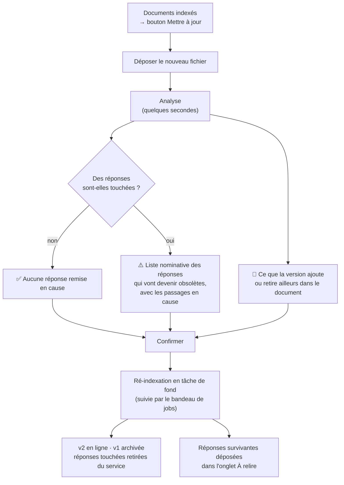

# Mettre à jour un document

## 1. Le problème

Les réponses enregistrées ont été rédigées **sur les documents tels qu'ils étaient** au moment
de leur validation. Quand la charte télétravail passe de 2 à 3 jours, la réponse canonique qui
disait « 2 jours » continue d'être servie automatiquement, sans qu'aucun humain la relise.

Il fallait donc trois choses : pouvoir **remplacer** le fichier d'un document sans casser ce qui
s'y rattache ; **savoir lesquelles** des réponses enregistrées ce remplacement rend fausses ; et,
pour tout ce que cette dernière question ne peut pas trancher seule, **poser la question à un
humain** au lieu de continuer à servir en silence.

## 2. Le parcours

Tout part de **Documents indexés**. Le système ne devine pas quel document vous mettez à jour :
c'est la ligne sur laquelle vous cliquez qui le désigne. Le fichier déposé peut porter
n'importe quel nom.



L'écran d'analyse est **exact, pas indicatif** : les réponses qu'il nomme sont exactement
celles qui disparaîtront. Rien n'est modifié tant que vous n'avez pas confirmé — vous pouvez
fermer la fenêtre sans conséquence.

**Le document garde son identifiant.** Ce n'est pas un nouveau document : c'est la version
suivante du même, et l'ancienne reste téléchargeable dans l'historique.

### Si vous passez par la page *Ingestion*

Déposer un fichier qui porte le nom d'un document déjà présent dans le même domaine ne crée
plus un second document en silence — c'était le moyen le plus simple de se retrouver avec deux
versions qui se contredisent. Une alerte propose trois issues : **mettre à jour** le document
existant (l'analyse démarre directement, sans re-déposer le fichier), **créer quand même** un
nouveau document, ou annuler.

Un fichier **renommé** passe à travers ce garde-fou : il n'y a pas de signal fiable dans ce cas.

## 3. Comment on décide qu'une réponse est obsolète

C'est le point contre-intuitif, et il vaut la peine de s'y arrêter.

> **On ne lit jamais le texte de la réponse. On compare le document à lui-même.**

Le moteur reformule : le document dit « limité à 2 jours par semaine », la réponse dit « jusqu'à
deux jours hebdomadaires ». Chercher les mots de la réponse dans le document ne donnerait rien.

Ce qu'on sait, en revanche, c'est **quels passages du document ont servi** à rédiger chaque
réponse — c'est enregistré à la génération. La question posée est donc beaucoup plus simple :

```
DOCUMENT v1, passage #7
  « Le télétravail est limité à 2 jours par semaine, sur accord du manager. »
        │
        │  a servi à rédiger ↓
        ↓
RÉPONSE ENREGISTRÉE — jamais comparée, jamais lue
  « Vous pouvez télétravailler jusqu'à deux jours hebdomadaires… »


ON MET À JOUR → on cherche le passage #7 dans le texte de la v2

  v2 : « …limité à 3 jours par semaine… »
        └─→ le passage a disparu  →  la réponse est obsolète

  v2 : « …limité à 2 jours par semaine, sur accord du manager. »  (reformatée ailleurs)
        └─→ le passage est intact →  la réponse est conservée
```

**Un seul passage disparu suffit** à rendre la réponse obsolète : si l'une de ses sources a
changé, on ne peut plus garantir qu'elle est juste.

Conséquence utile : reformater un document (retours à la ligne, espaces, PDF réexporté) sans
en changer le fond ne rend **aucune** réponse obsolète. Ce ne sont pas les découpages qui sont
comparés, ce sont les passages eux-mêmes.

### Le trou de cette règle, et ce qu'on en fait

La règle ci-dessus ne voit qu'une chose : les passages qui **ont servi**. Elle est donc aveugle
au cas inverse.

> Un « article 7 bis » ajouté **ailleurs** dans le document, qui restreindrait le télétravail,
> ne touche aucun passage cité. Rien ne devient obsolète. La réponse enregistrée, qui l'ignore,
> continue d'être servie automatiquement.

C'est le risque le plus sérieux du dispositif, et il faut le nommer : contrairement au faux
positif de la section 4 — visible dans l'onglet Obsolètes, réversible en un clic — celui-ci
serait **invisible**. Et les mises à jour de charte sont typiquement additives : le cas n'a rien
de théorique.

On pourrait croire que l'indexation suffit : le passage ajouté est bien indexé, et une question
*nouvelle* repart en génération sur le document à jour. C'est vrai, mais hors sujet — le
problème concerne les questions **déjà traitées**, précisément celles qui ont une réponse
enregistrée à resservir.

Aucune règle automatique ne peut trancher : décider si un ajout invalide une réponse demande de
le lire. Ce qu'on peut faire, en revanche, c'est **le rendre visible**. La même comparaison est
donc appliquée **dans les deux sens** :

| Sens | Ce qu'il attrape |
|---|---|
| Paragraphes de la v2 absents de la v1 | L'article **ajouté**, et la phrase réécrite. |
| Paragraphes de la v1 absents de la v2 | La règle **abrogée** — supprimée sans que rien ne soit écrit à la place, donc invisible au premier sens. |

Un pur reformatage (retours à la ligne, espaces, PDF réexporté) ne tire dans **aucun** des deux :
c'est ce qui empêche le signal de se déclencher à chaque mise à jour et de cesser d'être lu.

Dès qu'un des deux sens tire, deux choses se produisent.

**1. L'écran d'impact le montre, avant confirmation** — à la personne qui met le document à jour,
la mieux placée pour savoir ce qu'elle vient d'y écrire :

```
┌────────────────────────────────────────────────────────────────┐
│ 📄  Cette version change le contenu du document.               │
│                                                                │
│     2 réponses enregistrées continueront d'être servies        │
│     après la mise à jour. À vérifier dans                      │
│     Réponses enregistrées › À relire ↗                         │
│                                                                │
│     ┌──────────────────────────────────────────────────────┐   │
│     │ Combien de jours de télétravail ?   canonique 12 val.│   │
│     │ Vous pouvez télétravailler jusqu'à deux jours…       │   │
│     └──────────────────────────────────────────────────────┘   │
│     ┌──────────────────────────────────────────────────────┐   │
│     │ Le télétravail est-il de droit ?    canonique  5 val.│   │
│     │ Le télétravail est un droit ouvert à tous les…       │   │
│     └──────────────────────────────────────────────────────┘   │
└────────────────────────────────────────────────────────────────┘
```

Les réponses sont **nommées, pas comptées** — **toutes** les réponses VALIDÉE encore servies
du document sont affichées, sans filtre. Les plus validées viennent en tête : ce sont celles
qui repartent le plus souvent. La question de savoir si un changement spécifique contredit une
réponse donnée revient à l'humain ; aucun filtre automatique ne peut y répondre de façon fiable.

**2. Les réponses concernées sont déposées dans une liste durable** — l'onglet **À relire** de
*Réponses enregistrées*, décrit en section 4 bis. C'est ce qui distingue ce dispositif d'un
simple avertissement : la modale se ferme, le signal reste.

Deux réserves à connaître :

- une phrase simplement **réécrite** apparaît des deux côtés : passage disparu *et* passage
  ajouté. Les deux lectures sont vraies, le doublon est assumé ;
- le panneau reste **masqué** si le fichier de la version courante n'est plus sur le disque
  (documents antérieurs au versionnage). Afficher « 0 passage ajouté » se lirait comme une
  garantie ; mieux vaut ne rien dire que rassurer à tort. Les réponses sont alors quand même
  signalées, mais avec la mention « la version précédente n'a pas pu être relue » — un onglet
  bruyant qui dit pourquoi il l'est vaut mieux qu'un silence.

Agir sur une réponse signalée — la confirmer, la réécrire, la retirer du service ou la purger —
demande le **même droit que la mise à jour du document** : être back-office et avoir le domaine
du ticket d'origine. Celui qui voit l'alerte peut donc la traiter lui-même. Séparer les deux
reviendrait à dire qu'un validateur peut périmer une réponse en remplaçant le document dont elle
découle, mais pas la corriger directement. **L'administrateur n'y échappe pas** : il voit tout, il
n'écrit que dans ses domaines.

## 4. Ce qui arrive à une réponse obsolète

Avant le détail : ne pas confondre les deux états. Ils viennent tous deux d'une mise à jour de
document, mais ils ne disent pas la même chose et ne se traitent pas de la même façon.

| | **Obsolète** | **À relire** |
|---|---|---|
| Ce qu'on sait | Un passage qui **fondait** la réponse a disparu. | Le document a changé **ailleurs**. |
| Est-elle encore servie ? | **Non** — retirée de l'index. | **Oui** — rien n'a changé pour elle. |
| Ce qu'on vous demande | Vérifier si le retrait était mérité. | Juger si le changement la contredit. |
| Où | Onglet **Obsolètes** | Onglet **À relire** |
| Le geste normal | Restaurer, ou laisser. | Confirmer, corriger, ou retirer du service. |

Autrement dit : l'obsolescence est une **décision** prise par le système, faillible et
réversible ; le signalement est une **question** posée à un humain, parce qu'aucune règle ne peut
y répondre.

| | |
|---|---|
| Elle est **retirée du service** | Plus jamais resservie automatiquement. La question repartira en génération sur le document à jour. |
| Elle **n'est pas supprimée** | Ses validations, son auteur, son historique sont conservés intacts. |
| Les **tickets clos ne bougent pas** | La réponse reste affichée telle quelle sur les tickets où elle a été donnée : elle *était* correcte à l'époque, l'historique n'est pas réécrit. |
| Elle est **consultable** | Onglet **Obsolètes** de *Réponses enregistrées*, avec le document et la version déclencheurs. |
| Elle est **restaurable** | Un clic la remet en service, telle quelle. |

Ce bouton **Restaurer** est la soupape du système. La détection est volontairement stricte : si
quelqu'un a simplement reformulé une phrase sans en changer le sens, la réponse est marquée
obsolète à tort. Vous la relisez, vous constatez qu'elle tient toujours, vous la restaurez.
C'est le prix d'une règle sans seuil à régler — et c'est un faux positif visible et réversible,
là où un seuil mal calibré produirait des faux négatifs invisibles.

## 4 bis. L'onglet *À relire*

Toutes les réponses VALIDÉE encore servies d'un document dont le contenu a changé y sont
déposées — **sans filtre**. Elles **continuent d'être servies** pendant tout ce temps : le
drapeau est une file de relecture, pas un retrait. Le contraire ferait tomber en génération toute
la base de connaissances d'un document au moindre ajout.

Les réponses EN_ATTENTE (générées par le RAG mais pas encore validées) sont elles aussi annulées
à la mise à jour : les valider ensuite aboutirait à une réponse fondée sur l'ancienne version.

```
Réponses enregistrées   [ Canoniques ]  [ À relire ② ]  [ Obsolètes 3 ]
                                                 ▲
                              le badge compte les DOCUMENTS, pas les réponses
┌──────────────────────────────────────────────────────────────────────┐
│ Charte_RH.md  v3                              [ ✓ Tout confirmer ]   │
│ 2 réponses sur cette page                                            │
│ 1 passage ajouté                                                     │
│ ▌ Article 7 bis : le télétravail est suspendu pendant les            │
│   périodes de forte activité déclarées par la direction.             │
│ ─────────────────────────────────────────────────────────────────── │
│  Combien de jours de télétravail ?            canonique     12 val.  │
│  Vous pouvez télétravailler jusqu'à deux jours hebdomadaires…        │
│                        [ ✓ Toujours d'actualité ]  [ ✎ ]  [ 👁 ]     │
│ ─────────────────────────────────────────────────────────────────── │
│  Le télétravail est-il de droit ?             canonique      5 val.  │
│  Le télétravail est un droit ouvert à tout collaborateur…            │
│                        [ ✓ Toujours d'actualité ]  [ ✎ ]  [ 👁 ]     │
└──────────────────────────────────────────────────────────────────────┘
```

Le **diff du document** (passages ajoutés et retirés) est affiché **une seule fois en tête de
groupe** — c'est lui qu'on lit pour juger l'ensemble, pas répété par carte. Il est *figé* au
moment de la mise à jour, pas recalculé : trois jours plus tard, l'archive de la version sortante
peut avoir été purgée.

**Le badge compte les documents.** « 2 documents à relire » se traite ; « 39 réponses » se subit —
alors que ce sont bien deux diffs à lire, pas trente-neuf.

Trois issues par réponse, plus une en lot :

| Action | Effet |
|---|---|
| **Toujours d'actualité** | Le signalement tombe, rien d'autre ne change. La réponse continue d'être servie. |
| **Modifier** | On réécrit la réponse pour tenir compte du changement. Le signalement tombe : l'avoir éditée *est* le jugement demandé. |
| **Retirer du service** | La réponse bascule dans **Obsolètes**, d'où elle reste restaurable. |
| **Tout confirmer** | La sortie normale quand un document a signalé trente réponses : on lève le lot d'un document et d'une version. |

La **version** fait partie de la clé du lot, et pas seulement le document : si le document a été
remis à jour entre-temps, ses réponses ont été reflaguées sur v(n+1), et une confirmation partie
de l'écran de v(n) ne doit pas balayer un signalement que personne n'a vu.

Une réponse signalée reste visible dans l'onglet **Canoniques**, où elle porte une pastille ambre.
C'est cohérent : elle est toujours servie, elle a toute sa place dans la liste des réponses
actives — mais l'écran ne doit pas la présenter comme acquise.

Enfin, si une réponse signalée devient **obsolète** lors d'une mise à jour ultérieure, son
signalement est levé : l'obsolescence tranche la question que la relecture posait, et la réponse
ne siège jamais dans les deux onglets à la fois.

## 5. Versions et restauration

Chaque mise à jour archive la version sortante. L'**historique** liste les versions de la plus
récente à la plus ancienne : date, auteur, taille, nombre de passages, et un bouton de
téléchargement pour chacune.

**Restaurer ne revient pas en arrière.** Restaurer la v1 depuis la v3 ne recrée pas la v1 : elle
crée une **v4** dont le contenu est celui de la v1, marquée « restaurée depuis la v1 ». Le fil
des versions n'est jamais réécrit — on sait toujours ce qui a été en ligne, et quand.

```
v1 ──── v2 ──── v3 ──── v4  (contenu de la v1, restaurée depuis v1)
                        ▲
                        └── une restauration est une mise à jour comme une autre
```

Et puisque c'est une mise à jour comme une autre, elle **change le texte du document** : elle
peut donc à son tour rendre des réponses obsolètes — celles qui s'appuyaient sur des passages
apparus en v2 ou v3. Le même écran d'impact s'affiche avant de confirmer, avec les mêmes
garanties.

Symétriquement, restaurer une version **ne ressuscite pas** les réponses qu'elle avait rendues
obsolètes. Elles restent dans l'onglet Obsolètes, où vous les restaurez explicitement si elles
redeviennent valables.

## 6. Les limites, dites franchement

- **La reformulation cosmétique déclenche un faux positif.** Changer un synonyme ou une
  ponctuation dans un passage cité marque la réponse obsolète alors que le fond n'a pas bougé.
  Réponse du système : c'est visible, et Restaurer le corrige en un clic.
- **On signale, on ne décide pas.** Un changement ailleurs dans le document est détecté (dans les
  deux sens) et dépose **toutes** les réponses VALIDÉE du document dans l'onglet *À relire* — mais
  aucune règle ne peut dire si le changement les contredit : cela demande de lire. Tant que
  personne n'a tranché, la réponse **continue d'être servie**. C'est la limite la plus sérieuse,
  et la seule qui repose entièrement sur la vigilance humaine ; ce qui a changé, c'est qu'elle ne
  repose plus sur la vigilance d'une seule personne à un seul instant.
- **Le signalement est large par construction.** Toutes les réponses VALIDÉE d'un document dont le
  contenu a changé sont déposées dans l'onglet, même celles qui ne concernent pas la modification.
  C'est voulu : tout filtre automatique produit des faux négatifs invisibles. D'où le groupement
  par document et la confirmation en lot (§4 bis) — c'est la sortie normale, pas l'exception.
- **Un seul signalement à la fois par réponse.** Si un second document la fait signaler, les
  colonnes sont écrasées : dernier arrivé gagne. Une réponse ne peut pas porter deux relectures en
  attente.
- **Un fichier renommé échappe au garde-fou homonyme** de la page Ingestion.
- **Le domaine d'un document n'est pas modifiable** par une mise à jour.
- **Supprimer un document efface aussi ses archives** — toutes les versions, définitivement.

---

## Annexe — pour les développeurs

**Endpoints** (`backend/app/api/v1/documents.py`) :

| Étape | Route | Effet |
|---|---|---|
| Aperçu | `POST /documents/{doc_id}/versions/preview` | Met le fichier en staging, calcule l'impact. **Ne modifie rien.** |
| Confirmation | `POST /documents/{doc_id}/versions/confirm` | Réserve le numéro de version, lance le job Celery. |
| Historique | `GET /documents/{doc_id}/versions` | Versions décroissantes ; `fichier_disponible` signale les archives absentes du disque. |
| Archive | `GET /documents/{doc_id}/versions/{v}/download` | Fichier de la version `v`. |
| Restauration | `POST /documents/{doc_id}/versions/{v}/restaurer` | Stage le fichier archivé → **renvoie le même aperçu d'impact**, à confirmer par `confirm`. |

Le flux en deux temps existe pour que la confirmation porte sur **exactement** le fichier
analysé. Une restauration n'a pas de chemin de code propre : elle appelle `stager_et_analyser`,
partagé avec la mise à jour, puis le même `confirm`.

**Détection** : `backend/app/services/obsolescence.py`.
`indices_modifies(anciens_chunks, nouveau_texte)` teste la présence en sous-chaîne, après
normalisation des espaces. C'est valide parce que le découpage produit des sous-chaînes du texte
complet. `reponses_obsoletes` part de `reponse_chunks`, puis **descend transitivement** vers les
copies SUGGESTION/CANONIQUE via `reponse_source_id` (elles ne citent aucun chunk) ; `racines`
dédoublonne la famille pour que le comptage annoncé à l'écran soit celui des réponses réellement
distinctes.

**Détection en miroir** : `decouper_en_passages` + `passages_ajoutes`, **même primitive appelée
deux fois, arguments inversés** — c'est tout le second sens. L'unité est le **paragraphe**, pas
le chunk : un chunk fait 384 tokens, donc un extrait illisible et une granularité telle que la
moindre retouche marquerait 1 500 caractères comme ajoutés. Les blocs de moins de 40 caractères
(titres, numérotation, artefacts PDF) sont écartés. Coût : un `extract_text` de plus — sur le
fichier de la version courante, qui sert de texte de référence. Ni appel API, ni embedding. Si ce
fichier est absent ou illisible, `analyser_changements` (`api/v1/documents.py`) renvoie
`ajouts_analysables: False` et le front masque le panneau : l'obsolescence, elle, est déjà
calculée, et perdre le signal secondaire ne doit pas coûter le principal.

Le calcul existe en deux exemplaires, volontairement : `analyser_changements` côté API pour
l'aperçu, son homonyme dans le worker pour figer le résultat dans `DocumentVersion.changements` à
la confirmation. `extrait()` est partagé pour que les deux montrent exactement le même texte.
**Ne jamais** reconstituer le texte sortant en concaténant les chunks capturés : le chevauchement
de 128 tokens du splitter fabriquerait une fausse suppression à chaque couture.

**Job** : `backend/app/workers/document_update.py`, file `queue_ingestion`.
Ordre imposé — `scroll` (capture du texte des anciens passages, **avant toute suppression** :
c'est leur seule source) → extraction + détection → découpage + embeddings → `upsert` des
nouveaux points → `delete` des anciens → commit Postgres → `marquer_obsoletes` →
`marquer_a_relire` → SSE `document_updated`. L'upsert précède le delete : l'ordre inverse
ouvrirait un trou de service pendant toute la durée des embeddings. Le prix est une fenêtre de
quelques centaines de millisecondes où les deux versions coexistent dans l'index.
Le signalement vient **après** l'obsolescence, jamais avant : les réponses qui viennent de
disparaître n'ont pas à être relues, et `reponses_obsoletes` les écarte une fois le commit passé.
Le chemin du fichier sortant se lit dans le pré-vol, avec le domaine : la session est fermée
ensuite et `doc` devient détaché.

**Obsolescence en base** : un **drapeau** `Reponse.obsolete` (+ `obsolete_raison`,
`obsolete_doc_id`, `obsolete_version`, `obsolete_at`), et non une valeur de `statut`. `statut`
porte le workflow du ticket ; y écrire « obsolète » ferait apparaître comme périmée, sur des
tickets clos, une réponse qui *a bien été* validée et *était* correcte. Le drapeau donne le
comportement voulu sans corrompre l'historique.

**Signalement en base** : cinq colonnes en miroir exact des précédentes — `Reponse.a_relire`
(+ `a_relire_raison`, `a_relire_doc_id`, `a_relire_version`, `a_relire_at`). Les colonnes
`passages_pertinents` et `correction_suggeree` existent en base (migrations déjà appliquées) mais
ne sont plus peuplées. `marquer_a_relire` **ne touche pas à Qdrant** : c'est toute la différence
avec l'obsolescence. Il flague la famille entière (`reponses_obsoletes(..., indices=None)`) et non
les seules `racines` — `racines` garde les copies dont la source est hors ensemble, que le filtre
`reponse_source_id IS NULL` des listes rendrait invisibles donc indéboulonnables.

**EN_ATTENTE.** `marquer_obsoletes` annule aussi les réponses EN_ATTENTE liées au document via
`ReponseChunk` : les valider ensuite aboutirait à indexer une réponse fondée sur l'ancienne
version. Les EN_ATTENTE n'ont pas de point Qdrant (indexé seulement à la validation), l'appel à
`delete_response_point` est donc un no-op pour elles.

Ce qui lève le drapeau : `confirmer_actualite`, `PUT /reponses/{id}/editer`, `corriger_reponse`,
`marquer_obsoletes` (une réponse ne siège jamais dans les deux onglets), `restaurer_reponse`
(restaurer *est* le jugement demandé), et le reset des copies détachées par `DELETE`. Ce qui ne
le lève **pas** : `valider_reponse` — le validateur d'un nouveau ticket ne sait pas que le
document a bougé.

| Route | Effet |
|---|---|
| `GET /reponses/a-relire` | Liste paginée des **sources** signalées, avec `changements` de la version et `nb_documents` (le badge). |
| `POST /reponses/{id}/confirmer-actualite` | Lève le drapeau sur la famille. 409 si la réponse n'est pas signalée. |
| `POST /reponses/confirmer-actualite` | Lot `{doc_id, version}`, restreint aux domaines de l'appelant. |
| `POST /reponses/{id}/retirer` | Obsolescence à la main, `raison = RETIRÉ_À_LA_MAIN`, en reprenant `a_relire_doc_id`/`a_relire_version` — sinon l'onglet Obsolètes afficherait « document supprimé ». |

**`feedback_job` upserte sans condition** et `valider_reponse` le déclenche sur la source : le
point Qdrant d'une réponse retirée peut donc réapparaître. Le filtre `obsolete.is_(False)` de
`question.py` reste la vraie garantie — à ne pas présenter comme un retrait définitif.
