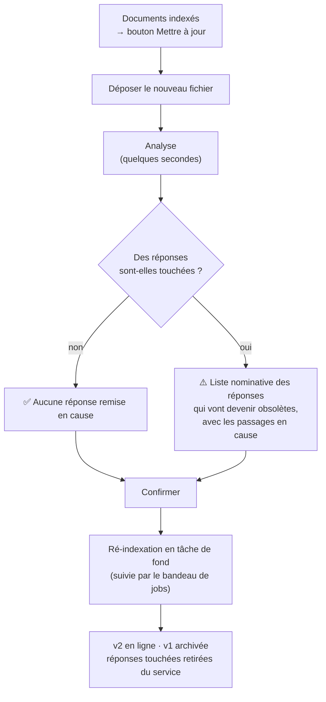

# Mettre à jour un document

## 1. Le problème

Les réponses enregistrées ont été rédigées **sur les documents tels qu'ils étaient** au moment
de leur validation. Quand la charte télétravail passe de 2 à 3 jours, la réponse canonique qui
disait « 2 jours » continue d'être servie automatiquement, sans qu'aucun humain la relise.

Il fallait donc deux choses : pouvoir **remplacer** le fichier d'un document sans casser ce qui
s'y rattache, et **savoir lesquelles** des réponses enregistrées ce remplacement rend fausses.

## 2. Le parcours

Tout part de **Documents indexés**. Le système ne devine pas quel document vous mettez à jour :
c'est la ligne sur laquelle vous cliquez qui le désigne. Le fichier déposé peut porter
n'importe quel nom.



L'écran d'analyse est **exact, pas indicatif** : les réponses qu'il nomme sont exactement
celles qui disparaîtront. Rien n'est modifié tant que vous n'avez pas confirmé — vous pouvez
fermer la fenêtre sans conséquence.

**Le document garde son identifiant.** Ce n'est pas un nouveau document : c'est la version
suivante du même, et l'ancienne reste téléchargeable dans l'historique.

### Si vous passez par la page *Ingestion*

Déposer un fichier qui porte le nom d'un document déjà présent dans le même domaine ne crée
plus un second document en silence — c'était le moyen le plus simple de se retrouver avec deux
versions qui se contredisent. Une alerte propose trois issues : **mettre à jour** le document
existant (l'analyse démarre directement, sans re-déposer le fichier), **créer quand même** un
nouveau document, ou annuler.

Un fichier **renommé** passe à travers ce garde-fou : il n'y a pas de signal fiable dans ce cas.

## 3. Comment on décide qu'une réponse est obsolète

C'est le point contre-intuitif, et il vaut la peine de s'y arrêter.

> **On ne lit jamais le texte de la réponse. On compare le document à lui-même.**

Le moteur reformule : le document dit « limité à 2 jours par semaine », la réponse dit « jusqu'à
deux jours hebdomadaires ». Chercher les mots de la réponse dans le document ne donnerait rien.

Ce qu'on sait, en revanche, c'est **quels passages du document ont servi** à rédiger chaque
réponse — c'est enregistré à la génération. La question posée est donc beaucoup plus simple :

```
DOCUMENT v1, passage #7
  « Le télétravail est limité à 2 jours par semaine, sur accord du manager. »
        │
        │  a servi à rédiger ↓
        ↓
RÉPONSE ENREGISTRÉE — jamais comparée, jamais lue
  « Vous pouvez télétravailler jusqu'à deux jours hebdomadaires… »


ON MET À JOUR → on cherche le passage #7 dans le texte de la v2

  v2 : « …limité à 3 jours par semaine… »
        └─→ le passage a disparu  →  la réponse est obsolète

  v2 : « …limité à 2 jours par semaine, sur accord du manager. »  (reformatée ailleurs)
        └─→ le passage est intact →  la réponse est conservée
```

**Un seul passage disparu suffit** à rendre la réponse obsolète : si l'une de ses sources a
changé, on ne peut plus garantir qu'elle est juste.

Conséquence utile : reformater un document (retours à la ligne, espaces, PDF réexporté) sans
en changer le fond ne rend **aucune** réponse obsolète. Ce ne sont pas les découpages qui sont
comparés, ce sont les passages eux-mêmes.

### Le trou de cette règle, et ce qu'on en fait

La règle ci-dessus ne voit qu'une chose : les passages qui **ont servi**. Elle est donc aveugle
au cas inverse.

> Un « article 7 bis » ajouté **ailleurs** dans le document, qui restreindrait le télétravail,
> ne touche aucun passage cité. Rien ne devient obsolète. La réponse enregistrée, qui l'ignore,
> continue d'être servie automatiquement.

C'est le risque le plus sérieux du dispositif, et il faut le nommer : contrairement au faux
positif de la section 4 — visible dans l'onglet Obsolètes, réversible en un clic — celui-ci est
**invisible**. Et les mises à jour de charte sont typiquement additives : le cas n'a rien de
théorique.

On pourrait croire que l'indexation suffit : le passage ajouté est bien indexé, et une question
*nouvelle* repart en génération sur le document à jour. C'est vrai, mais hors sujet — le
problème concerne les questions **déjà traitées**, précisément celles qui ont une réponse
enregistrée à resservir.

Aucune règle automatique ne peut trancher : décider si un ajout invalide une réponse demande de
le lire. Ce qu'on peut faire, en revanche, c'est **le rendre visible**. La même comparaison est
donc appliquée dans l'autre sens — quels paragraphes de la nouvelle version sont absents de
l'ancienne — et l'écran d'impact affiche, à côté du verdict d'obsolescence :

```
┌────────────────────────────────────────────────────────────────┐
│ 📄  2 passages ajoutés par cette version.                      │
│                                                                │
│     4 réponses enregistrées de ce document n'en tiennent pas   │
│     compte et resteront servies telles quelles. Rien ne        │
│     devient obsolète : à vous de juger si un de ces ajouts     │
│     les contredit.                                             │
│                                                                │
│     │ Article 7 bis : le télétravail est suspendu pendant…     │
│     │ Article 9 : les frais d'équipement sont plafonnés à…     │
│                                                                │
│     À RELIRE, LES PLUS SERVIES D'ABORD                         │
│     ┌──────────────────────────────────────────────────────┐   │
│     │ Combien de jours de télétravail ?  canonique 12 val. ↗│   │
│     │ Le télétravail est-il de droit ?   canonique  5 val. ↗│   │
│     └──────────────────────────────────────────────────────┘   │
└────────────────────────────────────────────────────────────────┘
```

Les réponses sont **nommées, pas comptées** : un simple « 4 réponses n'en tiennent pas compte »
obligerait à les retrouver à la main dans *Réponses enregistrées*, et l'avertissement retomberait.
Chaque ligne ouvre son ticket **dans un nouvel onglet** — la mise à jour en cours n'est pas
perdue, on peut relire sans renoncer à confirmer. Les plus validées viennent en tête : ce sont
celles qui repartent le plus souvent. Au-delà de dix, le reste est annoncé et se traite depuis
*Réponses enregistrées*.

C'est un **signal de tri, pas une décision** : aucune réponse n'est retirée du service par ce
panneau. Il transforme un angle mort en information affichée au bon moment — devant la personne
qui met le document à jour, et qui est la mieux placée pour savoir ce qu'elle vient d'y écrire.

Deux réserves à connaître :

- une phrase simplement **réécrite** apparaît des deux côtés : passage disparu *et* passage
  ajouté. Les deux lectures sont vraies, le doublon est assumé ;
- le panneau reste **masqué** si le fichier de la version courante n'est plus sur le disque
  (documents antérieurs au versionnage). Afficher « 0 passage ajouté » se lirait comme une
  garantie ; mieux vaut ne rien dire que rassurer à tort.

Agir sur une réponse signalée — la réécrire (`editer`) ou la purger (`DELETE`) — demande le
**même droit que la mise à jour du document** : être back-office et avoir le domaine du ticket
d'origine. Celui qui voit l'alerte peut donc la traiter lui-même. Séparer les deux reviendrait à
dire qu'un validateur peut périmer une réponse en remplaçant le document dont elle découle, mais
pas la corriger directement.

## 4. Ce qui arrive à une réponse obsolète

| | |
|---|---|
| Elle est **retirée du service** | Plus jamais resservie automatiquement. La question repartira en génération sur le document à jour. |
| Elle **n'est pas supprimée** | Ses validations, son auteur, son historique sont conservés intacts. |
| Les **tickets clos ne bougent pas** | La réponse reste affichée telle quelle sur les tickets où elle a été donnée : elle *était* correcte à l'époque, l'historique n'est pas réécrit. |
| Elle est **consultable** | Onglet **Obsolètes** de *Réponses enregistrées*, avec le document et la version déclencheurs. |
| Elle est **restaurable** | Un clic la remet en service, telle quelle. |

Ce bouton **Restaurer** est la soupape du système. La détection est volontairement stricte : si
quelqu'un a simplement reformulé une phrase sans en changer le sens, la réponse est marquée
obsolète à tort. Vous la relisez, vous constatez qu'elle tient toujours, vous la restaurez.
C'est le prix d'une règle sans seuil à régler — et c'est un faux positif visible et réversible,
là où un seuil mal calibré produirait des faux négatifs invisibles.

## 5. Versions et restauration

Chaque mise à jour archive la version sortante. L'**historique** liste les versions de la plus
récente à la plus ancienne : date, auteur, taille, nombre de passages, et un bouton de
téléchargement pour chacune.

**Restaurer ne revient pas en arrière.** Restaurer la v1 depuis la v3 ne recrée pas la v1 : elle
crée une **v4** dont le contenu est celui de la v1, marquée « restaurée depuis la v1 ». Le fil
des versions n'est jamais réécrit — on sait toujours ce qui a été en ligne, et quand.

```
v1 ──── v2 ──── v3 ──── v4  (contenu de la v1, restaurée depuis v1)
                        ▲
                        └── une restauration est une mise à jour comme une autre
```

Et puisque c'est une mise à jour comme une autre, elle **change le texte du document** : elle
peut donc à son tour rendre des réponses obsolètes — celles qui s'appuyaient sur des passages
apparus en v2 ou v3. Le même écran d'impact s'affiche avant de confirmer, avec les mêmes
garanties.

Symétriquement, restaurer une version **ne ressuscite pas** les réponses qu'elle avait rendues
obsolètes. Elles restent dans l'onglet Obsolètes, où vous les restaurez explicitement si elles
redeviennent valables.

## 6. Les limites, dites franchement

- **La reformulation cosmétique déclenche un faux positif.** Changer un synonyme ou une
  ponctuation dans un passage cité marque la réponse obsolète alors que le fond n'a pas bougé.
  Réponse du système : c'est visible, et Restaurer le corrige en un clic.
- **Une information ajoutée ailleurs ne rend rien obsolète automatiquement.** Elle est signalée
  sur l'écran d'impact (§3), mais c'est à un humain de juger si elle contredit une réponse
  existante. C'est la limite la plus sérieuse, et la seule qui repose entièrement sur la
  vigilance de la personne qui met à jour.
- **Un fichier renommé échappe au garde-fou homonyme** de la page Ingestion.
- **Le domaine d'un document n'est pas modifiable** par une mise à jour.
- **Supprimer un document efface aussi ses archives** — toutes les versions, définitivement.

---

## Annexe — pour les développeurs

**Endpoints** (`backend/app/api/v1/documents.py`) :

| Étape | Route | Effet |
|---|---|---|
| Aperçu | `POST /documents/{doc_id}/versions/preview` | Met le fichier en staging, calcule l'impact. **Ne modifie rien.** |
| Confirmation | `POST /documents/{doc_id}/versions/confirm` | Réserve le numéro de version, lance le job Celery. |
| Historique | `GET /documents/{doc_id}/versions` | Versions décroissantes ; `fichier_disponible` signale les archives absentes du disque. |
| Archive | `GET /documents/{doc_id}/versions/{v}/download` | Fichier de la version `v`. |
| Restauration | `POST /documents/{doc_id}/versions/{v}/restaurer` | Stage le fichier archivé → **renvoie le même aperçu d'impact**, à confirmer par `confirm`. |

Le flux en deux temps existe pour que la confirmation porte sur **exactement** le fichier
analysé. Une restauration n'a pas de chemin de code propre : elle appelle `stager_et_analyser`,
partagé avec la mise à jour, puis le même `confirm`.

**Détection** : `backend/app/services/obsolescence.py`.
`indices_modifies(anciens_chunks, nouveau_texte)` teste la présence en sous-chaîne, après
normalisation des espaces. C'est valide parce que le découpage produit des sous-chaînes du texte
complet. `reponses_obsoletes` part de `reponse_chunks`, puis **descend transitivement** vers les
copies SUGGESTION/CANONIQUE via `reponse_source_id` (elles ne citent aucun chunk) ; `racines`
dédoublonne la famille pour que le comptage annoncé à l'écran soit celui des réponses réellement
distinctes.

**Détection en miroir** : `decouper_en_passages` + `passages_ajoutes`, même primitive appliquée
dans l'autre sens. L'unité est le **paragraphe**, pas le chunk : un chunk fait 384 tokens, donc
un extrait illisible et une granularité telle que la moindre retouche marquerait 1 500
caractères comme ajoutés. Les blocs de moins de 40 caractères (titres, numérotation, artefacts
PDF) sont écartés. Coût : un `extract_text` de plus au moment de l'aperçu — sur le fichier de la
version courante, qui sert de texte de référence. Ni appel API, ni embedding. Si ce fichier est
absent ou illisible, `analyser_ajouts` renvoie `ajouts_analysables: False` et le front masque le
panneau : l'obsolescence, elle, est déjà calculée, et perdre le signal secondaire ne doit pas
coûter le principal.

**Job** : `backend/app/workers/document_update.py`, file `queue_ingestion`.
Ordre imposé — `scroll` (capture du texte des anciens passages, **avant toute suppression** :
c'est leur seule source) → extraction + détection → découpage + embeddings → `upsert` des
nouveaux points → `delete` des anciens → commit Postgres → `marquer_obsoletes` → SSE
`document_updated`. L'upsert précède le delete : l'ordre inverse ouvrirait un trou de service
pendant toute la durée des embeddings. Le prix est une fenêtre de quelques centaines de
millisecondes où les deux versions coexistent dans l'index.

**Obsolescence en base** : un **drapeau** `Reponse.obsolete` (+ `obsolete_raison`,
`obsolete_doc_id`, `obsolete_version`, `obsolete_at`), et non une valeur de `statut`. `statut`
porte le workflow du ticket ; y écrire « obsolète » ferait apparaître comme périmée, sur des
tickets clos, une réponse qui *a bien été* validée et *était* correcte. Le drapeau donne le
comportement voulu sans corrompre l'historique.
