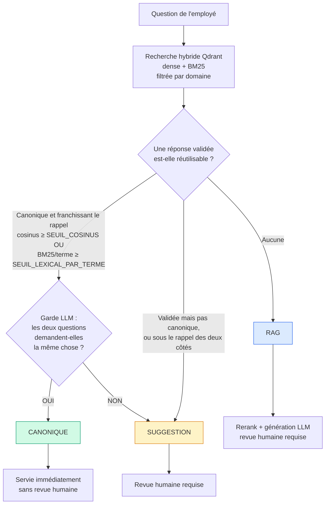
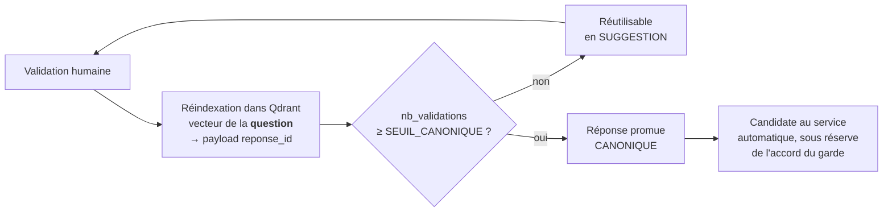

# TicketAI — Présentation du projet

TicketAI est un helpdesk interne alimenté par l'IA qui répond automatiquement aux questions des employés en s'appuyant sur une base de connaissances validée par des experts métier.

---

## Contexte et objectif

Les employés posent leurs questions procédurales ou réglementaires via un portail web. Le système tente d'y répondre automatiquement en cherchant dans les documents internes et les réponses déjà validées. Si la confiance est suffisante, la réponse est servie instantanément ; sinon, elle est soumise à un expert du domaine pour validation.

Chaque validation renforce la base : au bout de trois validations, une réponse devient **canonique** et est servie directement, sans intervention humaine, pour toutes les questions similaires à venir.

---

## Utilisateurs

| Rôle | Ce qu'ils font |
|---|---|
| **Employé** | Soumet une question dans son domaine et consulte les réponses depuis l'espace utilisateur |
| **Validateur** (expert métier) | Valide, corrige ou rejette les réponses générées par l'IA depuis le backoffice ; gère la base documentaire |
| **Admin** | Configure les seuils, les groupes, les domaines et surveille la santé de la plateforme |

---

## Les trois branches de réponse

**CANONIQUE** — une réponse déjà validée plusieurs fois a été retrouvée, **et un juge LLM a
confirmé que la question posée demande exactement la même chose** que celle sous laquelle
la réponse est indexée. Aucune intervention humaine.

**SUGGESTION** — une réponse validée existe mais n'est pas encore canonique, son score est
trop bas, **ou le garde a refusé de la servir sans revue**. Elle est réutilisée, mais
l'expert doit confirmer ou corriger.

**RAG** — aucune réponse réutilisable. Le système reranke les
chunks de documents pertinents et génère une réponse via LLM (Albert API). Elle est
toujours soumise à validation avant d'être publiée.

> **Le seuil de similarité ne décide pas de ce qui est sûr.** Deux questions peuvent être
> quasi identiques vectoriellement et appeler des réponses opposées (« puis-je
> télétravailler ? » vs « puis-je *refuser* de télétravailler ? »). Le seuil ne fait que
> limiter le nombre de candidats soumis au juge ; **c'est le garde qui tranche**. Voir
> [Garde du cache canonique](technique/garde-cache-canonique.md).

> **Deux signaux, deux portes.** Un candidat atteint le juge par sa proximité vectorielle
> **ou** par son recouvrement de mots (BM25). La seconde porte existe pour ce que la première
> ne voit pas : un sigle, une référence d'article, un nom propre inconnu du modèle
> d'embedding — cosinus médiocre, recouvrement parfait. Élargir le rappel coûte des appels au
> juge, pas de la sûreté.

---

## Boucle de feedback

La base de connaissances s'enrichit naturellement au fil des validations, sans action manuelle.

> **Pourquoi indexer la question et non la réponse ?** La similarité question↔question
> atteint des scores élevés pour deux formulations proches, alors que question↔réponse
> plafonne autour de 0,50 et n'atteint jamais le seuil. C'est un choix structurant du
> système.

---

## Panorama des fonctionnalités

| Domaine | Ce que le système offre | Détail |
|---|---|---|
| **Poser et suivre** | Soumission d'une question, fil de conversation avec relances, clôture, notation 1–5 | [Espace utilisateur](fonctionnalites/espace-utilisateur.md) |
| **Consulter sans demander** | Page FAQ : recherche sémantique dans les réponses déjà canoniques, tous domaines confondus. Aucun ticket, aucune génération — le seul écran où une réponse s'obtient sans repasser par la file de validation | [Espace utilisateur § 3](fonctionnalites/espace-utilisateur.md#3-chercher-une-réponse-déjà-validée-la-faq) |
| **Valider** | File de tickets filtrable, verrou collaboratif, assignation, valider / corriger / rejeter, timeline complète | [Traiter les tickets](fonctionnalites/backoffice-tickets.md) |
| **Capitaliser** | Réponses canoniques, file « à relire », réponses obsolètes, restauration | [Réponses enregistrées](fonctionnalites/reponses-enregistrees.md) |
| **Documenter** | Import PDF/DOCX/TXT/MD, versionnement, chunks consultables, angles morts | [Base de connaissances](fonctionnalites/base-de-connaissances.md) |
| **Rester informé** | Cloche de notifications, mises à jour temps réel sans rechargement | [Notifications et temps réel](fonctionnalites/notifications-et-temps-reel.md) |
| **Piloter** | Tableau de bord par domaine, répartition des branches, satisfaction, stats d'équipe | [Statistiques et pilotage](fonctionnalites/statistiques-et-pilotage.md) |
| **Administrer** | Groupes et domaines, santé des services, incidents, quotas Albert, bannière, suggestions | [Administration](fonctionnalites/administration.md) |

---

## Stack technique

| Couche | Technologie |
|---|---|
| **Backend** | FastAPI (Python 3.14), SQLAlchemy, Alembic |
| **Workers** | Celery (files `queue_questions` et `queue_ingestion`) |
| **Broker** | Valkey (Redis-compatible) |
| **Base de données** | PostgreSQL 16 |
| **Recherche vectorielle** | Qdrant, réellement hybride — denses 1024d BGE-M3 + BM25 creux (IDF côté serveur), fusion RRF manuelle pour l'ordre seul |
| **IA** | Albert API (gouvernement français) — embeddings, reranker, LLM |
| **Frontend** | React 19, Vite, TypeScript, Tailwind CSS v4 |
| **Infra locale** | Docker Compose (Postgres + Qdrant + Valkey) |

---

## Périmètre et contraintes

- Déploiement interne mono-organisation, sans multi-tenancy
- Interface entièrement en français (UI, prompts, documents)
- Domaines configurables par l'admin
- Documents supportés : PDF, DOCX, TXT, MD
- Mise à jour documentaire versionnée : remplacer un document déclenche une révérification automatique des réponses existantes
- Authentification LDAP (production) ou base locale (développement)
- Mises à jour temps réel via SSE (Server-Sent Events)
- Un validateur ne peut pas valider son propre ticket

---

## Principes de conception

**L'expertise se capitalise.** Chaque validation réduit le coût de la prochaine réponse identique. Le seuil canonique est le levier central du système.

**Confiance graduelle.** Les réponses traversent une porte humaine tant que la confiance n'est pas établie. Quand elle l'est, elles passent seules.

**Incertitude explicite.** Quand le système ne peut pas répondre avec confiance, il le dit et route vers un expert — jamais de réponse silencieusement approximative.

**Propriété par domaine.** Chaque expert ne voit que les tickets de son domaine. La séparation est appliquée au niveau du filtre Qdrant, pas seulement de l'UI.
