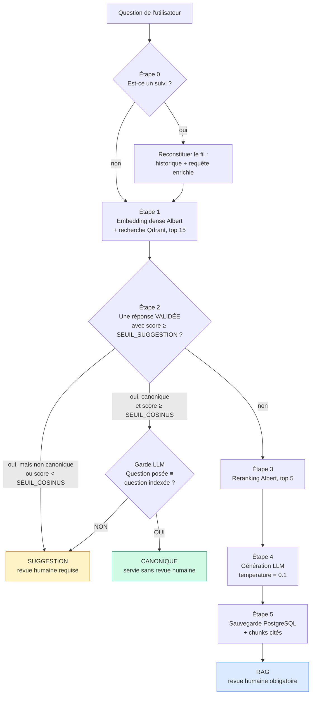

# Pipeline de traitement des questions

Ce document décrit le traitement d'une question depuis sa réception jusqu'à la réponse produite. Il détaille le flux, les branchements, et les décisions de conception.

**Fichiers concernés**
- `backend/app/workers/question.py` — point d'entrée Celery (`question_job`)
- `backend/app/services/question_pipeline.py` — logique métier (sans dépendance Celery)
- `backend/app/services/garde_cache.py` — garde LLM du cache canonique
- `backend/app/services/search.py` — recherche hybride + fusion RRF
- `backend/app/services/reranker.py` — reranking via Albert
- `backend/app/services/llm.py` — génération LLM via Albert
- `backend/app/workers/feedback.py` — réindexation après validation

---

## Vue d'ensemble



---

## Seuils de décision

| Variable | Valeur par défaut | Rôle |
|---|---|---|
| `SEUIL_COSINUS` | 0.80 | Cosinus minimum pour présenter un candidat canonique au garde |
| `SEUIL_SUGGESTION` | `SEUIL_COSINUS − 0.05` = 0.75 | Cosinus minimum pour la branche SUGGESTION |
| `SEUIL_LEXICAL_PAR_TERME` | 1.0 | BM25 **par terme** minimum — la porte lexicale, en disjonction du cosinus. `0` la referme |
| `SEUIL_CANONIQUE` | 3 | Nombre de validations pour promouvoir une réponse en canonique |

Les deux premiers et le troisième ne se combinent pas : ils s'appliquent **chacun sur son
signal**, et un candidat passe s'il franchit l'un **ou** l'autre. `SEUIL_LEXICAL_PAR_TERME`
est à recalibrer quand le corpus grossit — l'IDF de Qdrant est en log(N), donc toute
l'échelle lexicale se déplace. Sa valeur par défaut a été mesurée sur 24 points.

**« Par terme » est planché à deux termes.** Le diviseur est le nombre de termes de la
requête, appariés ou non — l'appariement partiel doit coûter. Mais à un seul terme il vaut 1
et la normalisation ne fait plus rien : franchir 1,0 ne demande alors qu'un IDF ≥ 0,64,
c'est-à-dire n'importe quel mot présent dans moins de la moitié du corpus. Toute requête d'un
mot ouvrait donc la porte lexicale, et chaque ouverture coûte un appel au juge. D'où
`DIVISEUR_MINIMAL = 2` (`services/search.py`) : un vrai terme rare passe toujours (« RGPD »,
IDF ≈ 3 → ≈ 2,3), un mot courant ne passe plus (IDF ≈ 0,7 → ≈ 0,53). **Aucun effet au-delà
d'un terme**, donc aucun effet sur la valeur calibrée du seuil.

> ⚠️ **Lire les § 14 et 15 de [`rapport-test-cache-semantique.md`](rapport-test-cache-semantique.md)
> avant de toucher `SEUIL_LEXICAL_PAR_TERME`, la tokenisation ou la condition de rappel.**
> Le § 15 ajoute une contrainte que le § 14 n'avait pas : `AVG_LEN` et `B` forment une paire
> calibrée, et les modifier **invalide tout vecteur creux déjà écrit** — la saturation TF est
> figée à l'écriture, contrairement à l'IDF. Le rattrapage se fait avec
> `scripts/reencoder_vecteurs_creux.py`, pas avec `reinitialiser_index.py`.
> Le piège principal y est mesuré : sur le jeu de 48 cas, un balayage désigne très
> clairement `5,0` — ce qui fermerait la porte sur `article L1222-9`, à 1,038/terme, c'est-à-dire
> exactement le cas qui la justifie. Le jeu de test ne contient aucun terme hors distribution
> du modèle d'embedding, donc il mesure ce que la porte coûte sans voir ce qu'elle rapporte.
> **Un balayage ne peut pas arbitrer sur une population absente de son jeu de test.**

`SEUIL_COSINUS` est un **filtre de coût**, pas un filtre de sécurité : c'est le garde LLM qui décide si la réponse peut être servie sans revue humaine. Abaisser ce seuil augmente le nombre d'appels LLM au garde ; le relever en réduit le nombre mais risque de rater des candidats légitimes. Porté de 0,90 à 0,85 le 05/09/2026 : à 0,90 il refusait à la place du juge et écartait des reformulations équivalentes. Puis à 0,80 le 07/09/2026, campagne rejouée à l'identique : CANONIQUE 14 → 19 sur 48, appels au juge 15 → 22, toujours aucun faux positif. Ne pas descendre plus bas — la bande [0,80 ; 0,85) contenait 5 reformulations équivalentes, la bande [0,75 ; 0,80) n'en contient aucune sur 4. Voir [`rapport-test-cache-semantique.md`](rapport-test-cache-semantique.md), § 12.

Le seuil ne peut plus **dégrader** l'issue en étant franchi : un refus du garde rend le candidat à la branche SUGGESTION, il ne le renvoie pas au RAG.

---

## Étape 1 — Recherche hybride

```python
chunks = search_hybrid(question, domaine, top_k=15)
```

**Deux requêtes Qdrant en parallèle :**
1. Recherche **dense** (vecteur 1024d BGE-M3, cosinus)
2. Recherche **creuse** (BM25) — tokens et saturation TF calculés localement par
   `app/services/bm25.py`, l'IDF étant fourni par Qdrant (`Modifier.IDF`)

**Fusion manuelle RRF** (`k=60`) :

```
score_rrf(point) = Σ  1 / (k + rang_dans_liste)
```

> **Pourquoi RRF manuel ?** Le Prefetch+Fusion natif de Qdrant 1.18 est buggé avec des vecteurs 1024d — comportement silencieusement incorrect. RRF manuel produit un résultat identique à ce qu'on attendrait du natif.

> ⚠️ **Le score RRF ne sert qu'au tri, jamais à une décision.** Il ne dépend que du rang :
> le premier d'un lot sans intérêt le vaut comme le premier d'un lot parfait. Les seuils
> portent donc sur chaque signal séparément, sur sa propre échelle — `score_cosinus` d'un
> côté, BM25 **par terme** de l'autre. On ne seuille pas une fusion.

**Deux portes, pas une moyenne.** Un candidat est examiné si son cosinus franchit
`SEUIL_SUGGESTION` **ou** si son BM25 par terme franchit `SEUIL_LEXICAL_PAR_TERME`
(`franchit_le_rappel`, `services/search.py`). C'est une disjonction parce que c'est là
qu'est l'intérêt de BM25 : un sigle, une référence d'article ou un nom propre que le modèle
d'embedding ne connaît pas a un cosinus médiocre et un recouvrement lexical parfait. Un score
mélangé (cosinus + bonus plafonné) ne peut structurellement pas les faire remonter — il a été
essayé, puis retiré pour cette raison exacte. `SEUIL_LEXICAL_PAR_TERME = 0` referme la porte
lexicale et restaure le comportement d'avant BM25.

**Le remplissage miroir est porteur** (`_completer_scores`). Un point hors du top-k d'une
branche hériterait sinon d'un `0.0` sur celle-ci : sans la direction dense, BM25 devient
inutile (le point est trouvé, puis jeté par le seuil) ; sans la direction lexicale, le
classement bascule. Deux requêtes Qdrant de plus, zéro appel Albert.

**Filtre domaine strict :** chaque requête Qdrant filtre par `domaine`. Les domaines sont
libres et définis par les groupes créés en administration (`RH`, `IT`, `JURIDIQUE`… ne
sont que des exemples courants). Aucune fuite inter-domaine n'est possible.

---

## Étape 2 — Branche CANONIQUE ou SUGGESTION

La fonction `trouver_reponse_reutilisable` parcourt les 15 chunks retournés et cherche si l'un d'eux porte un `reponse_id` (lien vers une réponse validée, inscrit lors du feedback) **qui franchit le rappel** : cosinus ≥ `SEUIL_SUGGESTION` **ou** BM25 par terme ≥ `SEUIL_LEXICAL_PAR_TERME` (`franchit_le_rappel`, `services/search.py`).

Si plusieurs réponses validées matchent, on choisit de manière déterministe : `canonique` d'abord, puis `nb_validations`, puis meilleur score, puis UUID.

**Conditions pour CANONIQUE** (servie sans revue humaine) :
- réponse trouvée avec `reponse.canonique == True`
- le candidat franchit le rappel **au niveau `SEUIL_COSINUS`** : `score_cosinus >= SEUIL_COSINUS` **ou** BM25 par terme ≥ `SEUIL_LEXICAL_PAR_TERME`
- le garde LLM confirme que la question posée exprime exactement la même demande que la question indexée (voir [`garde-cache-canonique.md`](garde-cache-canonique.md))

La « question indexée » est celle portée par le **point qui a matché** (payload `question_indexee`), remontée par `trouver_reponse_reutilisable` avec la réponse et le score. Une réponse en porte une par formulation validée ; la redériver de `Ticket.question` soumettrait au garde une paire que la recherche n'a pas produite. Repli sur `Ticket.question` / `Reponse.question_suivi` pour les points antérieurs à cette clé.

**Conditions pour SUGGESTION** (revue humaine requise) :
- réponse trouvée avec `reponse.statut == "VALIDÉE"` et `obsolete == False`
- mais au moins une condition CANONIQUE non remplie : rappel franchi seulement au niveau `SEUIL_SUGGESTION`, réponse pas encore canonique, **ou garde ayant refusé**

Un refus du garde sort donc en SUGGESTION, pas en RAG : le garde tranche sur le service *sans revue*, pas sur la pertinence du candidat pour un relecteur. Le refus reste tracé dans `garde_decisions` — en base, la SUGGESTION produite est indiscernable des autres.

Dans les deux cas, `reponse_source_id` pointe vers la réponse originale. Pour SUGGESTION, `nb_validations` est suivi sur la source, pas sur la copie.

---

## Étape 3 — Reranking

Si aucune réponse réutilisable n'a été trouvée, les 15 chunks passent au reranker Albert (cross-encoder) qui les reclasse par pertinence sémantique vis-à-vis de la question. On garde les **top 5**.

```python
chunks_rerankes = rerank(requete_recherche, chunks_rag, top_k=5)
```

Le reranker retourne un `relevance_score` par chunk (`rerank_score` dans le code). En cas de réponse inattendue de l'API, `rerank` retourne `[]` sans lever d'exception.

---

## Étape 4 — Génération LLM

```python
reponse_texte, hors_domaine = generate(question, chunks_rerankes, historique=historique)
```

**Prompt système** : assistant de support interne, répond uniquement depuis le contexte, sans citer de source, en français formel, 300 mots max. Si l'information n'est pas disponible, le LLM préfixe sa réponse par `[HORS_DOMAINE]`.

**Paramètres** : `temperature=0.1`, `max_tokens=512`, `timeout=120s`.

Les chunks sont présentés triés par `rerank_score` décroissant, avec leur score en en-tête :
```
[pertinence=0.92]
...texte du chunk...
```

En cas d'échec LLM, le ticket passe en `ÉCHOUÉ` et Celery retente jusqu'à 3 fois (délai 60s).

---

## Étape 5 — Sauvegarde

- Le `Ticket` est créé (ou mis à jour si retraitement).
- La `Reponse` est créée avec `statut="EN_ATTENTE"`, `source="LLM"` (ou `"HORS_DOMAINE"`).
- Les `ReponseChunk` sont enregistrés (doc_id, chunk_index, scores) pour la traçabilité et le pipeline de révérification documentaire.
- Un événement SSE est broadcasted : `ticket_answered` sur le channel du domaine et, si connu, de l'utilisateur.

---

## Feedback — comment une réponse devient réutilisable

Après validation humaine (`statut → VALIDÉE`), `feedback_job` est déclenché. Il indexe un nouveau point Qdrant représentant cette réponse, **avec le vecteur de la question** (et non le texte de la réponse).

**Pourquoi indexer la question ?**
- Question↔question : cosinus élevé pour des questions proches → seuil facilement atteint.
- Question↔réponse : cosinus plafonné vers ~0.50, n'atteint jamais le seuil.

Le payload du point inclut `reponse_id`, ce qui permet à `trouver_reponse_reutilisable` de retrouver la réponse lors d'une future question similaire, et `question_indexee`, la question sous laquelle **ce** point est indexé, que le garde jugera.

**Une réponse porte un point par formulation validée par un humain.** Quand un validateur approuve une copie SUGGESTION, il confirme que la réponse source répond aussi à la question de *ce* ticket-là : `valider_reponse` émet alors un second `feedback_job(source_id, formulation_id)` qui indexe cette question sur un point distinct, `uuid5(f"{source.id}:{copie.id}")`. Sans cela, une réponse promue canonique à trois validations n'était atteignable que depuis **une seule** formulation — les deux autres, pourtant validées explicitement, étaient perdues.

L'identifiant du point d'origine reste un UUID5 déterministe dérivé de `reponse_id` (un upsert ultérieur écrase proprement l'ancien). Corollaire : **`delete_response_point` supprime par filtre de payload `reponse_id`, pas par id de point** — supprimer par id laisserait la réponse servable depuis ses alias, et un retrait pour obsolescence serait sans effet.

Quand `nb_validations` atteint `SEUIL_CANONIQUE` (défaut : 3), la réponse passe `canonique=True`. Elle est alors servie directement sur de nouvelles questions similaires, sans revue humaine.

---

## Mode suivi (fil de conversation)

Quand un utilisateur pose une précision sur un ticket existant (`ticket_id` fourni, `retraiter=False`), le pipeline entre en mode suivi :

1. **`charger_contexte_fil`** reconstruit l'historique du ticket (alternance user/assistant) et concatène toutes les questions pour former `requete_recherche` (enrichie).
2. La recherche hybride et le reranking utilisent cette `requete_recherche` enrichie.
3. La génération LLM reçoit l'`historique` et peut résoudre les références implicites (`"et pour ça ?"`, pronoms anaphoriques…).
4. Si une réponse de suivi est validée, elle est indexée sous sa propre `question_suivi` (pas la question initiale du ticket).
5. Un match contextuel **peut** déclencher CANONIQUE si le garde l'approuve. Le garde reçoit alors `requete_recherche` (le fil complet : question initiale + précisions) plutôt que la seule précision brute, afin de pouvoir juger l'équivalence dans son contexte. Voir [`garde-cache-canonique.md`](garde-cache-canonique.md).

---

## File Celery

Le worker tourne sur `queue_questions` (4 workers concurrents par défaut). `feedback_job` tourne sur `queue_ingestion` pour ne pas saturer la file des questions avec des opérations I/O lourdes.

```bash
celery -A app.workers.celery_app worker -Q queue_questions -c 4
celery -A app.workers.celery_app worker -Q queue_ingestion -c 2
```

Retries : 3 tentatives max, délai 60s, sur toute exception non-`TicketDisparu`. `TicketDisparu` est catché et retourne `{"statut": "IGNORÉ"}` sans retry — un ticket supprimé ne reviendra jamais.

Les autres tâches planifiées ou déclenchées sont :

| Tâche | File | Déclencheur |
|---|---|---|
| `question_job` | `queue_questions` | Nouvelle question ou relance |
| `feedback_job` | `queue_ingestion` | Validation ou correction d'une réponse |
| `ingestion_job` | `queue_ingestion` | Import d'un document |
| `document_update_job` | `queue_ingestion` | Confirmation d'une nouvelle version |
| `reverification_job` | `queue_questions` | Enchaîné par le job de mise à jour |
| `auto_cloture_job` | `queue_questions` | **Celery Beat, chaque nuit à 02 h 00** |

---

## Voir aussi

| Document | Sujet |
|---|---|
| [Garde du cache canonique](garde-cache-canonique.md) | Le juge de l'étape 2 — **à lire avant de toucher aux seuils** |
| [Mettre à jour un document](mise-a-jour-documents.md) | Ce qui arrive aux réponses indexées quand un document change |
| [Référence API](reference-api.md) | Les endpoints qui déclenchent ce pipeline |
| [Cycle de vie et labels](../fonctionnalites/labels-et-categories.md) | Comment ces branches se traduisent en badges |
| [Notifications et temps réel](../fonctionnalites/notifications-et-temps-reel.md) | Les événements SSE émis à l'étape 5 |
