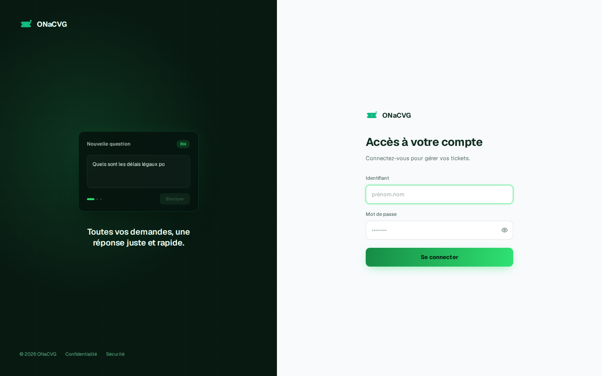

# Auth & rôles

## Vue d'ensemble

L'accès dans TicketAI s'organise sur deux axes indépendants :

- **Le rôle** (`USER` ou `ADMIN`) — déterminé par l'Active Directory, gravé dans le JWT.
- **L'appartenance à un groupe** — attribuée manuellement par un admin ; c'est elle qui ouvre l'accès au backoffice et aux domaines.

Ces deux axes se combinent. Un `ADMIN` sans groupe peut configurer l'application (groupes, utilisateurs) mais ne voit aucun document et ne peut valider aucun ticket. Un `USER` avec un groupe peut valider des tickets dans ses domaines mais n'accède pas à la page d'administration.

---

## Les niveaux d'accès

### Utilisateur lambda (`USER` sans groupe)

C'est le rôle par défaut à la création du compte.

- Soumet des tickets et suit leur progression.
- Consulte uniquement ses propres tickets.
- N'a pas accès au backoffice.

### Validateur (`USER` avec au moins un groupe)

Un utilisateur lambda devient validateur dès qu'un admin l'ajoute à un groupe. Le champ `role` en base reste `USER` — c'est la présence du groupe qui change tout.

- Accède au backoffice (liste de tickets, réponses enregistrées, documents indexés).
- Voit et agit uniquement sur les domaines de ses groupes.
- Peut valider, rejeter, corriger et uploader — mais **uniquement dans ses domaines**.

### Administrateur (`ADMIN`)

Provient du groupe AD `ldap_group_admin`. Le rôle est mis à jour à chaque connexion.

- Accède à la page d'administration (groupes, membres, santé système).
- Voit et agit uniquement sur les domaines de ses groupes — comme un validateur.
- Un admin sans groupe ne peut ni lire les documents ni valider de ticket.

---

## Les groupes et les domaines

Un groupe est associé à **exactement un domaine** (contrainte unique). Un domaine ne peut donc avoir qu'un seul groupe.

```
Groupe "Équipe RH"  →  domaine "RH"
Groupe "Support IT" →  domaine "IT"
Groupe "Juridique"  →  domaine "LEGAL"
```

Un utilisateur peut appartenir à plusieurs groupes : il a alors accès à plusieurs domaines.

### Ce que contrôle le domaine

| Action | Règle |
|---|---|
| Lire un ticket | Backoffice / admin : son domaine ; lambda : son ticket |
| Lire un document / ses chunks | Ses domaines — sans exception pour l'admin |
| Uploader, modifier, supprimer un document | Doit être **membre** du domaine — sans exception pour l'admin |
| Valider / rejeter / corriger une réponse | Doit être **membre** du domaine du ticket |
| Confirmer un signalement *À relire* en lot | Restreint aux domaines de l'appelant |

La règle d'écriture sans exception pour l'admin est intentionnelle : elle empêche un admin de modifier par inadvertance un document dans un domaine qu'il ne connaît pas.

---

## Le chef de groupe

Dans la table de liaison `user_groups`, le flag `is_chef` donne accès aux **statistiques par membre** du groupe (`GET /stats/groupe/{id}`). C'est la seule permission supplémentaire qu'il apporte.

Un admin peut voir les stats de tous les groupes, chef ou non.

---

## La règle d'anti-auto-validation

Un utilisateur backoffice ne peut pas valider, rejeter ou corriger une réponse sur **son propre ticket**. Si le ticket a été soumis par le validateur lui-même, l'action renvoie une 403.

---

## Authentification



Le champ *Identifiant* attend le `sAMAccountName` de l'annuaire, au format `prénom.nom`.

### LDAP / Active Directory

À chaque connexion, le système effectue deux opérations LDAP :

1. Bind du compte de service → recherche de l'utilisateur par son identifiant
   (`sAMAccountName` par défaut).
2. Re-bind avec les identifiants de l'utilisateur → vérification réelle du mot de passe.

Si le LDAP primaire est injoignable, un serveur secondaire peut être configuré (`ldap_server_url_secondary`).

> ⚠️ **`AUTH_MODE` ne conditionne pas l'authentification.** Malgré son nom et le
> commentaire de `app/config.py`, ce réglage n'est lu qu'à **un seul endroit** :
> `app/api/v1/admin/users.py`, pour décider si `GET /admin/gestionnaires` interroge
> l'annuaire ou retombe sur la base.
>
> `auth.py` appelle `ldap_auth.authenticate()`, qui appelle `_authenticate_ldap()` **sans
> jamais consulter `auth_mode`**. Il n'existe ni stub, ni repli base de données. **Un
> serveur LDAP joignable est donc requis pour se connecter, y compris en développement.**

> ⚠️ **Un échec LDAP est indiscernable d'un mot de passe incorrect.** `authenticate()`
> intercepte `LDAPException` et renvoie `None` :
>
> ```python
> try:
>     return _authenticate_ldap(username, password)
> except LDAPException:
>     return None   # serveur injoignable, timeout, filtre invalide…
> ```
>
> L'API répond alors `401 Identifiant ou mot de passe incorrect`. **Un annuaire
> injoignable, un timeout réseau ou un compte de service expiré produisent exactement le
> même message qu'une faute de frappe dans le mot de passe.** En cas d'échec de connexion
> inexpliqué, vérifiez la joignabilité du serveur avant de suspecter les identifiants.

### Provisioning juste-à-temps (JIT)

Le compte n'existe pas en base avant la première connexion. À chaque login réussi :

- Si l'utilisateur n'existe pas → il est créé avec `role = USER`.
- Les attributs annuaire (`prenom`, `nom`, `departement`, `is_gestionnaire`, `role`) sont **rafraîchis à chaque connexion** — une promotion ou révocation dans l'AD est effective au prochain login.

Le rôle `ADMIN` est attribué automatiquement si l'utilisateur appartient au groupe AD `ldap_group_admin`. Autrement, le rôle reste `USER`.

### Le flag `is_gestionnaire`

Un utilisateur est marqué `is_gestionnaire = True` s'il appartient au groupe AD `ldap_group_gestionnaire`. Ce flag ne donne aucun accès supplémentaire par lui-même : il sert uniquement à le rendre visible dans le sélecteur d'ajout de membre de l'interface d'administration.

### JWT

Après validation LDAP, un JWT est émis (`sub` = id utilisateur, claim `role`, expiration configurable). Toutes les routes protégées le vérifient. Le rôle inscrit dans le JWT est la valeur en base au moment du login — c'est pourquoi les attributs sont resynchronisés à chaque connexion.

Le login est limité à **10 tentatives par minute et par IP** (Valkey). Si Valkey est indisponible, la limite est ignorée (fail-open).

---

## Résumé des gardes d'accès

| Garde | Condition |
|---|---|
| `get_current_user` | JWT valide, utilisateur existant en base |
| `require_backoffice` | `role == ADMIN` **ou** au moins un groupe |
| `require_admin` | `role == ADMIN` uniquement |
| `check_domain_read` | Admin passe toujours ; sinon membre du domaine |
| `check_domain_write` | Membre du domaine — sans exception |

---

## Annexe — pour les développeurs

### Variables `.env` concernées

| Variable | Rôle |
|---|---|
| `AUTH_MODE` | **N'affecte pas le login** — voir l'avertissement ci-dessous. Sert uniquement à `GET /admin/gestionnaires` |
| `LDAP_SERVER_URL` | URL primaire Active Directory |
| `LDAP_SERVER_URL_SECONDARY` | Basculement automatique si le primaire est injoignable |
| `LDAP_BIND_DN` | DN du compte de service |
| `LDAP_BIND_PASSWORD` | Mot de passe du compte de service |
| `LDAP_USER_SEARCH_BASE` | Base LDAP de recherche des utilisateurs |
| `LDAP_USER_SEARCH_FILTER` | Filtre (ex. `(sAMAccountName={username})`) |
| `LDAP_GROUP_GESTIONNAIRE` | CN du groupe AD → `is_gestionnaire = True` |
| `LDAP_GROUP_ADMIN` | CN du groupe AD → `role = ADMIN` |
| `JWT_SECRET_KEY` | Clé de signature (HMAC-SHA256 par défaut) |
| `ACCESS_TOKEN_EXPIRE_MINUTES` | Durée de vie du JWT (défaut 480 min) |

### Modèle de données

```
User
  id              UUID
  email           String  (clé naturelle, unique)
  role            String  "USER" | "ADMIN"
  is_gestionnaire Boolean (vient de l'AD, rafraîchi à chaque login)
  groupes         → Groupe[] via user_groups

user_groups  (table de liaison)
  user_id
  groupe_id
  is_chef     Boolean  (accès aux stats du groupe)

Groupe
  id
  nom
  domaine     String  (unique — un domaine = un groupe)
```

### Endpoints d'administration des groupes

Tous sous `/api/v1/admin/`, protégés par `AdminUser`.

| Route | Effet |
|---|---|
| `GET /groupes` | Liste des groupes avec leurs membres |
| `GET /domaines` | Domaines existants (valeurs distinctes) |
| `POST /groupes` | Crée un groupe (domaine unique) |
| `DELETE /groupes/{id}` | Supprime un groupe et ses associations |
| `POST /groupes/{id}/membres/{user_id}` | Ajoute un membre (UUID ou email ; crée l'utilisateur JIT si besoin) |
| `DELETE /groupes/{id}/membres/{user_id}` | Retire un membre |
| `PUT /groupes/{id}/membres/{user_id}/chef` | Désigne ou révoque le chef |
| `GET /gestionnaires` | Liste les gestionnaires depuis l'AD (avec fallback base) |

### Les autres endpoints d'administration

Également sous `/api/v1/admin/`, protégés par `AdminUser` :

| Route | Effet |
|---|---|
| `GET /health` | État des services et indicateurs fonctionnels |
| `GET /albert-quotas` | Consommation Albert du jour, par modèle |
| `GET /incidents` | Tickets échoués, tickets bloqués, documents échoués |
| `POST /tickets/{id}/retry` · `DELETE /tickets/{id}` | Réparation d'un ticket |
| `POST /documents/{task_id}/retry` · `DELETE /documents/{task_id}` · `GET /documents/{task_id}/download` | Réparation d'une ingestion |
| `POST /documents/reconcile` | Recrée les lignes `documents` manquantes depuis Qdrant |
| `PUT /config/{key}` | Modifie une clé de configuration |

**Exception notable :** `GET /admin/config` est ouvert à **tout utilisateur
authentifié**, et non aux seuls admins — l'interface a besoin d'y lire la bannière pour
tout le monde. Seule l'écriture (`PUT`) est réservée aux administrateurs.

Le détail complet est dans [Référence API](reference-api.md), et les écrans
correspondants dans [Administration](../fonctionnalites/administration.md).

---

## Ce que les rôles ne font pas

Trois idées reçues, corrigées :

| Idée reçue | Réalité |
|---|---|
| « Il existe un rôle `VALIDATEUR` » | **Non.** Seuls `USER` et `ADMIN` existent en base. Un validateur est un `USER` **appartenant à au moins un groupe**. |
| « Un admin peut tout faire » | **Non.** Un admin sans groupe ne peut ni importer de document, ni valider de ticket : les gardes d'écriture n'ont **aucune exception** pour l'admin. |
| « `is_gestionnaire` donne des droits » | **Non.** Ce drapeau ne sert qu'à faire apparaître l'utilisateur dans le sélecteur d'ajout de membre. |
